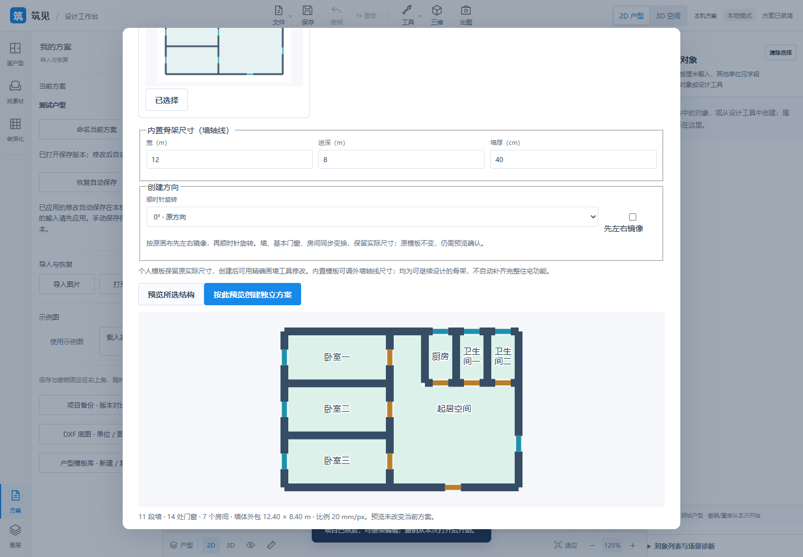
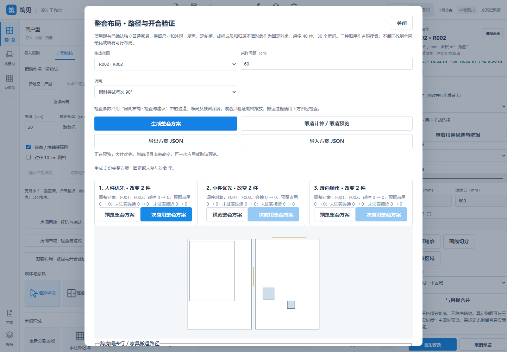
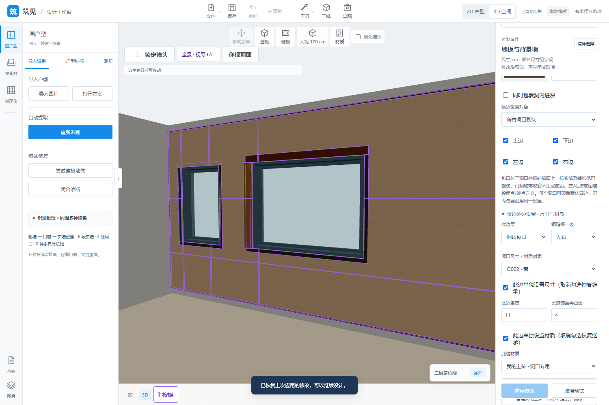
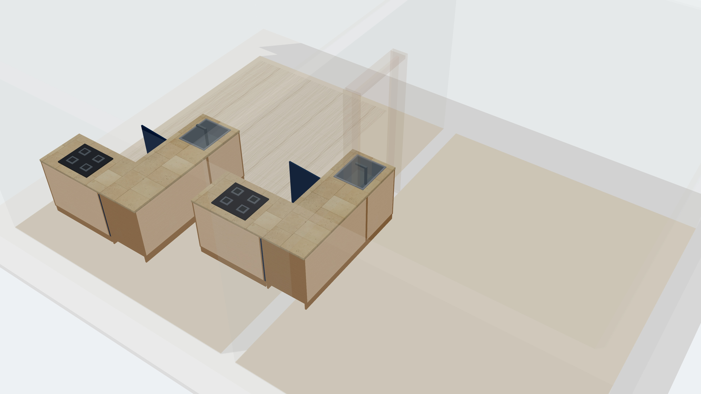

# GewuZhizao · 格物智造

**English** | [中文](README.zh-CN.md)

**From a 2D floor plan to an editable 3D interior.**

Browser-based floor plan recognition, editing and interior visualization.

GewuZhizao is an interior design tool prototype under active development. It brings image recognition, manual review, scale calibration, spatial editing, materials and lighting into a browser workbench. Recognized walls, openings and furniture remain editable and form the basis of the 3D scene.

This repository presents project documentation, actual application screenshots and an architecture overview. The current demo runs through a local service; a public online trial is not available.

**Status: active development · Showcase updated: 2026-10-30**

[Features and limitations](docs/features.md) · [Architecture](docs/architecture.md) · [Demo guide](docs/demo.md) · [Screenshot index](screenshots/README.md)

*An actual floor plan reconstructed as a 3D scene. This image comes from the running project at real-time preview quality.*

## Latest update · 2026-10-30 · Local P21 and import tools

- **P21**: seven structure templates; text/binary DXF, ordinary blocks, rotation/crop, text/saved dimensions/fills/basic styles; confirmed boundary-wall, opening-symbol and room-name candidates create editable projects.
- **P17 / P30 / P31**: separated-resource glTF import; obstacle-avoiding walking/fixed-pose carrying routes; image-correction copies, local OCR, complete annotations/grouped evaluation tools.
- **Scope**: the agreed local version passed acceptance. DWG, arbitrary angled/curved walls/complex CAD/symbols and independent real-world generalization remain open. Candidates need review; universal file compatibility is not claimed.

Source: [d9338b5](https://github.com/ETET114514/GewuZhizaoNew/commit/d9338b5dd8194e8acb36768fa068e6626959531e). **514 frontend tests, 138 DXF Python checks, 41 template checks and 215 P21 browser groups** passed, with additional project/opening and final targeted rechecks. Python groups overlap and are not summed. [Full scope and dated evidence](docs/updates-2026-10-30.md).

## Earlier update · 2026-10-28 · Local workflows and P30

- **P30 Z01–Z06**: room-use confirmation, rule reports/snapshots, individual and complete room/whole-house existing-furniture candidates, multi-plan comparison/map previews and atomic batch application. Authored walking/carrying paths check actual walls, frames, leaves and heights; modeled opening intervals check independent leaves/screens; explicit four-side zones also cover imported furniture.
- **Local reuse and delivery**: P17 favorites/display names/groups/tags; P19 saved-view JPG/PNG ZIP export; P25 front-cell/bay-surface materials; P29 portable ZIP projects and read-only version comparison; P31 independent reference-dimension checks.
- **Limits**: finite sampling of existing confirmed independent furniture, up to 40 objects/30 rooms/3 plans. No automatic model addition, route finding or global-optimum guarantee. Close contact, missing geometry and exhausted budgets remain unproven; product-specific ergonomics/new mechanisms and accounts/cloud remain separate scope.

New source: [01e2db7](https://github.com/ETET114514/GewuZhizaoNew/commit/01e2db70b7088779dd65c642b5c09e74e3e72365). Latest evidence: **503 full frontend tests, 43 targeted Python tests and 18 new browser acceptance groups**, plus original bed-foot/snapshot/candidate browser regressions; includes desktop/390 px, cancel/stale rejection, undo/redo, save/reopen, recovery and portable backups. Earlier feature-specific counts are historical, not a fresh full Python run. See [release details](docs/updates-2026-10-28.md).

## Earlier update · 2026-10-27 · P35

- **Ceilings and fixtures**: six refined procedural fixtures and six original CC0 lamp GLBs, local product-model imports, part PBR, per-face ceiling/cove/rail materials and physical texture origins. Closed arc/cubic Bézier contours, custom profiles and 2–16 variable-profile stations, plus double-curvature ceiling slabs from a 4 × 4 height grid, clipped to rooms and holes.
- **Rails and motion**: independent polyline, arc and cubic rails; actual arc-length placement, translation and tangent-following rotation; play, pause, seek and reset with once/loop/ping-pong modes. Current lighting and collision follow the preview frame.
- **Section views and model library**: actual mesh-intersection caps preserving holes, rotated main plane and up to six simultaneous planes; local brand/series/SKU/tag search, product links and hash-bound catalog import/export. **No external vendor's online brand service is connected.**

Corresponding full New source commit: [99882a8](https://github.com/ETET114514/GewuZhizaoNew/commit/99882a803e649666153e617bcf2b132661040c9d). **437 full-suite Node tests and a 517-test full Python snapshot** passed, followed by **80 targeted Python checks** covering the final boundary revisions. Sets overlap and are not added. New and original P35 browser checks and existing ceiling/cove regressions passed, including 390 px, 3840 × 2160 export, camera restoration, save/reopen and recovery. See [scope, limits and verification](docs/updates-2026-10-27-p35.md).

| Rotated section planes with actual caps | Ceiling controls at 390 px |
| --- | --- |
|  |  |

*Actual isolated acceptance scenes. Curved surfaces are height fields with vertical thickness; motion is a preview, and sections are inspection views. Professional illuminance, electrical calculations, construction sections and cloud rendering remain separately planned.*

## Earlier update · 2026-10-27 · P16/P18

- **P16 F01–F08**: move, rotate, copy and delete temporary selections; box/click selection across furniture, independent structural elements and lights; mixed and nested groups, member editing/ungrouping and independent copies. Adds proportional scaling, individual 2D rotation, shared/type-specific batch properties, fitting within a rectangle at any angle, and multi-segment movement/rotation checks with custom passage clearances.
- **P18 M01–M08**: five-map PBR for color, normal, roughness, metalness and AO, with DirectX normal conversion; stable GLB mesh parts, original UVs/physical projection and original-material restoration; automatic room wall sides and local clipping along a shared side; batch material assignment/replacement across objects; upload-library batch renaming/removal and cache cleanup after reference checks.
- **Editing and persistence**: object geometry and floor-layout cells remain intact; one application creates one history entry. Cancel previews, reject failed operations atomically, retain redo for unchanged edits, carry assets through project saves/recovery, and support older color-only uploads.

Corresponding full New source commit: [2164415](https://github.com/ETET114514/GewuZhizaoNew/commit/2164415b7f8e8bac992c975a2a999f243312171f). **427 full-suite Node tests and 495 full-suite Python tests** passed. A subsequent 48-test targeted verification includes 13 P18 tests; the final cache verification has 23 tests. These sets overlap and must not be added. Four boundary tests added after the full-suite snapshot are included in the targeted verification. New P18 and existing materials/upload-library/GLB/wall-paint browser regressions passed, including 390 px, 4K and camera restoration. P16 retains its separate development-round record. See [update and verification details](docs/updates-2026-10-27.md).

| Mixed objects and groups | Room wall sides and batch materials |
| --- | --- |
|  |  |

*Actual UI from isolated acceptance scenes; red boxes show current collision aids. P16/P18 are complete within their agreed scope. Structural elements/kitchens retain orthogonal constraints, and lights retain host constraints. Path checks use existing envelopes and custom clearances; they do not certify building-code compliance or lifting/tilting transport. Historical pending items retain their meaning at the time; consult the feature list for current status.*

## Previous update · 2026-10-26

- **P13 N01–N03**: retains existing centerline/corner segments and adds room-side net lengths, solid-wall segment lengths excluding horizontal opening projections, room filters, and withheld values for unconfirmed gaps. Changing the measurement view does not modify project data or history.
- **P22 E01–E03**: optional deductions for floor-contacting elements from paving/paveable floor area, with overlap unions and allocation across rooms. Shows gross/deducted/paveable area, preserves contours and per-piece records, restores paving after movement/copying/disabling/deletion, and retains properties for consecutive element edits.
- **P25 D01–D03**: actual row/column divisions and mullions/transoms with per-cell operation, door transoms/sidelights, flat/stepped/beveled frame profiles, independent insect screens, rectangular three-sided bay windows, and explicit collinear/orthogonal connections at different heights with solid wall preserved outside the shared height.
- **P24, three groups this round**: L-shaped wall cabinets and left/right blind corners, U-shaped base/wall runs and continuous concave base-cabinet worktops; rectangular/circular/rounded equipment holes and hole-only mode, ordinary/blind-corner hosts and two or three adjacent cabinets in one run, explicit shared-side-panel notches and internal-clearance checks for participating cabinets.
- **P23 C01–C08**: free straight seams/simple polygon panels, individual wall/floor piece geometry and floor handles; composite feature walls/layers/recessed lights, actual trim profiles/per-edge reveals and current-library frame fitting; more physical laying patterns/repeating motifs, custom skirting profiles and clipping against current cabinet occupancy. The agreed feature-list scope is complete.

Corresponding full New source commit: [35d29cd](https://github.com/ETET114514/GewuZhizaoNew/commit/35d29cd8116dca7402186e52930fd6feaa976912). All **407 Node and 480 Python tests** passed before publication; P13 browser checks passed this round. Other same-day module rounds are recorded in [update and verification details](docs/updates-2026-10-26.md). Counts from different rounds are not added.

| Room-side net lengths | Opening subdivisions, frames and screens |
| --- | --- |
|  |  |

*Net lengths are 2D structural reference measurements. Openings, kitchens and structural elements are reported only within the agreed scope; product hardware, full motion paths, multiple floors and construction-document delivery remain pending.*

## Previous update · 2026-10-25

- **P23 panel seams and trim**: wall-segment/floor seam origins, nonuniform horizontal/vertical rectangular divisions, per-edge rectangular trim width/projection, materials and independent texture settings around perimeters and openings.
- **P23 per-opening exceptions**: materials/uploads and dimensions for each edge of a specific door/window; independent inheritance for dimensions and materials from opening override to direction default to shared settings.
- **P23 opening reveals**: adjustable depth and board thickness, continuing from the decorative face along the actual opening boundary up to the wall centerline; no bottom edge for doors or full-height windows.
- **P23/P25 frame depth and clear-opening fitting**: adjustable frame depth and inward/outward offset for a single door, fixed window or single casement within one wall segment; frame and leaf fit the lined clearance while preserving the structural opening. A 3D shortcut opens the same 2D form.
- **P18 upload library and dedicated entry points**: name search/rename, unused-entry deletion and protection for current-project/history/saved-version/recovery references; direct color uploads on wall panels, elements, kitchen worktops and procedural furniture/custom cabinet parts.

Corresponding full New source commit: [3d812a2](https://github.com/ETET114514/GewuZhizaoNew/commit/3d812a2d9bc78b7e51271c6ae7f04357ea00ff1a). **301 full-suite Node tests**, **63 targeted Python tests** from the latest frame-fitting round, and new frame-fitting/existing reveal browser suites passed, including 390 px, 4K and camera restoration. Another **116 targeted Python tests** passed before publication. Sets overlap and are not added. See [verification details](docs/updates-2026-10-25.md).

| Reveal and frame fitting | Per-opening edge dimensions and materials |
| --- | --- |
|  |  |

*Actual isolated acceptance scenes. At this historical stage, fitting was off by default and limited to ordinary rectangular single-leaf openings within one wall segment; sliding/multiple leaves, corners, cross-segment fitting, nonrectangular profiles and installation details were pending. P18 then supported opaque color uploads only, without normal/roughness map generation.*

## Previous update · 2026-10-24

- **P23 physical herringbone**: orthogonally interlocking rectangular boards, clipped to concave/disconnected regions and holes; adjustable width/length, direction, origin, gap and per-board texture.
- **P23 individual floor pieces**: selection in the main 2D canvas, mini view and 3D; independent materials/uploads/textures, hiding and restoration of one/all pieces.
- **P18 uploaded color maps**: PNG/JPG/WebP, carried with project saves and recovery after application, with verification and missing-cache restoration.
- **P16 furniture groups**: 2–40 members, naming/member editing/ungrouping, whole-group movement/arbitrary rotation/independent copying, 3D handles and direct 2D dragging, snapping and spacing.
- **P23 opening surrounds and per-edge trim**: perimeter edge toggles, exterior opening strips/per-opening four-edge overrides, independent dimensions/materials and clipping that follows opening edits.

Corresponding full New source commit: [544714f](https://github.com/ETET114514/GewuZhizaoNew/commit/544714f145bec6094d7a9b3ed4ac20582f59d265). Latest herringbone round: **252 Node tests, 68 targeted Python tests, new browser checks and existing laying regressions passed**. Another 34 furniture/kitchen Python regressions passed before publication. Counts are not added across rounds; see [verification details](docs/updates-2026-10-24.md).

| Physical herringbone and per-board selection | Furniture groups and handles |
| --- | --- |
|  |  |

*Isolated acceptance scenes. Blue boards use a project-created striped upload; gaps demonstrate hiding, not structural openings or a finished design. Color uploads did not generate normal/roughness maps. Chevron/complex patterns and nested/mixed groups were pending at this stage. Initial reveals and ordinary frame fitting followed on 2026-10-25.*

## Previous update · 2026-10-23

- **Kitchen sinks/hobs and actual holes**: simplified equipment on ordinary base cabinets; editable hole dimensions, relative position and inset depth. Worktops and cabinet top panels both avoid holes. Straight/L-shaped groups carry equipment through movement, right-angle rotation and copying, with checks for margins, hole spacing, internal structure and drawer envelopes.
- **Floor origins and three laying patterns**: straight, half-offset and third-offset grids; piece dimensions, origin, joint width/color and orientation; actual clipping to concave rooms, holes and multiple regions, with shared 2D/3D settings and legacy appearance preserved by default.
- **Unified workbench U01–U05**: top-level 2D/3D switch, five shared tool groups and property positions; consistent apply/cancel, Esc and unapplied-edit protection; repeated unchanged basic edits do not create history or autosaves.
- **Auxiliary views and canvas controls**: collapsible 3D preview and 2D camera map; furniture/kitchen movement axes, plane and rotation handles; one undo step per gesture, with cancellation restoring the prior state.
- **Initial L-shaped kitchens**: left/right blind-corner base cabinets, main/corner/return runs, one continuous concave worktop with a real recess; preserves structure, materials and operation, with whole-group movement/right-angle rotation/independent copying.
- **Feature audit**: of 23 directions with remaining scope, 15 had a main workflow and eight lacked the stated target workflow, although some shared foundations existed. These figures do not measure the full gap against Kujiale.

Corresponding New source commit: `a1407646daa384e1bc5c7f8650724208c2118d80`. Latest flooring round: 236 Node tests, 43 targeted Python tests and new/existing-material browser checks passed. Kitchen-hole round: 230 Node tests, 48 targeted Python tests and new/existing straight/group/L-shaped browser regressions passed, including persistence, 390 px and 4K. Counts are not added across rounds; see [verification details](docs/updates-2026-10-23.md). At that stage, holes were rectangular within ordinary base cabinets and flooring offered three patterns; cross-cabinet/blind-corner/nonrectangular holes, product equipment, individual-piece editing, complex patterns, procurement lists and construction drawings remained pending.

| Kitchen equipment and actual holes | Floor origin and layout |
| --- | --- |
|  |  |

*Actual UI and real-time image output from local isolated acceptance scenes, not a finished interior or construction deliverable.*

| Unified workbench and canvas handles | Left/right blind-corner L-shaped kitchens |
| --- | --- |
|  |  |

*Actual UI from isolated acceptance scenes. Red boxes show current-pose collision aids; these screenshots document functionality, not a completed design.*

## Previous update · 2026-10-20

- **Panel seams and trim**: regular grids, adjustable gaps, perimeter rectangular trim and independent materials, preserving actual openings.
- **Single-floor rectangular elements**: columns, beams, flues and pipe enclosures with 2D placement, dimensions/elevation, 3D materials, collision and headroom under beams.
- **Custom wardrobes/storage**: boards, 1–6 proportional compartments, shelves, rails, internal drawers and per-compartment door operation/materials.
- **Straight kitchen runs**: base/wall cabinet presets, ordered alignment and one continuous base-cabinet worktop with adjustable thickness, overhang and material.

Corresponding New source commit: `e6f30749e0fd2550187cd1785b70a701efeb8acd`. All 217 Node tests, 60 targeted Python tests and browser acceptance records for all four features passed; see [historical verification](docs/updates-2026-10-20.md). Group operations and L-shaped blind corners/continuous worktops followed on 2026-10-23; ordinary rectangular equipment holes were added in the latest 2026-10-23 round. More hole shapes, structural-element/room geometry integration and schedules/drawings were still pending.

| Wardrobe interiors and operation | Straight kitchen and continuous worktop |
| --- | --- |
|  |  |

*Actual results from isolated feature demos. Showcase publishes summaries and screenshots; New maintains complete code, assets, tests and the feature inventory.*

## Previous update · 2026-10-19

- **Precise orthogonal wall drawing**: blank/traced plans, continuous walls, physical length/thickness, fixed ends and endpoint dragging; connected walls update together with opening checks. Diagonal/curved walls remained pending.
- **Interior wall finishes**: flat feature panels, vertical slats and room skirting with position, size, thickness and solid/PBR materials, clipped to actual openings.
- **Ceilings and windows**: actual ceiling/dropped-ceiling/cove materials, horizontal 2–6-leaf windows and per-leaf operation.
- **Project management**: names, thumbnails, search and redo; applied edits autosave locally and can be recovered, including imported GLB assets. Unapplied forms are not recovered; undo history restarts between sessions.

Corresponding New source commit: `5ab0ec185db65707aa657d005dfc7bdae29eca6b`. This repository continues to publish summaries and actual screenshots only. Each push updates both New's full project and Showcase summaries, with verification scope in the [round record](docs/updates-2026-10-19.md).

| Feature wall preserving a window opening | Vertical timber slats |
| --- | --- |
|  |  |

*Isolated feature demos showing actual UI and geometry, not a complete interior design.*

## The problem it addresses

Walls, openings and furniture in a floor-plan image need to become editable objects before dimensions, furniture layouts and spatial effects can be adjusted. The project follows this workflow:

**Import plan → Recognize candidates → Review manually → Calibrate scale → Edit in 2D → Design in 3D → Save and export images**

Recognition is a starting point. Users can correct false detections, add missing objects and confirm room boundaries before continuing the design.

## Implemented capabilities

| Stage | Current capability |
| --- | --- |
| Plan recognition | PNG/JPG/WebP import, candidate walls/openings/furniture, layers and numbered navigation |
| Geometry review | Orthogonal walls from blank/traced plans, physical length/thickness/endpoints, short-gap connections, closure diagnostics and opening constraints |
| Scale and regions | Known-length calibration, fallback scale estimation, centerline/room-side/solid-wall projection lengths, region split/merge and element-aware paveable area |
| 2D and 3D | Walls, openings, floors, furniture and ceilings generated from the same editable element data |
| Furniture layout | 17 procedural furniture/fixture categories; temporary cross-object selection, mixed/nested groups, move/rotate/copy, scaling/batch properties, rectangular fitting and multi-segment clearance checks |
| Models and materials | Five external CC0 furniture GLBs, six original CC0 lamp GLBs and local imports; local brand/series/SKU catalog; 160 base/14 furniture materials, five-map PBR, GLB parts/room wall sides, cross-object replacements and upload-library/cache management |
| Doors and windows | Hinged, fixed glazing, double/unequal double doors, dual-track sliding and horizontal multi-leaf windows, with per-leaf operation synchronized in 3D |
| Interior walls | Flat feature panels, vertical slats, regular seams, perimeter trim and room skirting; adjustable size/position/materials, avoiding openings |
| Single-floor elements | Rectangular columns, beams, flues and pipe enclosures with 2D placement, dimensions/height/elevation and 3D materials |
| Custom cabinetry | Wardrobe/storage compartments, shelves/rails/internal drawers and operation; straight base/wall runs, left/right blind-corner L-shaped base runs and continuous worktops, group movement/right-angle rotation/independent copies |
| Editing workflow | Shared 2D/3D workbench, five tool groups/property positions, collapsible views and furniture/kitchen handles; consistent apply/cancel/Esc, unapplied-edit protection and unchanged-edit history protection |
| Ceilings and lighting | Local/perimeter/multilevel ceilings, per-face materials, free curves/height surfaces, variable profiles, curved rails/motion, six refined light types, light groups, daylight/indoor shadows and soft cove bounce |
| Viewing and output | First-person walking, named views, rotated/multiple capped section views and JPG/PNG image export up to a 3840-pixel longest edge |
| Editing and persistence | Preview/cancel, undo/redo, names/thumbnails/search, local autosave/recovery and independent manual versions |

See [features and limitations](docs/features.md) for detailed status and constraints.

## Actual application screenshots

### 2D workbench and object editing

Walls, openings and furniture have separate markers. Tools and assets are on the left; selected-object properties are on the right.

### Room regions and reference areas

Reference areas are calculated after region boundaries and scale are established. Recognition and automatic regions still need manual review.

### Materials, openings and lighting

| Wall material editing | Dual-track sliding door |
| --- | --- |
|  |  |
| Each wall side can have its own color/material preview | One moving leaf slides along two tracks behind the fixed leaf |

*Cove lights illuminate nearby ceilings and approximate soft wall lighting with one diffuse bounce. This image is a feature demo.*

See the [screenshot index](screenshots/README.md) for the material overview and real furniture-model previews.

## Technology and engineering focus

| Layer | Technology |
| --- | --- |
| Images and recognition | Python, NumPy, Pillow, OpenCV, optional ONNX Runtime |
| Spatial geometry | Shapely and wall/opening/region geometry processing |
| Browser interaction | JavaScript ES Modules, HTML/CSS and SVG 2D editing |
| 3D preview | Three.js, WebGL, PBR materials, GLB models and real-time shadows |
| Local service and persistence | Python HTTP service, local project files and asset management |
| Verification | Python unit/API tests, Node.js geometry tests and Playwright browser regressions |

Engineering focuses on consistent 2D/3D data, a complete preview/apply/undo/save cycle, and practical browser costs for materials, models and lighting. See the [architecture overview](docs/architecture.md).

## Future directions

P23 C01–C08, P16 F01–F08, P18 M01–M08 and P35 local ceiling/lighting workflows are implemented within their agreed scopes. Further work follows actual needs for product models/mechanisms, diagonal walls/irregular elements, additional installation details and model compatibility; external online vendor brand services still await provider selection and connection. Drawing/model exchange remains lower priority. Procurement quantities, construction pricing, cloud collaboration and AI layout are not implemented. Nineteen directions retain future scope: thirteen have a main workflow and six lack the stated target workflow. These counts are not completion percentages.

## Documentation languages and publication

English is the default repository home (`README.md`); [中文](README.zh-CN.md) opens the Chinese home. Every documentation page has an English `.md` and a Chinese `.zh-CN.md` counterpart, with a language switch to the same page. Feature lists, architecture, demo guides, screenshot captions/alt text, asset notices and dated updates are maintained in both languages. Navigation stays in the selected language; both versions share the original screenshots, whose application UI remains as captured.

Every push must update both languages together, including implemented capabilities, pending scope, verification and the corresponding New commit. Historical verification remains attributed to its original round. Check content consistency, language switches and relative links before declaring publication complete. The persistent push rules are maintained in New's README and FEATURES ([documentation-rule commit](https://github.com/ETET114514/GewuZhizaoNew/commit/b5bb1f164d8c7927297b45cac5aeb62f499b120a)).

## Source code and assets

Source code is private due to ongoing development and intellectual property considerations.

The complete source is held in a private repository. This Showcase contains documentation and screenshots; it does not distribute source code, model weights, original project data or an executable application.

Screenshots use the actual interface or rendered results. Some are isolated feature demos rather than complete interior design cases. See the [asset notice](NOTICE.md) for third-party models and materials.
