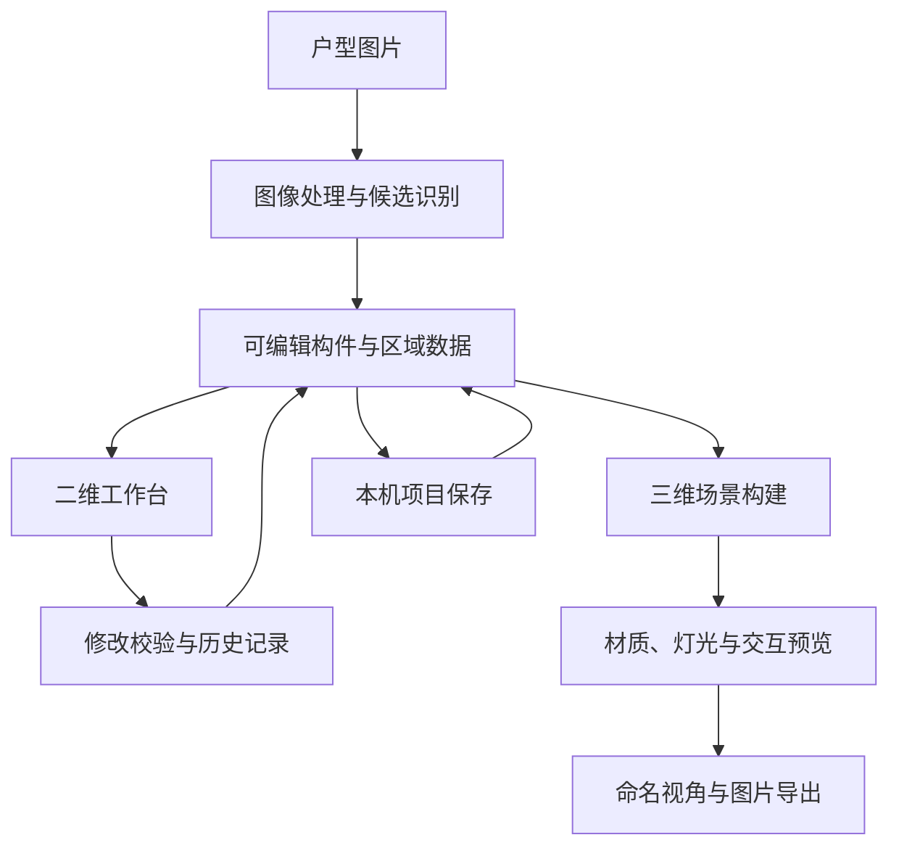

# 架构与工程设计

本页介绍当前原型的系统分工与工程取舍，不包含源代码、接口凭据、训练数据或具体识别规则。

## 总体结构

当前版本由浏览器工作台和 Python 本地服务组成。浏览器承担二维编辑与三维预览，本地服务承担图像处理、编辑校验和项目保存。

## 模块分工

| 模块 | 职责 | 主要技术 |
| --- | --- | --- |
| 图像处理 | 读取底图，提取墙体、门窗与家具候选，复用相同识别输入的缓存 | Python、NumPy、Pillow、OpenCV、可选 ONNX Runtime |
| 几何与空间 | 处理墙体、洞口、连接、房间边界、比例与面积 | Python、Shapely、平面几何处理 |
| 编辑服务 | 校验修改，维护当前方案与撤销/重做历史，管理本机命名项目、资源与自动恢复 | Python HTTP 服务、文件存储 |
| 二维工作台 | 图层、选中、定位、拖动、尺寸输入、区域编辑与参数预览 | JavaScript ES Modules、SVG、HTML/CSS |
| 三维场景 | 根据构件尺寸构建墙体、门窗、家具、地面与顶面 | Three.js、WebGL、程序化几何、GLB |
| 外观与照明 | PBR 贴图、金属/玻璃、日光、灯具投影与灯槽柔光 | Three.js 材质、阴影与光照贴图 |
| 验证 | 几何测试、参数校验、接口操作与实际浏览器流程 | Python unittest、Node.js test runner、Playwright |

## 关键工程问题

### 让二维编辑与三维几何保持一致

二维原始几何保留图像坐标，通过比例换算为实际尺寸。三维墙体保留洞口上方、下方和侧边实体，门窗当前开合状态同时影响二维符号、三维构件和当前碰撞检查。

这样可以在修改门窗位置、尺寸或开合方式时继续使用同一套可编辑对象，而不需要单独维护一份脱离户型的展示模型。

### 让不确定的识别结果可以修正

墙体、门窗和家具识别输出候选。工作台提供编号定位、确认与排除、手工补充及闭合诊断。分区只在分析中使用门窗虚拟边界，不把分析封口直接变成实体墙。

当前原型优先支持人工校核后的完整工作流；通用识别准确率需要独立测试图集进一步评估。

### 让每次修改可检查、可恢复

参数编辑通过预览、应用、取消与撤销/重做衔接。已应用修改原子写入本机自动保存，保留上份完整记录；损坏时尝试回退，冲突恢复副本分别保存。未应用表单不在恢复范围，跨次完整撤销栈尚未持久化。项目保存包括构件、区域、比例、材质、灯光和视角；导入模型资源随项目保存。重新打开后可继续编辑。

图片导出等待相关贴图与灯槽光照更新，暂时隐藏选中高亮及碰撞辅助标记，结束后恢复画布和镜头。

### 在浏览器中控制渲染成本

模型与材质使用本地资源和缩略图。阴影按画质与灯数预算启用；灯槽间接光采用一次漫反射近似并分批计算，编辑变化后取消过期更新。复杂家具的部分遮挡检查采用包围盒近似。

这些取舍服务于交互预览，不等同于离线写实渲染或专业光照仿真。

## 验证方式

| 层次 | 关注内容 |
| --- | --- |
| 参数与接口 | 非法值、预览/应用/撤销、保存重开、历史兼容与失败恢复 |
| 几何与状态 | 洞口轮廓、门窗运动、二维/三维一致性、碰撞、纹理跟随 |
| 浏览器流程 | 实际鼠标与键盘操作、面板切换、取消恢复、窄屏布局与高清导出 |
| 图像核查 | 图片解码、输出尺寸、辅助标记隐藏及关键效果截图 |

验证按功能迭代执行。现有测试不作为对任意户型图、设备或使用场景的准确率与性能保证。

[返回项目首页](../README.md)
