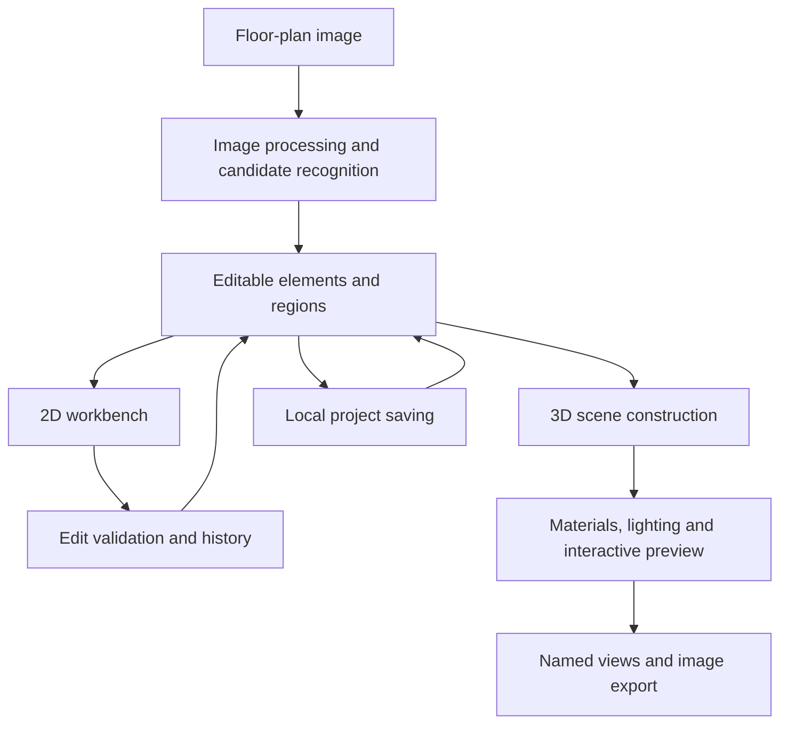

# Architecture and engineering

**English** | [中文](architecture.zh-CN.md)

## 2026-11-20 · P24 kitchen disassembly and retained-tool transfer turns

[Source commit 27a9f22](https://github.com/ETET114514/GewuZhizaoNew/commit/27a9f2228e26bf08a6fdfeb6060f9deaab0dee9d) · [Source PR #3, awaiting merge](https://github.com/ETET114514/GewuZhizaoNew/pull/3) · [Scope and evidence](updates-2026-11-20-p24.md)

A verified transfer updates the existing retained entity before approach and board-motion checks. Reuse validates continuity at the new position and orientation. The reverse report lists the transfer turns in inverse order.

## 2026-11-18 · Wall reference ranges and kitchen drawing/contact workflows

[Source 9b48db1](https://github.com/ETET114514/GewuZhizaoNew/commit/9b48db190e64f437662d0ac37662332151c6fe97) · [Scope and evidence](updates-2026-11-18-p12-p24.md)

Wall interval bindings retain explicit host/side/range semantics and reject loss of declared coverage; the Python wall-drawing resolver binds output to the current document digest. Kitchen sheets reuse physical manufacturing layers, actual placement and closed component poses. The browser builds a read-only report; source guards and the CAD service check the complete selected group/member set. Cross-cabinet checks aggregate measured board-pair contact/overlap into cabinet pairs; any material overlap excludes that cabinet pair as a contact-graph edge. Component checks compare board/slab/equipment layers while excluding board-board repetition and same-fixture internal parts. Native dimensions, revision XDATA and ZIP file hashes preserve traceability.

Full P12 and P24 remain unfinished. These are bounded reference drawings and geometric checks. Unknown reference semantics, arbitrary wall topology, complete construction details, professional hidden-line removal, hardware/connection strength, installation constraints, assembly order/motion and manufacturer CNC remain open. Equipment is the existing schematic geometry; an overlap may be intended embedding and requires review.

Development evidence: 809 full Node tests, 57 related Python tests, 15 new Edge workflow groups, and the existing 14 cross-cabinet/11 single-cabinet browser groups passed. Independent GEOS checks cover 24 normal/low-upper-cabinet cases; actual ZIP/CSV/HTML/JSON and native-dimension CAD downloads were read back. Publication preparation additionally passed 22 P12 reference-range/wall-drawing Python tests on 2026-11-18. Counts overlap and are not added; no full Python rerun or fresh rerun of every earlier browser suite is claimed. Showcase publication checks bilingual pages, links and screenshot provenance.

## 2026-11-16 · Continuous wall sections, curved junctions and typed references

[Source 00dd9d8](https://github.com/ETET114514/GewuZhizaoNew/commit/00dd9d883d67ce5c9be5de6e7b9fae626efedbc0) · [Scope and evidence](updates-2026-11-16-p12-sections.md)

Wall profiles store linear axis controls, with interpolation shared by actual footprints, local roof/opening checks, sloping mesh cells, split/trim rebasing and finish measurement. Variable overlap sections separately choose width, height and material sources, preserving live global height inheritance. Curve nodes use finite analytic supports and explicit normalized-station behavior when reshaping. A validated JSON Pointer registry masks only exact typed nodes from unknown-reference guards; undeclared fields remain protected. P27 angle/band intent resolves against current finish geometry and source endpoint material.

Full P12 remains unfinished. Profiles have 2–64 controls, 50–600 mm thickness and 100–20000 mm height; all heights may inherit globally, without mixing inherited and numeric controls. Junctions select 3–12 wall ends with 0–1000 mm movement: retain supports, explicitly rotate straight supports, or reconstruct a circle while retaining its far endpoint/tangent and curvature direction. No valid finite solution or unsupported references rejects the edit. Typed JSON Pointer bindings cover fraction, station and host semantics, including one-to-many rebinding; undeclared business/program semantics stay protected. Elevation checks qualify the measurement-line endpoints, without inferring a new room partition/area at that height. Arc geometry uses the existing bounded sampling; collision stays conservative and quantities retain nominal axis-based face-area conventions. Arbitrary surface/topology transition bodies, undefined reference semantics, complete construction sections/details and unlimited report-external inference/global-optimum guarantees remain open.

Source validation on 2026-11-16: **1363 full Python tests** across all 183 modules, **760 full Node tests**, **78 final related Python checks**, and **14 new real Edge workflow groups** passed. Six existing browser suites were rerun: path finishes, closeout, engineering, whole-room/node, original path walls and P27 drawing export. Final related checks also verify the last calibration/projection binding branches. Coverage includes independent mesh-volume and spiral-length checks, real 3D viewing, holes, split conservation, inheritance, transition following, curve-support reconstruction, explicit overlap sources, external bindings, undo/redo, save/reopen and 390px. Independent downloaded DXF/PDF extraction confirms 5317 mm angled and 3760 mm height-band net dimensions. Counts overlap and are not added. Showcase publication verifies bilingual pages, local links and screenshot provenance without rerunning application suites.

## 2026-11-16 · P12 room finishes, live net dimensions and straight-wall junctions

[Source 65ad14a](https://github.com/ETET114514/GewuZhizaoNew/commit/65ad14a203f1e00fc7e36aebf07fda4530b349a2) · [Scope and evidence](updates-2026-11-16-p12-room.md)

The shared browser geometry resolver subtracts orthogonal and left/right piecewise path finish occupancy from the authored structural room polygons, retaining holes and disconnected parts. Authored room geometry and flooring data stay unchanged. P27 resolves saved room/measurement-line intent from live geometry. Repartition migrates room references only through a unique retained-room match using the existing 95% area rule; reused display numbers do not silently rebind references. Junction previews run atomic known-reference migration and validation before a single-history commit.

Full P12 remains unfinished. Arc finish contours use at most 0.5 mm sagitta sampling; their perimeter is a sampled polygon length, distinct from the existing analytic single-wall along-path report. Whole-room contours are planar gross boundaries without opening or height-band deductions. P27 stores room identity, relative measurement-line position and interval intent; ambiguous room changes or interval-count changes become unresolved. Junction consolidation preserves original straight supports and allows 0–1000 mm endpoint movement, with at least 100 mm wall remaining; unsupported references, opening truncation and new overlap reject the complete edit. Curved/moving-support nodes, continuous variable thickness/height, unknown-reference reconstruction, arbitrary topology, full construction sections/details and unlimited report-external inference/global-optimum guarantees remain open.

Source validation on 2026-11-16: **1349 full Python tests** passed across all 181 modules in four independent processes; **753 full Node tests**, **66 final related Python tests**, **12 new Edge workflow groups** and **24 existing P12 browser groups** passed. Final related/browser checks also cover the last source-snapshot guard. Real save/reopen, live wall-edit identity migration, undo/redo, stale-source refusal and 390px were checked. Downloaded DXF/PDF were independently read back with the updated 3720 mm value; PNG is 1754 × 1240. Counts overlap and are not added. Showcase publication checks bilingual content, local links and image provenance without rerunning application tests.

## 2026-11-16 · P12 wall engineering and path-side finish measurement

[Source 9189120](https://github.com/ETET114514/GewuZhizaoNew/commit/918912079639253fb9ad7cfcb07d010239d822ed) · [Scope and evidence](updates-2026-11-16-p12.md)

The exhaustive-search cursor lives outside project history, is bound to session/revision/options and advances atomically after successful batches. Projection creates an isolated exact-support document before using the existing cleanup pipeline. Typed one-to-many migrations keep known dimensions, opening hosts, finish intervals and live decoration chains; unknown references remain protected. Analytic fillet solvers recompute two-host tangencies during supported edits. Saved path_finishes profiles keep explicit values separate from global inheritance; read-only reports split at policy/opening boundaries and use actual offset radii. Server validation, project storage, undo/redo and ZIP share the authored data.

Full P12 remains unfinished. Enumeration certifies only the current finite report after completion (at most 100 reported candidates, 20 selected gaps and 500 resulting wall segments), without report-external semantic or unlimited global-optimum guarantees. Projection requires an explicit supporting line/circle and a tolerance of at most 10px; unknown references and unsupported conflicts reject the complete edit. Fillets require a valid finite analytic solution and preserve explicit thickness steps. Path-side finishes are measurement policies, without new finish solids, whole-room nonorthogonal finished-face reconstruction, step-connector lengths, multi-wall node reconstruction, continuous variable sections or P27-linked construction sheets.

Final source-stage rerun on 2026-11-16: **1342 full Python tests and 744 full Node tests passed**. Real Edge acceptance passed 5 new path-finish groups plus the existing 9 closeout and 10 engineering groups, with no unexpected page/HTTP errors. Coverage includes independent arc formulas, real CSV/JSON read-back, preview/cancel/history, actual panel pieces/volume, door poses, project save/reopen, and 390px layouts; Python also checks restore/ZIP. The 8 new Python tests are included in the full-suite count. Earlier dated counts overlap and are not added. Showcase publication checks bilingual documentation, relative links and screenshot provenance; it does not repeat application tests.

## 2026-11-14 · Spatial tools, cabinet views and purchasing

[Source 2c0bbbb](https://github.com/ETET114514/GewuZhizaoNew/commit/2c0bbbb7c9481c78dec968c07d40b92ef56eb7da) · [Scope and evidence](updates-2026-11-14.md)

Data flow: authored functional_zones and dimension_chains use native project history/validation/ZIP comparison. Derived zone shapes intersect effective floors and preserve holes; existing ceiling components own lamps. PDF workers preserve graphic transforms and produce provenance-carrying DXF layers; HouseSpec workers map millimeter world coordinates into isolated native projects. Existing preview/revision checks reject stale changes. Cabinet and procurement reports remain bound to source hashes.

Zones preserve physical rooms and flooring quantities; color overlays are illustrations. Dimension suggestions do not move geometry. PDF extraction is limited to independently drawn straight/polygon edges, and HouseSpec imports one floor of supported structure with explicit unsupported-item reports. Full P24 kitchen/assembly/process drawings and full P28 inventory, arbitrary manufacturing and external identities/ERP/payment/signature/CNC integrations remain open. No universal recognition accuracy is claimed.

Evidence: 744 full Node and 58 related Python tests, 22 new browser groups and existing P31/DXF-axis/wall-review regressions passed in this development batch. Immediately before publication, another 27 P24/P28-related Python checks passed. Counts overlap; no full Python-suite or complete rerun of prior cabinet/procurement browser evidence is claimed. Showcase publication checks bilingual documentation, links and image provenance.

## 2026-11-13 · P28 manufacturing references and local procurement

Source [7714f04](https://github.com/ETET114514/GewuZhizaoNew/commit/7714f0486a557d35aa069b249a37d29947030ed6) · [P28 manufacturing references and local procurement](updates-2026-11-13-p28.md)

The browser modules build reviewed geometry, pricing and stock snapshots; Python project storage normalizes frozen records and local procurement events. New-record validation independently recomputes supported geometry, stock and financial values. Read-only production export binds to the selected frozen revision/hash and uses explicit geometry-field whitelists: selling prices, taxes, customer fields and contract bodies are omitted from the manufacturing pack; entered names/model strings remain. The complete commercial snapshot remains a separate delivery export. Board drawings use local Y-up coordinates; stock SVG uses a top-left Y-down origin. Canceling export stops client waiting/download; read-only server generation may finish. Late responses cannot download into a different project.

Remaining work includes arbitrary surface/solid deductions and external board reconstruction, multi-/back-face machining, manufacturer hardware/load checks, global irregular nesting and actual inventory, additional currency/tax rules, real identities/roles and shared approvals, online signatures, supplier ERP/payment and machine-specific CNC. Supplier/API/deployment, tooling and hardware documentation is still required for the external scope. Local approvals and entered actor names are not authenticated identities; the hash-linked event history is editable through project history and is not an immutable ledger.

Validation on 2026-11-13: **737 full Node tests and 70 related Python tests passed in the final pre-push rerun**; this is not a full Python-suite run. Earlier acceptance in this development batch passed the new procurement browser workflow and five existing P28 browser flows sequentially, including narrow layouts, plus independent ZIP/SHA-256, DXF, CSV and PDF read-back. These browser/export checks were not rerun for Showcase publication. Earlier counts overlap and must not be added. One earlier parallel browser startup failure was retained; subsequent sequential runs passed.

## 2026-11-10 · Project delivery, native CAD dimensions and geographic sunlight

Source [0de6906](https://github.com/ETET114514/GewuZhizaoNew/commit/0de69064f7a98e5cab7dd4db0e9707ab3a6ce458) · Scope and evidence: [Project delivery, native CAD dimensions and geographic sunlight](updates-2026-11-10-delivery-sun.md)

Project delivery now combines four recomputed schedules (room areas, furniture sizes/room assignment, openings and structural elements), searchable review lists, filtered CSV and offline HTML/JSON with a same-snapshot drawing/schedule ZIP. Drawing sets add optional project covers/directories; straight DXF dimensions can be native DIMENSION entities, retaining unit-aware numeric placeholders and graphic blocks. Geographic sunlight uses latitude/longitude, local date/time, an explicit UTC offset and drawing north, with 24 hourly samples, CSV/JSON records and preview/apply/cancel/history. Below-horizon direct sun is disabled.

Services snapshot the document under the state lock, then produce read-only reports/archives bound to a shared revision and SHA-256 manifests. Native CAD conversion applies only to valid linear measurements; PDF/PNG retain their existing static layout. Solar calculations run locally in Python; application recomputes angles server-side and persists validated solar inputs separately from rendered sunlight settings.

These remain reference deliverables: exported CAD dimensions are not constrained to walls; arc/net conventions that differ from endpoint distance stay static. Schedules are not manufacturing/procurement BOMs or formal approvals. NOAA fractional-year solar positions are approximate geometric directions, without refraction/weather/timezone lookup or regulatory sunlight-duration/illuminance analysis. Ambient/HDRI/interior lighting remains separately controlled. No cloud collaboration or DWG completion is claimed.

Source-stage final evidence: **692 full Node tests and 75 related Python tests**, plus real Edge workflows, 390px checks and independent read-back of native DXF entities, ZIP hashes/shared revisions and downloaded solar CSV/JSON. Earlier stage counts overlap and are not added; no full Python rerun. Showcase publication checks documentation, relative links, bilingual navigation and image provenance, without rerunning application suites.

## 2026-11-07 · Local rendering and model/plan delivery

Source [f913696](https://github.com/ETET114514/GewuZhizaoNew/commit/f913696701fd4c8e94aaea153ea14f6d65bb86b1). [Scope and evidence](updates-2026-11-07-render-exchange.md)

Local P19 path tracing now uses an isolated Worker/OffscreenCanvas scene, multiple light bounces, finite area/spot lights, local HDRI, region rendering, saved-view batches, reusable recipes, pause/resume and early finish with actual/target sample metadata. P20 exports static meter-based GLB/embedded glTF, millimeter DXF axes and wall/room/furniture footprint layers, plus fixed-scale A4/A3 vector PDF or DPI-tagged PNG. Room holes, opening gaps and rotated furniture envelopes are retained; labels avoid outlines. Earlier source changes since the previous showcase also expanded furniture and added wall cleanup, batch arrangement and a globally accessible design assistant.

Background encoding/sampling is isolated from project data; cancellation terminates the Worker and batches commit transactionally. Plan services snapshot documents under the state lock, then generate DXF/sheets using existing geometry and shared millimeter coordinates.

These are delivered subscopes, not completion of all P19/P20 work. No cloud renderer, IES, EXR import, geographic sun study, persistent render history, DWG, construction drawing sets or P27-linked sheet dimensions. Furniture exports are envelopes; door/window symbols remain axes, not detailed frames/swings. Non-ASCII paper labels currently use Unicode escapes; DXF preserves original text. Rendering requires local WebGL2/float buffers; the gallery is session-only. Small synthetic samples do not establish high-resolution speed, photorealistic quality or recognition generalization.

Source-stage evidence: **666 full Node tests and 28 related Python tests**; actual GLB/glTF round trips, DXF/PDF/PNG downloads, independent ezdxf/Pillow/pypdf reads, vector scale bars, cancellation/failure restoration and 390px layouts passed. One glTF download run timed out; the isolated retry passed and the failed log is retained. Earlier render-control acceptance reported 660 Node/12 related Python tests and real pause/resume/early-finish checks. Counts overlap and are not summed. The render sample is 320×180/64 samples; separate 16×16/1024-sample HDR and 32×18/64-sample region checks are small-scene evidence, not 1920–3840px benchmarks. This showcase synchronization checks documentation, links and asset provenance; it does not rerun the source test suites.

Earlier dated sections preserve their historical scope; see the newest dated section above for current status.

## 2026-10-31 · P26 and P13 closeout · Project resources, isolated sharing and deterministic output

Source [77736ba](https://github.com/ETET114514/GewuZhizaoNew/commit/77736bac6b0e83db23a9c269ad21c66d09f9c1d9); [scope and evidence](updates-2026-10-31-closeout.md).

Panoramas/audio are project-carried SHA256 resources. Geometry/view signatures flag stale captures; recapture preserves scenes/hotspots. The sharing-only listener omits editor tokens/project APIs; salted PBKDF2 passwords, expiry and revocation are checked server-side. Sequential JPEG frame jobs encode MP4 locally with FFmpeg and clean up on cancellation/completion. P13/P27 share finish boundaries and linked intent, recomputing after geometry changes rather than retaining stale numbers.

The dated sections below retain historical snapshots and do not override this current status.

## 2026-10-31 · Independent panorama packages and restorable capture

Source [b9ee167](https://github.com/ETET114514/GewuZhizaoNew/commit/b9ee167b494268e74a54c2e242c904004dbced65); [scope and evidence](updates-2026-10-31-panorama.md).

GPano is inserted without recompressing the image. Text/jump hotspots attach by spherical direction; packages validate IDs, versions, input budgets and target references, with explicit single-image packages taking priority over temporary drafts. Serial capture freezes motion, snapshots its queue and restores the camera on cancel/failure. Results remain separate from model projects. Unchanged P27 settings retain the document, redo and autosave identity.

## 2026-10-30 · Geometry-linked design intent and reversible tour scenes

Source [0f28b3e](https://github.com/ETET114514/GewuZhizaoNew/commit/0f28b3e043333f733bcf8c89ca6fc11f0b6eb1cf). Parameterized straight/arc walls keep hosted openings and stable object IDs. Dimensions persist anchor intent rather than stale numeric lengths, recompute from current geometry/scale and migrate hosts on split; unresolved references do not keep old measurements. Guided playback uses an optional temporary open-door scene and restores the original project/camera. Video and panoramic captures restore renderer state. Quantities are derived from current geometry; the project stores pricing choices rather than frozen totals. [Scope and evidence](updates-2026-10-30-design.md).

## 2026-10-30 · Bounded imports, explicit sources and confirmed creation

Source checkpoint: [d9338b5](https://github.com/ETET114514/GewuZhizaoNew/commit/d9338b5dd8194e8acb36768fa068e6626959531e).

DXF parsing runs in a time-limited subprocess; layers/units/ordinary-block poses/rotation/crop share coordinates. Dimension/fill primitives are reference graphics, while walls use separately selected sources. Boundary, opening-symbol and room-name candidates are selected and revalidated before independent project creation. File/geometry/pairing/raster budgets and failure isolation do not depend on accounts. glTF packages normalize in memory into existing static GLB resource workflows without external URL reads.

P31 image copies and analysis/annotations are separate from project geometry; OCR naming validates document revisions, and grouped evaluation prevents source leakage without training/calibrating a new recognizer. P30 bounded grid search calls existing continuous validation and only fills validated route inputs, without moving the scene. Shared history/resources/persistence remain in use. [Release scope and evidence](updates-2026-10-30.md).

## 2026-10-28 · Versioned layout plans and continuous checks

Worker-isolated finite search produces poses without mutating the scene. Preview/application validate a SHA-256 revision of the full source document; pose validation is copy-on-write and the batch commits once. Authored walking/carrying paths use continuous collision intervals and walking-floor/door bridging. Opening intervals interpolate current modeled parameters; collision witnesses fail early, while clear requires exclusion of all intervals. Missing geometry, near contact and exhausted budgets remain unproven. P29 validates portable packages in isolation; P17 organization is local library metadata; P31 references do not change scale until explicitly requested.

See [release scope and evidence](updates-2026-10-28.md).

This page describes the prototype's responsibilities and engineering choices. It contains no source code, credentials, training data or specific recognition rules.

## Overall structure

The current version combines a browser workbench with a local Python service. The browser handles 2D editing and 3D previews; the service handles image processing, edit validation and project persistence.

U01–U05 coordinates existing forms and selection state in one 2D/3D workbench with shared tool/property positions. Apply/cancel, Esc and unapplied-edit protection are consistent. Unchanged basic edits neither write history/autosave nor clear redo. The main 3D view and the small 2D-mode 3D preview share one renderer. Auxiliary views start collapsed and hidden 3D rendering pauses. In 3D mode, a simplified 2D map shows camera direction and lets users place the camera on walkable ground.

## Module responsibilities

| Module | Responsibility | Main technology |
| --- | --- | --- |
| Image processing | Load plan images, extract wall/opening/furniture candidates, reuse caches for identical recognition inputs | Python, NumPy, Pillow, OpenCV, optional ONNX Runtime |
| Spatial geometry | Walls, openings, connections, room boundaries, scale and area | Python, Shapely, planar geometry |
| Editing service | Validate edits, manage current project/undo/redo and local named projects/assets/recovery | Python HTTP service, file storage |
| 2D workbench | Layers, selection, navigation, dragging, dimensions, regions and parameter preview | JavaScript ES Modules, SVG, HTML/CSS |
| 3D scene | Generate walls, openings, furniture, floors and ceilings from element dimensions | Three.js, WebGL, procedural geometry, GLB |
| Appearance/lighting | PBR maps, metal/glass, daylight, fixture shadows and soft cove lighting | Three.js materials, shadows and lightmaps |
| Verification | Geometry, parameter validation, API operations and actual browser workflows | Python unittest, Node.js test runner, Playwright |

## Key engineering problems

### Consistent 2D editing and 3D geometry

Original 2D geometry retains image coordinates and uses calibrated scale for physical dimensions. 3D walls retain solids above, below and beside openings. Current door/window operation affects 2D symbols, 3D parts and current collision checks together.

This keeps the same editable objects in use when positions, dimensions or opening mechanisms change, without maintaining a separate display model disconnected from the plan.

Custom cabinet boards/operation derive from cabinet parameters; kitchen groups store member order and worktop settings. Continuous worktops derive from the current valid arrangement. Gaps, misalignment or inconsistent elevations pause the worktop and request realignment; cancel/undo can restore it. Single-floor rectangular columns/beams share editing, materials, collision and persistence; they do not automatically change room regions or generate structural openings.

Kitchen group movement/right-angle rotation uses the first cabinet center, updating members and worktop together. Copies create independent member/group IDs. Furniture/kitchen handles reuse preview/commit: one gesture, one history entry, with cancellation/failure restoration. Invalid arrangements, bounds or budgets reject the entire action. General furniture groups also reuse preview/commit and 2D dragging; kitchens remain orthogonal. P16 adds a mixed/nested reference tree and temporary selection, rebinding every descendant on copy. Scaling/batch properties reuse original constraints; multi-segment paths use continuous envelope intervals and custom clearances.

L-shaped kitchens derive from a main run, one left/right blind-corner base cabinet and a return. Fixed blind panels are separate from operable doors. One concave polygon produces the worktop, while collision uses two rectangles to retain the recess. Legacy straight projects keep their format. Ordinary base cabinets host simplified sinks/hobs: actual worktop holes and split top panels avoid the opening. Equipment uses host-local coordinates, copies rebind to new members, and conflicts/mismatches are explicit. The current round adds L-shaped wall/U-shaped matching groups and continuous base worktops, circular/rounded holes, blind-corner and two/three adjacent-cabinet holes, plus explicit shared-panel notches. Arbitrary multiple corners/irregular worktops, further mechanisms and product equipment remain pending.

Room floors derive straight or two offset grids from piece dimensions and clip to concavity/holes/disconnected contours; actual piece faces exclude joint widths. Origins/dimensions use physical lengths independently of texture scale. 2D/3D share derived layouts; room/project budgets reject excessive grids. Older projects retain continuous textures. Physical herringbone uses two orthogonal rectangular-board sets, with textures following boards. Per-piece materials/hiding are sparse overrides cleared by grid changes. Free movement/scaling/contours, adjustable chevron and repeating motifs were added in P23 C01–C08. Procurement quantities/construction drawings remain pending.

Wall panels support regular/nonuniform rectangular divisions and wall-segment/floor origins. Perimeter/opening dimensions and materials inherit independently, with per-opening overrides over direction defaults. Reveals reuse actual union boundaries, stop at the wall centerline and avoid corner overlap. Ordinary rectangular openings derive frames/leaves inside independent depth/offset using lined clearance, preserving the structural opening; mismatches pause fitting with a warning. P23 completes current-library frame fitting, free straight seams/simple polygons, actual trim profiles and per-edge reveals. Curved types/additional product installation details remain pending.

### Correctable recognition uncertainty

Walls, openings and furniture are candidates. The workbench provides numbered navigation, confirmation/rejection, manual additions and closure diagnostics. Region analysis uses virtual boundaries at openings without turning those analysis closures into solid walls.

The prototype prioritizes a complete manually reviewed workflow. General recognition accuracy requires further evaluation on an independent image set.

### Inspectable, recoverable edits

Parameter editing connects preview, apply, cancel and undo/redo. Applied changes atomically autosave locally while retaining the previous complete record. Corrupt records trigger fallback attempts; conflicting recovery copies are saved separately. Unapplied forms are excluded, and full undo stacks are not persistent across sessions. Projects store elements, regions, scale, materials, lights and views. Imported models, GLB part overrides and five-map PBR travel with projects and recover through content IDs/checksums. Color becomes opaque JPEG; normal/roughness/metalness/AO use linear lossless PNG. DirectX normals convert to OpenGL. Reopened projects remain editable.

The upload library supports search/rename, unused-entry deletion and save/recovery/history reference protection; removing an entry retains its cache. Batch management and explicit cache cleanup preflight and recheck project/history/snapshot/preview references under the server lock, rejecting out-of-root paths and links. System-locked files stay hidden and retryable. Object-specific upload entry points share this lifecycle.

Image export waits for relevant textures/cove lighting, temporarily hides selection/collision aids and restores canvas/camera afterwards.

### Browser rendering costs

Models/materials use local assets and thumbnails. Shadows follow quality/light-count budgets. Cove indirect light approximates one diffuse bounce in batches, cancelling stale work after edits. Some occlusion checks for complex furniture use bounding boxes.

These choices serve interactive previews, rather than offline photorealistic rendering or professional lighting simulation.

## Verification approach

| Layer | Focus |
| --- | --- |
| Parameters/API | Invalid values, preview/apply/undo, save/reopen, historical compatibility and failure recovery |
| Geometry/state | Opening contours/motion, 2D/3D consistency, collision and following textures |
| Browser workflows | Actual mouse/keyboard operations, panel switches, cancellation, narrow layouts and high-resolution output |
| Image checks | Decoding, dimensions, hidden helpers and screenshots of key effects |

Verification follows feature iterations. Existing tests do not guarantee recognition accuracy/performance for every plan, device or use case.

[Back to project home](../README.md)

## Geometry and verification update · 2026-10-26

Floor layouts and element deductions use derived geometry while retaining room contours, origins and piece identities. Overlapping occupancies use unions and actual cross-room intersections. Net-length labels read adjacent wall-side geometry from existing rooms; view changes do not alter project data/history. Openings, pieces and profiles synchronize actual geometry in 2D, 3D and current-pose collision within each bounded scope.

Before publication, 407 Node/480 Python tests and the net-length browser checks passed. Other module rounds and full code baseline are in the [2026-10-26 update](updates-2026-10-26.md).

## Objects and materials update · 2026-10-27

GLB overrides locate source node/mesh/primitive with a model-content fingerprint, preventing old part overrides from applying to replacement models. Custom UVs clone geometry, keeping original model assets restorable. Room wall sides clip actual surfaces along adjacency intervals, preserving openings and union corners; ambiguous ownership falls back with a notice. Cross-object batch operations carry a document-version fingerprint and reject the whole application if any type is invalid. Floor layout directions/per-piece overrides remain intact.

P16/P18 historical snapshot: 427 Node/495 Python, plus 48 targeted final checks and 23 final cache checks, all passed. Overlapping sets are not added. New P18 and existing materials/upload-library/GLB/wall-paint browser checks passed; P16 retains its own acceptance record. See [update and verification](updates-2026-10-27.md).

## P35 geometry, runtime preview and asset data · 2026-10-27

Authored arc/cubic controls and height grids produce derived meshes clipped to actual boundaries and holes, with closed slab sides and mounting against the actual triangles. Variable-profile stations interpolate corresponding vertices; checks use the maximum envelope. Rails use actual arc length and deterministic time-based transforms. Runtime motion is separate from persisted authoring state, so pause/seek/export can use the visible frame while stop/edit restores the applied state.

Section caps reconstruct actual intersection loops, preserve nested holes and combine material-split faces by logical solid. Rotated/multiple planes participate in cap geometry and picking. Open meshes report unclosed contours; they are not treated as closed solids. Brand metadata preserves source provenance and binds catalog records to model content hashes; atomic local imports and project-carried resources do not imply an online vendor connection.

P35 checkpoint source: [99882a8](https://github.com/ETET114514/GewuZhizaoNew/commit/99882a803e649666153e617bcf2b132661040c9d). Recorded verification: 437 full Node tests, a 517-test full Python snapshot and 80 final relevant Python checks, with overlapping sets not added. New/original P35 and existing ceiling/cove browser workflows passed, including narrow layout, 4K and recovery. See [P35 checkpoint scope and verification](updates-2026-10-27-p35.md).
