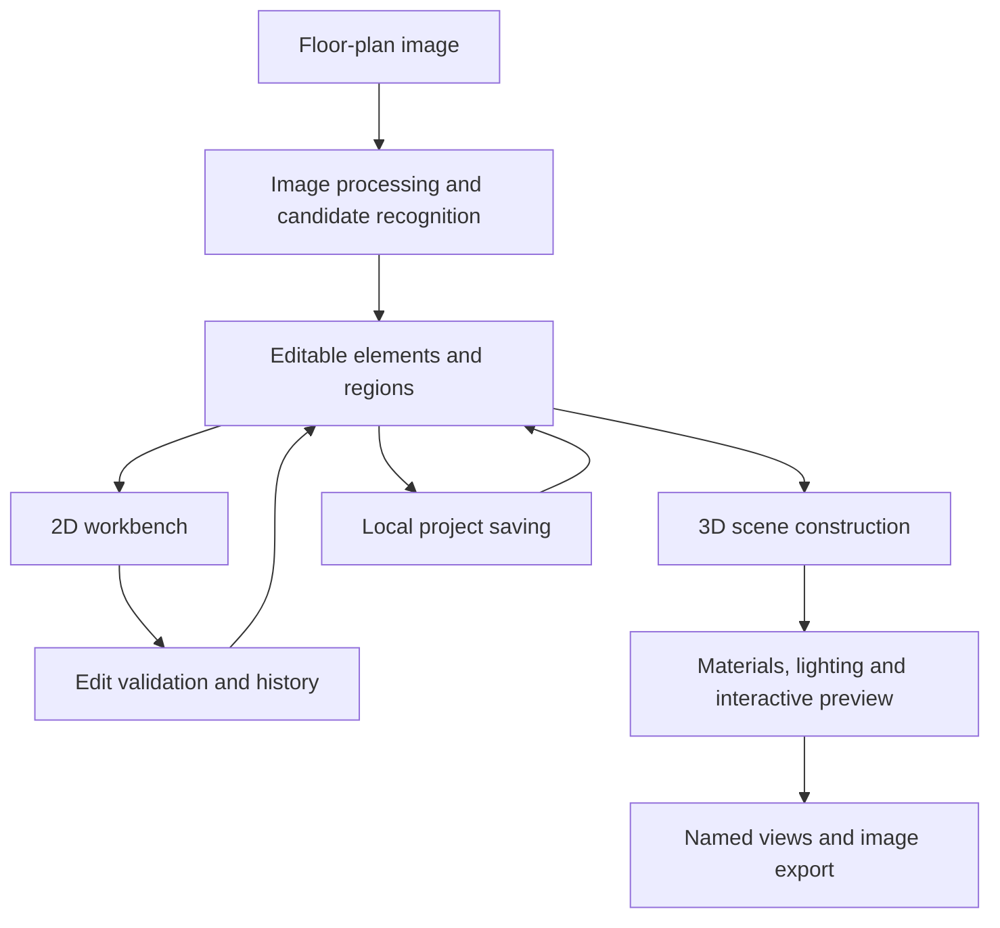

# Architecture and engineering

**English** | [中文](architecture.zh-CN.md)

This page describes the prototype's responsibilities and engineering choices. It contains no source code, credentials, training data or specific recognition rules.

## Overall structure

The current version combines a browser workbench with a local Python service. The browser handles 2D editing and 3D previews; the service handles image processing, edit validation and project persistence.

U01–U05 coordinates existing forms and selection state in one 2D/3D workbench with shared tool/property positions. Apply/cancel, Esc and unapplied-edit protection are consistent. Unchanged basic edits neither write history/autosave nor clear redo. The main 3D view and the small 2D-mode 3D preview share one renderer. Auxiliary views start collapsed and hidden 3D rendering pauses. In 3D mode, a simplified 2D map shows camera direction and lets users place the camera on walkable ground.

## Module responsibilities

| Module | Responsibility | Main technology |
| --- | --- | --- |
| Image processing | Load plan images, extract wall/opening/furniture candidates, reuse caches for identical recognition inputs | Python, NumPy, Pillow, OpenCV, optional ONNX Runtime |
| Spatial geometry | Walls, openings, connections, room boundaries, scale and area | Python, Shapely, planar geometry |
| Editing service | Validate edits, manage current project/undo/redo and local named projects/assets/recovery | Python HTTP service, file storage |
| 2D workbench | Layers, selection, navigation, dragging, dimensions, regions and parameter preview | JavaScript ES Modules, SVG, HTML/CSS |
| 3D scene | Generate walls, openings, furniture, floors and ceilings from element dimensions | Three.js, WebGL, procedural geometry, GLB |
| Appearance/lighting | PBR maps, metal/glass, daylight, fixture shadows and soft cove lighting | Three.js materials, shadows and lightmaps |
| Verification | Geometry, parameter validation, API operations and actual browser workflows | Python unittest, Node.js test runner, Playwright |

## Key engineering problems

### Consistent 2D editing and 3D geometry

Original 2D geometry retains image coordinates and uses calibrated scale for physical dimensions. 3D walls retain solids above, below and beside openings. Current door/window operation affects 2D symbols, 3D parts and current collision checks together.

This keeps the same editable objects in use when positions, dimensions or opening mechanisms change, without maintaining a separate display model disconnected from the plan.

Custom cabinet boards/operation derive from cabinet parameters; kitchen groups store member order and worktop settings. Continuous worktops derive from the current valid arrangement. Gaps, misalignment or inconsistent elevations pause the worktop and request realignment; cancel/undo can restore it. Single-floor rectangular columns/beams share editing, materials, collision and persistence; they do not automatically change room regions or generate structural openings.

Kitchen group movement/right-angle rotation uses the first cabinet center, updating members and worktop together. Copies create independent member/group IDs. Furniture/kitchen handles reuse preview/commit: one gesture, one history entry, with cancellation/failure restoration. Invalid arrangements, bounds or budgets reject the entire action. General furniture groups also reuse preview/commit and 2D dragging; kitchens remain orthogonal. P16 adds a mixed/nested reference tree and temporary selection, rebinding every descendant on copy. Scaling/batch properties reuse original constraints; multi-segment paths use continuous envelope intervals and custom clearances.

L-shaped kitchens derive from a main run, one left/right blind-corner base cabinet and a return. Fixed blind panels are separate from operable doors. One concave polygon produces the worktop, while collision uses two rectangles to retain the recess. Legacy straight projects keep their format. Ordinary base cabinets host simplified sinks/hobs: actual worktop holes and split top panels avoid the opening. Equipment uses host-local coordinates, copies rebind to new members, and conflicts/mismatches are explicit. The current round adds L-shaped wall/U-shaped matching groups and continuous base worktops, circular/rounded holes, blind-corner and two/three adjacent-cabinet holes, plus explicit shared-panel notches. Arbitrary multiple corners/irregular worktops, further mechanisms and product equipment remain pending.

Room floors derive straight or two offset grids from piece dimensions and clip to concavity/holes/disconnected contours; actual piece faces exclude joint widths. Origins/dimensions use physical lengths independently of texture scale. 2D/3D share derived layouts; room/project budgets reject excessive grids. Older projects retain continuous textures. Physical herringbone uses two orthogonal rectangular-board sets, with textures following boards. Per-piece materials/hiding are sparse overrides cleared by grid changes. Free movement/scaling/contours, adjustable chevron and repeating motifs were added in P23 C01–C08. Procurement quantities/construction drawings remain pending.

Wall panels support regular/nonuniform rectangular divisions and wall-segment/floor origins. Perimeter/opening dimensions and materials inherit independently, with per-opening overrides over direction defaults. Reveals reuse actual union boundaries, stop at the wall centerline and avoid corner overlap. Ordinary rectangular openings derive frames/leaves inside independent depth/offset using lined clearance, preserving the structural opening; mismatches pause fitting with a warning. P23 completes current-library frame fitting, free straight seams/simple polygons, actual trim profiles and per-edge reveals. Curved types/additional product installation details remain pending.

### Correctable recognition uncertainty

Walls, openings and furniture are candidates. The workbench provides numbered navigation, confirmation/rejection, manual additions and closure diagnostics. Region analysis uses virtual boundaries at openings without turning those analysis closures into solid walls.

The prototype prioritizes a complete manually reviewed workflow. General recognition accuracy requires further evaluation on an independent image set.

### Inspectable, recoverable edits

Parameter editing connects preview, apply, cancel and undo/redo. Applied changes atomically autosave locally while retaining the previous complete record. Corrupt records trigger fallback attempts; conflicting recovery copies are saved separately. Unapplied forms are excluded, and full undo stacks are not persistent across sessions. Projects store elements, regions, scale, materials, lights and views. Imported models, GLB part overrides and five-map PBR travel with projects and recover through content IDs/checksums. Color becomes opaque JPEG; normal/roughness/metalness/AO use linear lossless PNG. DirectX normals convert to OpenGL. Reopened projects remain editable.

The upload library supports search/rename, unused-entry deletion and save/recovery/history reference protection; removing an entry retains its cache. Batch management and explicit cache cleanup preflight and recheck project/history/snapshot/preview references under the server lock, rejecting out-of-root paths and links. System-locked files stay hidden and retryable. Object-specific upload entry points share this lifecycle.

Image export waits for relevant textures/cove lighting, temporarily hides selection/collision aids and restores canvas/camera afterwards.

### Browser rendering costs

Models/materials use local assets and thumbnails. Shadows follow quality/light-count budgets. Cove indirect light approximates one diffuse bounce in batches, cancelling stale work after edits. Some occlusion checks for complex furniture use bounding boxes.

These choices serve interactive previews, rather than offline photorealistic rendering or professional lighting simulation.

## Verification approach

| Layer | Focus |
| --- | --- |
| Parameters/API | Invalid values, preview/apply/undo, save/reopen, historical compatibility and failure recovery |
| Geometry/state | Opening contours/motion, 2D/3D consistency, collision and following textures |
| Browser workflows | Actual mouse/keyboard operations, panel switches, cancellation, narrow layouts and high-resolution output |
| Image checks | Decoding, dimensions, hidden helpers and screenshots of key effects |

Verification follows feature iterations. Existing tests do not guarantee recognition accuracy/performance for every plan, device or use case.

[Back to project home](../README.md)

## Geometry and verification update · 2026-10-26

Floor layouts and element deductions use derived geometry while retaining room contours, origins and piece identities. Overlapping occupancies use unions and actual cross-room intersections. Net-length labels read adjacent wall-side geometry from existing rooms; view changes do not alter project data/history. Openings, pieces and profiles synchronize actual geometry in 2D, 3D and current-pose collision within each bounded scope.

Before publication, 407 Node/480 Python tests and the net-length browser checks passed. Other module rounds and full code baseline are in the [2026-10-26 update](updates-2026-10-26.md).

## Objects and materials update · 2026-10-27

GLB overrides locate source node/mesh/primitive with a model-content fingerprint, preventing old part overrides from applying to replacement models. Custom UVs clone geometry, keeping original model assets restorable. Room wall sides clip actual surfaces along adjacency intervals, preserving openings and union corners; ambiguous ownership falls back with a notice. Cross-object batch operations carry a document-version fingerprint and reject the whole application if any type is invalid. Floor layout directions/per-piece overrides remain intact.

Latest full suites: 427 Node/495 Python, plus 48 targeted final checks and 23 final cache checks, all passed. Overlapping sets are not added. New P18 and existing materials/upload-library/GLB/wall-paint browser checks passed; P16 retains its own acceptance record. See [update and verification](updates-2026-10-27.md).
