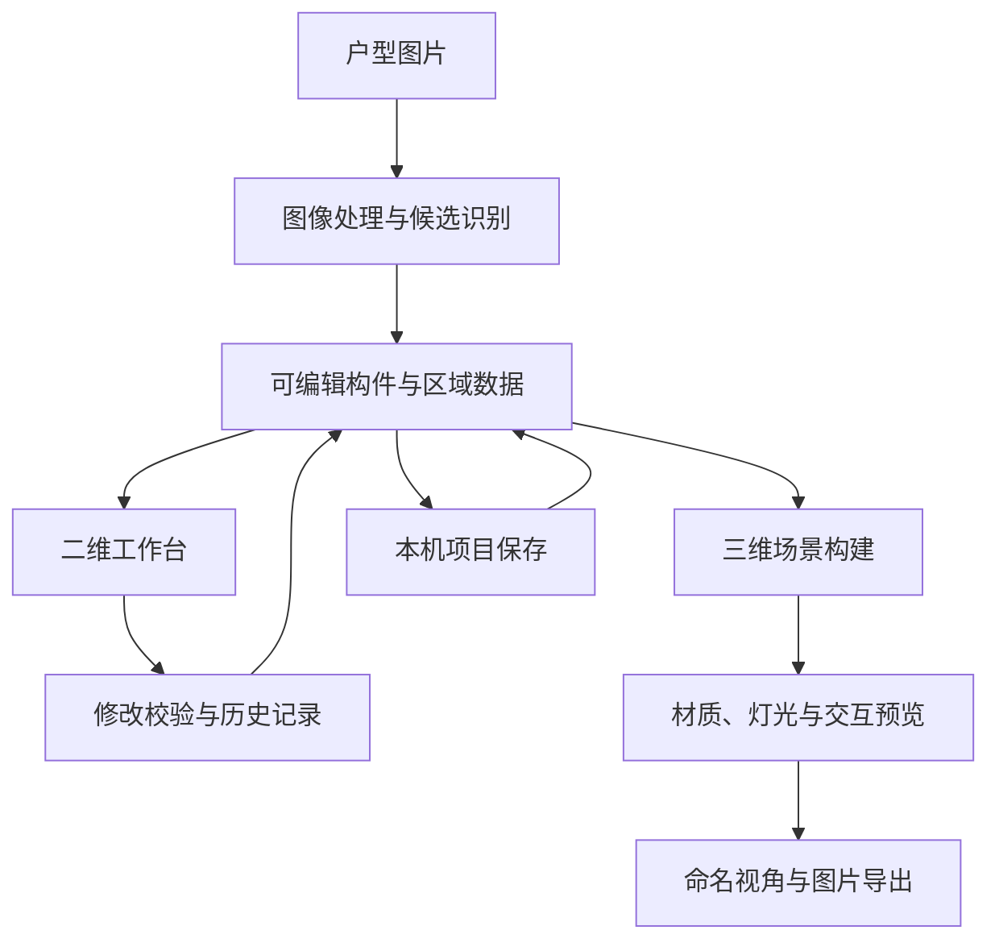

# 架构与工程设计

本页介绍当前原型的系统分工与工程取舍，不包含源代码、接口凭据、训练数据或具体识别规则。

## 总体结构

当前版本由浏览器工作台和 Python 本地服务组成。浏览器承担二维编辑与三维预览，本地服务承担图像处理、编辑校验和项目保存。

U01～U05 协调现有表单与选择状态，在同一工作台切换二维/三维，共用工具与属性位置；统一应用取消、Esc 与未应用保护，无变化的基础编辑不写入历史或自动保存，也不清空重做。主三维画面与二维时的三维小预览共用一个渲染器；辅助视图默认收起，隐藏时暂停三维渲染。三维时的简化二维图可查看相机方向并点击可站立位置定位。

## 模块分工

| 模块 | 职责 | 主要技术 |
| --- | --- | --- |
| 图像处理 | 读取底图，提取墙体、门窗与家具候选，复用相同识别输入的缓存 | Python、NumPy、Pillow、OpenCV、可选 ONNX Runtime |
| 几何与空间 | 处理墙体、洞口、连接、房间边界、比例与面积 | Python、Shapely、平面几何处理 |
| 编辑服务 | 校验修改，维护当前方案与撤销/重做历史，管理本机命名项目、资源与自动恢复 | Python HTTP 服务、文件存储 |
| 二维工作台 | 图层、选中、定位、拖动、尺寸输入、区域编辑与参数预览 | JavaScript ES Modules、SVG、HTML/CSS |
| 三维场景 | 根据构件尺寸构建墙体、门窗、家具、地面与顶面 | Three.js、WebGL、程序化几何、GLB |
| 外观与照明 | PBR 贴图、金属/玻璃、日光、灯具投影与灯槽柔光 | Three.js 材质、阴影与光照贴图 |
| 验证 | 几何测试、参数校验、接口操作与实际浏览器流程 | Python unittest、Node.js test runner、Playwright |

## 关键工程问题

### 让二维编辑与三维几何保持一致

二维原始几何保留图像坐标，通过比例换算为实际尺寸。三维墙体保留洞口上方、下方和侧边实体，门窗当前开合状态同时影响二维符号、三维构件和当前碰撞检查。

这样可以在修改门窗位置、尺寸或开合方式时继续使用同一套可编辑对象，而不需要单独维护一份脱离户型的展示模型。

定制柜的板件与开合由单柜参数生成，厨房组合保存成员顺序和台面设置。连续台面依据当前有效排列派生；成员出现断缝、错位或标高不一致时暂停显示并提示重新对齐，预览取消和撤销可以恢复。单层矩形柱梁等构件共用编辑、材质、碰撞和保存流程；尚未自动修改房间分区或生成结构开洞。

厨房整组移动和直角旋转以首柜中心定位，成员和台面同步更新；复制创建独立成员/组合编号。家具/厨房画布手柄复用预览与提交流程，一次手势一条历史，取消或提交失败恢复。失效排列、越界或超出预算时整次拒绝；通用家具组已复用预览/提交机制及二维拖动；厨房仍限直角，嵌套/混合成组和完整路径待做。

L 形由主排、唯一左右盲角地柜和返排派生。固定盲板与可开门区分开，连续台面由单个凹多边形挤出；碰撞拆为两个矩形区域以保留凹口空间。旧直线项目沿用原格式。普通地柜现可绑定简化水槽/灶具，台面生成真实通孔、柜顶板分块避孔；设备位置按宿主局部坐标保存，复制重绑新成员，冲突或失配明确提示。本轮已补齐 L 形吊柜/U 形同系列组合及连续地柜台面，新增圆/圆角孔、盲角与同排相邻 2～3 柜开孔和显式共享侧板缺口；任意多转角/异形台面、更多机构和商品设备仍待做。

房间地面可按单块尺寸生成正铺或两种错缝网格，并按凹形/孔洞/多块轮廓裁切，缝宽从实际块面扣除；起铺点与尺寸以实际长度保存，贴图比例独立。二维示意与三维使用相同派生排版，按房间及全项目预算拒绝过密网格。旧项目保持连续贴图。真实人字拼由两组正交矩形板派生，纹理跟随板身；逐块材质/隐藏用稀疏例外保存，改网格清除例外。自由移动/缩放、鱼骨/复杂拼花、采购用量与施工图待做。

墙板支持规则/非等距矩形分板与墙段/地面起点；外周/洞边逐边矩形尺寸与材质独立继承，单洞口可覆盖方向默认。洞内包覆复用真实联合边界，最多到墙厚中线，角部避免重叠。普通矩形门窗可在独立进深/偏移内按包覆净空派生框与扇，原结构洞口保持；失配暂停并提示。特殊类型适配、异形与安装节点待做。

### 让不确定的识别结果可以修正

墙体、门窗和家具识别输出候选。工作台提供编号定位、确认与排除、手工补充及闭合诊断。分区只在分析中使用门窗虚拟边界，不把分析封口直接变成实体墙。

当前原型优先支持人工校核后的完整工作流；通用识别准确率需要独立测试图集进一步评估。

### 让每次修改可检查、可恢复

参数编辑通过预览、应用、取消与撤销/重做衔接。已应用修改原子写入本机自动保存，保留上份完整记录；损坏时尝试回退，冲突恢复副本分别保存。未应用表单不在恢复范围，跨次完整撤销栈尚未持久化。项目保存包括构件、区域、比例、材质、灯光和视角；导入模型与已应用上传颜色图随项目保存，以内容编号和校验值恢复；图片规范为不透明 JPEG，不生成其他 PBR 图。重新打开后可继续编辑。上传库支持名称搜索/重命名、未使用条目删除及保存/恢复/历史引用保护，删除保留缓存；对象专用入口复用同一资源生命周期。

图片导出等待相关贴图与灯槽光照更新，暂时隐藏选中高亮及碰撞辅助标记，结束后恢复画布和镜头。

### 在浏览器中控制渲染成本

模型与材质使用本地资源和缩略图。阴影按画质与灯数预算启用；灯槽间接光采用一次漫反射近似并分批计算，编辑变化后取消过期更新。复杂家具的部分遮挡检查采用包围盒近似。

这些取舍服务于交互预览，不等同于离线写实渲染或专业光照仿真。

## 验证方式

| 层次 | 关注内容 |
| --- | --- |
| 参数与接口 | 非法值、预览/应用/撤销、保存重开、历史兼容与失败恢复 |
| 几何与状态 | 洞口轮廓、门窗运动、二维/三维一致性、碰撞、纹理跟随 |
| 浏览器流程 | 实际鼠标与键盘操作、面板切换、取消恢复、窄屏布局与高清导出 |
| 图像核查 | 图片解码、输出尺寸、辅助标记隐藏及关键效果截图 |

验证按功能迭代执行。现有测试不作为对任意户型图、设备或使用场景的准确率与性能保证。

[返回项目首页](../README.md)

## 本轮几何与验证 · 2026-10-26

地面铺装与构件扣除采用派生几何，原房间轮廓、起铺点和逐块身份继续保存；重叠占用按并集，跨房间取实际相交范围。净长标注沿已划房间相邻墙侧读取几何，切换口径不改变工程数据或编辑历史。门窗、板块与截面以真实几何同步二维、三维和当前姿态碰撞，保留各自有限范围。

发布前 407 项 Node、480 项 Python 通过，本轮净长浏览器检查通过；其他模块的分轮验收和完整代码基线见[2026-10-26 更新](updates-2026-10-26.md)。
