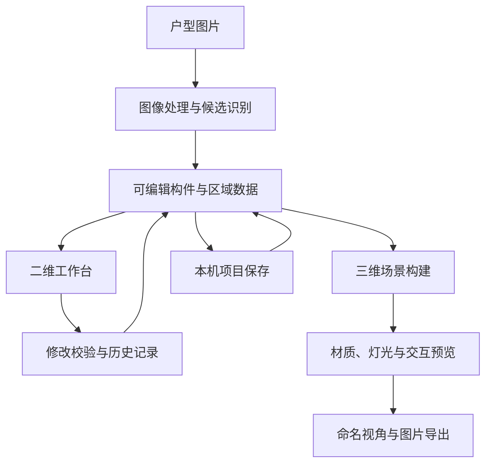

# 架构与工程设计

[English](architecture.md) | **中文**

## 2026-10-31 · P26与P13整项收尾 · 项目资源、独立分享与确定性出图

源码 [77736ba](https://github.com/ETET114514/GewuZhizaoNew/commit/77736bac6b0e83db23a9c269ad21c66d09f9c1d9); [范围和证据](updates-2026-10-31-closeout.zh-CN.md).

全景和音轨以SHA256资源引用随项目保存；模型/视角签名用于提示过期，重采集保留站位/热点。独立分享监听器不提供编辑器token或工程API，密码使用带随机盐的PBKDF2；有效期与撤销由服务端检查。逐帧任务串行上传JPEG，本机FFmpeg编码MP4，取消/完成清理临时帧。P13和P27共享完成面边界与关联意图，几何变化后重算，不保存过期数值。

后续按日期保留的章节为历史快照，不覆盖本节当前状态。

## 2026-10-31 · 独立全景包与可恢复采集

源码 [b9ee167](https://github.com/ETET114514/GewuZhizaoNew/commit/b9ee167b494268e74a54c2e242c904004dbced65); [范围与验证](updates-2026-10-31-panorama.zh-CN.md).

GPano元数据在不重编码原压缩图像的前提下写入。文字/跳转热点按球面方向关联图像；包验证编号、版本、输入预算及目标引用，显式单张包优先于临时缓存。串行采集冻结运动、快照输入队列，在取消/失败后恢复完整镜头；打包结果与模型工程分离。P27无变化设置保留文档、重做及自动保存。

## 2026-10-30 · 关联设计意图与可恢复带看场景

源码[0f28b3e](https://github.com/ETET114514/GewuZhizaoNew/commit/0f28b3e043333f733bcf8c89ca6fc11f0b6eb1cf)。参数直/弧墙保留宿主门窗和对象编号。尺寸保存端点关联而非过期长度，随几何/比例重算，拆墙迁移宿主；失效关联不继续报旧数值。带看可使用临时开门副本，结束恢复原工程/镜头；录像与全景捕获恢复渲染状态。工程量从当前几何派生，工程保存计价选择而非冻结总价。[边界与验证](updates-2026-10-30-design.zh-CN.md)。

## 2026-10-30 · 有界导入、明确来源与确认创建

源码检查点：[d9338b5](https://github.com/ETET114514/GewuZhizaoNew/commit/d9338b5dd8194e8acb36768fa068e6626959531e).

DXF在有时限的独立进程中解析，图层/单位/普通块姿态/转正/裁剪共用坐标。标注与填充只用于参考显示，墙体使用单独明确的来源；双线配对、门窗符号与房间文字候选需选择并重新校验，才创建独立工程。文件/几何/配对/栅格预算及失败隔离不依赖账号。glTF包在内存中归一化为原静态GLB资源流程，不读取外部网址。

P31图片副本与分析/标注独立于工程几何，OCR命名带版本校验；分组评估防止同源泄漏，不训练或校准新识别器。P30有界网格搜索后调用原连续验证，只带入通过的路线，不移动场景。共享撤销/资源/保存机制继续使用。[本轮范围与验证](updates-2026-10-30.zh-CN.md)。

## 2026-10-28 · 版本绑定方案与连续检查

独立 Worker 有限搜索生成姿态，不修改场景。预览/应用核对整个源文档的 SHA-256 版本，姿态以复制后写入方式校验，一次提交整批。指定步行/搬运路径采用连续碰撞区间，步行另查地面与门洞桥接。开合区间插值当前建模参数；碰撞见证可提前失败，通过需排除所有区间；缺失几何、近接触与预算耗尽保持未证实。P29 包在隔离目录校验，P17 整理是本机库元数据，P31 参考仅在明确重标定时改变比例。

见[发布边界与证据](updates-2026-10-28.zh-CN.md)。

本页介绍当前原型的系统分工与工程取舍，不包含源代码、接口凭据、训练数据或具体识别规则。

## 总体结构

当前版本由浏览器工作台和 Python 本地服务组成。浏览器承担二维编辑与三维预览，本地服务承担图像处理、编辑校验和项目保存。

U01～U05 协调现有表单与选择状态，在同一工作台切换二维/三维，共用工具与属性位置；统一应用取消、Esc 与未应用保护，无变化的基础编辑不写入历史或自动保存，也不清空重做。主三维画面与二维时的三维小预览共用一个渲染器；辅助视图默认收起，隐藏时暂停三维渲染。三维时的简化二维图可查看相机方向并点击可站立位置定位。

## 模块分工

| 模块 | 职责 | 主要技术 |
| --- | --- | --- |
| 图像处理 | 读取底图，提取墙体、门窗与家具候选，复用相同识别输入的缓存 | Python、NumPy、Pillow、OpenCV、可选 ONNX Runtime |
| 几何与空间 | 处理墙体、洞口、连接、房间边界、比例与面积 | Python、Shapely、平面几何处理 |
| 编辑服务 | 校验修改，维护当前方案与撤销/重做历史，管理本机命名项目、资源与自动恢复 | Python HTTP 服务、文件存储 |
| 二维工作台 | 图层、选中、定位、拖动、尺寸输入、区域编辑与参数预览 | JavaScript ES Modules、SVG、HTML/CSS |
| 三维场景 | 根据构件尺寸构建墙体、门窗、家具、地面与顶面 | Three.js、WebGL、程序化几何、GLB |
| 外观与照明 | PBR 贴图、金属/玻璃、日光、灯具投影与灯槽柔光 | Three.js 材质、阴影与光照贴图 |
| 验证 | 几何测试、参数校验、接口操作与实际浏览器流程 | Python unittest、Node.js test runner、Playwright |

## 关键工程问题

### 让二维编辑与三维几何保持一致

二维原始几何保留图像坐标，通过比例换算为实际尺寸。三维墙体保留洞口上方、下方和侧边实体，门窗当前开合状态同时影响二维符号、三维构件和当前碰撞检查。

这样可以在修改门窗位置、尺寸或开合方式时继续使用同一套可编辑对象，而不需要单独维护一份脱离户型的展示模型。

定制柜的板件与开合由单柜参数生成，厨房组合保存成员顺序和台面设置。连续台面依据当前有效排列派生；成员出现断缝、错位或标高不一致时暂停显示并提示重新对齐，预览取消和撤销可以恢复。单层矩形柱梁等构件共用编辑、材质、碰撞和保存流程；尚未自动修改房间分区或生成结构开洞。

厨房整组移动和直角旋转以首柜中心定位，成员和台面同步更新；复制创建独立成员/组合编号。家具/厨房画布手柄复用预览与提交流程，一次手势一条历史，取消或提交失败恢复。失效排列、越界或超出预算时整次拒绝；通用家具组已复用预览/提交机制及二维拖动；厨房仍限直角。P16 新增混合/嵌套对象引用树和临时选择，复制重绑所有后代；缩放/批量属性复用原约束，多段路径按包络连续区间与自定义净距检查。

L 形由主排、唯一左右盲角地柜和返排派生。固定盲板与可开门区分开，连续台面由单个凹多边形挤出；碰撞拆为两个矩形区域以保留凹口空间。旧直线项目沿用原格式。普通地柜现可绑定简化水槽/灶具，台面生成真实通孔、柜顶板分块避孔；设备位置按宿主局部坐标保存，复制重绑新成员，冲突或失配明确提示。本轮已补齐 L 形吊柜/U 形同系列组合及连续地柜台面，新增圆/圆角孔、盲角与同排相邻 2～3 柜开孔和显式共享侧板缺口；任意多转角/异形台面、更多机构和商品设备仍待做。

房间地面可按单块尺寸生成正铺或两种错缝网格，并按凹形/孔洞/多块轮廓裁切，缝宽从实际块面扣除；起铺点与尺寸以实际长度保存，贴图比例独立。二维示意与三维使用相同派生排版，按房间及全项目预算拒绝过密网格。旧项目保持连续贴图。真实人字拼由两组正交矩形板派生，纹理跟随板身；逐块材质/隐藏用稀疏例外保存，改网格清除例外。自由移动/缩放/轮廓、真实可调鱼骨及重复拼花已由 P23 C01～C08 接入；采购用量与施工图待做。

墙板支持规则/非等距矩形分板与墙段/地面起点；外周/洞边逐边矩形尺寸与材质独立继承，单洞口可覆盖方向默认。洞内包覆复用真实联合边界，最多到墙厚中线，角部避免重叠。普通矩形门窗可在独立进深/偏移内按包覆净空派生框与扇，原结构洞口保持；失配暂停并提示。当前库门窗框适配、自由直缝/简单多边形、实际收边截面和逐边包覆已由 P23 收尾；曲线类型与额外商品安装节点仍待做。

### 让不确定的识别结果可以修正

墙体、门窗和家具识别输出候选。工作台提供编号定位、确认与排除、手工补充及闭合诊断。分区只在分析中使用门窗虚拟边界，不把分析封口直接变成实体墙。

当前原型优先支持人工校核后的完整工作流；通用识别准确率需要独立测试图集进一步评估。

### 让每次修改可检查、可恢复

参数编辑通过预览、应用、取消与撤销/重做衔接。已应用修改原子写入本机自动保存，保留上份完整记录；损坏时尝试回退，冲突恢复副本分别保存。未应用表单不在恢复范围，跨次完整撤销栈尚未持久化。项目保存包括构件、区域、比例、材质、灯光和视角；导入模型、GLB 部位覆盖和五图 PBR 随项目保存，以内容编号和校验值恢复；颜色为不透明 JPEG，法线/粗糙度/金属度/AO 为线性无损 PNG，DirectX 法线转换为 OpenGL。重新打开后可继续编辑。上传库支持名称搜索/重命名、未使用条目删除及保存/恢复/历史引用保护，移除保留缓存；批量管理与显式缓存清理在服务器锁内预检并重查方案/历史/快照/预览引用，拒绝越界及链接，系统占用保持隐藏可重试。对象专用入口复用同一生命周期。

图片导出等待相关贴图与灯槽光照更新，暂时隐藏选中高亮及碰撞辅助标记，结束后恢复画布和镜头。

### 在浏览器中控制渲染成本

模型与材质使用本地资源和缩略图。阴影按画质与灯数预算启用；灯槽间接光采用一次漫反射近似并分批计算，编辑变化后取消过期更新。复杂家具的部分遮挡检查采用包围盒近似。

这些取舍服务于交互预览，不等同于离线写实渲染或专业光照仿真。

## 验证方式

| 层次 | 关注内容 |
| --- | --- |
| 参数与接口 | 非法值、预览/应用/撤销、保存重开、历史兼容与失败恢复 |
| 几何与状态 | 洞口轮廓、门窗运动、二维/三维一致性、碰撞、纹理跟随 |
| 浏览器流程 | 实际鼠标与键盘操作、面板切换、取消恢复、窄屏布局与高清导出 |
| 图像核查 | 图片解码、输出尺寸、辅助标记隐藏及关键效果截图 |

验证按功能迭代执行。现有测试不作为对任意户型图、设备或使用场景的准确率与性能保证。

[返回项目首页](../README.zh-CN.md)

## 本轮几何与验证 · 2026-10-26

地面铺装与构件扣除采用派生几何，原房间轮廓、起铺点和逐块身份继续保存；重叠占用按并集，跨房间取实际相交范围。净长标注沿已划房间相邻墙侧读取几何，切换口径不改变工程数据或编辑历史。门窗、板块与截面以真实几何同步二维、三维和当前姿态碰撞，保留各自有限范围。

发布前 407 项 Node、480 项 Python 通过，本轮净长浏览器检查通过；其他模块的分轮验收和完整代码基线见[2026-10-26 更新](updates-2026-10-26.zh-CN.md)。

## 本轮对象与材质 · 2026-10-27

GLB 材质覆盖使用源节点/网格/primitive 和模型内容指纹定位，替换模型不会误套旧部位；自定义 UV 克隆几何，原模型资源保持可恢复。房间墙侧在实际墙体表面沿邻接区间裁切，洞口和联合墙角保留，归属歧义回退并提示。跨对象批量操作附文档版本指纹，任一类型无效则拒绝整次应用；地面排版方向和逐块例外保留。

P16/P18 历史快照：全量 427 Node/495 Python、48 项相关最终复验和 23 项缓存最终复验通过，测试集合不相加。新 P18 与原材质、上传库、GLB、墙漆浏览器通过；P16 当轮验收另列，详见[更新与验证](updates-2026-10-27.zh-CN.md)。

## P35 几何、运行预览与资产资料 · 2026-10-27

已编辑的圆弧/三次曲线控制点和高度网生成派生网格，按真实边界/孔洞裁切，厚板侧边闭合并在实际三角面安装。变截面按对应顶点插值，校核使用最大包络。轨道使用真实弧长和确定性时间变换；运行预览与保存的编辑状态分开，暂停/定位/出图可用可见帧，停止/修改恢复已应用状态。

剖切封口重建真实截线闭环、保留嵌套孔洞，按逻辑实体合并分材质面；旋转和多切面参与封口几何与拾取。开放网格报告未闭合截线，不视为封闭实体。品牌资料保留模型来源，并将目录绑定到内容哈希；本机原子导入和项目资源携带不代表已连接在线厂商。

P35历史检查点源码：[99882a8](https://github.com/ETET114514/GewuZhizaoNew/commit/99882a803e649666153e617bcf2b132661040c9d)。验证记录为 437 项全量 Node、517 项全量 Python 快照和 80 项最终相关 Python，重叠集合不相加；新旧 P35 与原顶面/灯槽浏览器通过，含窄屏、4K 与恢复。详见[P35检查点范围与验证](updates-2026-10-27-p35.zh-CN.md)。
