# Demo guide

**English** | [中文](demo.zh-CN.md)

## 2026-11-20 · P24 kitchen disassembly and tool withdrawal turns

[Source commit bc71e67](https://github.com/ETET114514/GewuZhizaoNew/commit/bc71e6716c54061b871dfe3aea8494355e4cf784) · [Source PR #3, awaiting merge](https://github.com/ETET114514/GewuZhizaoNew/pull/3) · [Scope and evidence](updates-2026-11-20-p24.md)

Open the kitchen drawing report and enable the disassembly check. Give a tool an entry path, a withdrawal path and a withdrawal turn angle. Read the report again to see the turn in the step preview. The demo uses a 390 px viewport and a schematic cabinet fixture.

## 2026-11-18 · Wall reference ranges and kitchen drawing/contact workflows

[Source 9b48db1](https://github.com/ETET114514/GewuZhizaoNew/commit/9b48db190e64f437662d0ac37662332151c6fe97) · [Scope and evidence](updates-2026-11-18-p12-p24.md)

In the workbench, open Detail design → Whole-kitchen elevations/countertop-equipment sheets. Select a main group and optional additional groups, then read the sheets. Choose one cabinet to append isometric/exploded reference views. Enable cross-cabinet checks and/or countertop-equipment checks explicitly; each option change invalidates the old report. Click a board, cabinet or equipment-part number to inspect the source geometry; selecting another entity from a single-cabinet isometric view returns to the overall plan. Download SVG/DXF/CSV/offline HTML/JSON/ZIP, or cancel and retry. For P12, declare supported external interval semantics and use the wall-drawing panel to choose the host, station and section level. Check stale-source refusal and save/reopen regeneration.

Full P12 and P24 remain unfinished. These are bounded reference drawings and geometric checks. Unknown reference semantics, arbitrary wall topology, complete construction details, professional hidden-line removal, hardware/connection strength, installation constraints, assembly order/motion and manufacturer CNC remain open. Equipment is the existing schematic geometry; an overlap may be intended embedding and requires review.

Development evidence: 809 full Node tests, 57 related Python tests, 15 new Edge workflow groups, and the existing 14 cross-cabinet/11 single-cabinet browser groups passed. Independent GEOS checks cover 24 normal/low-upper-cabinet cases; actual ZIP/CSV/HTML/JSON and native-dimension CAD downloads were read back. Publication preparation additionally passed 22 P12 reference-range/wall-drawing Python tests on 2026-11-18. Counts overlap and are not added; no full Python rerun or fresh rerun of every earlier browser suite is claimed. Showcase publication checks bilingual pages, links and screenshot provenance.

## 2026-11-16 · Continuous wall sections, curved junctions and typed references

[Source 00dd9d8](https://github.com/ETET114514/GewuZhizaoNew/commit/00dd9d883d67ce5c9be5de6e7b9fae626efedbc0) · [Scope and evidence](updates-2026-11-16-p12-sections.md)

Select an angled/arc wall and enter rows of station %, thickness cm and height cm under Continuous sections; leave every height empty for global inheritance. Preview/cancel or apply, add a window and inspect 3D, then split and reopen the project. Under Closure diagnostics, enable continuous fillet transitions or choose a multi-wall node mode; inspect the real preview before applying. Duplicate-wall sections require explicit thickness/height/material sources. Declare existing external node paths under External reference migration rules. Under Whole-room finishes, select a custom angle or endpoint elevation/band and link valid intervals to P27 before drawing export.

Full P12 remains unfinished. Profiles have 2–64 controls, 50–600 mm thickness and 100–20000 mm height; all heights may inherit globally, without mixing inherited and numeric controls. Junctions select 3–12 wall ends with 0–1000 mm movement: retain supports, explicitly rotate straight supports, or reconstruct a circle while retaining its far endpoint/tangent and curvature direction. No valid finite solution or unsupported references rejects the edit. Typed JSON Pointer bindings cover fraction, station and host semantics, including one-to-many rebinding; undeclared business/program semantics stay protected. Elevation checks qualify the measurement-line endpoints, without inferring a new room partition/area at that height. Arc geometry uses the existing bounded sampling; collision stays conservative and quantities retain nominal axis-based face-area conventions. Arbitrary surface/topology transition bodies, undefined reference semantics, complete construction sections/details and unlimited report-external inference/global-optimum guarantees remain open.

Source validation on 2026-11-16: **1363 full Python tests** across all 183 modules, **760 full Node tests**, **78 final related Python checks**, and **14 new real Edge workflow groups** passed. Six existing browser suites were rerun: path finishes, closeout, engineering, whole-room/node, original path walls and P27 drawing export. Final related checks also verify the last calibration/projection binding branches. Coverage includes independent mesh-volume and spiral-length checks, real 3D viewing, holes, split conservation, inheritance, transition following, curve-support reconstruction, explicit overlap sources, external bindings, undo/redo, save/reopen and 390px. Independent downloaded DXF/PDF extraction confirms 5317 mm angled and 3760 mm height-band net dimensions. Counts overlap and are not added. Showcase publication verifies bilingual pages, local links and screenshot provenance without rerunning application suites.

## 2026-11-16 · P12 room finishes, live net dimensions and straight-wall junctions

[Source 65ad14a](https://github.com/ETET114514/GewuZhizaoNew/commit/65ad14a203f1e00fc7e36aebf07fda4530b349a2) · [Scope and evidence](updates-2026-11-16-p12-room.md)

Open Plan drawing → Measure → Whole-room finishes and linked net dimensions. Select a room and horizontal/vertical measurement line, recompute the contour, then download JSON/SVG or link the intervals to P27. Edit the saved finish policy or wall and check that the linked values recompute. For junctions, open Import/recognition → Closure diagnostics → Multi-straight-wall common node; enter one wall endpoint per line, a common-support coordinate and maximum movement, preview, cancel or apply, then verify undo/redo.

Full P12 remains unfinished. Arc finish contours use at most 0.5 mm sagitta sampling; their perimeter is a sampled polygon length, distinct from the existing analytic single-wall along-path report. Whole-room contours are planar gross boundaries without opening or height-band deductions. P27 stores room identity, relative measurement-line position and interval intent; ambiguous room changes or interval-count changes become unresolved. Junction consolidation preserves original straight supports and allows 0–1000 mm endpoint movement, with at least 100 mm wall remaining; unsupported references, opening truncation and new overlap reject the complete edit. Curved/moving-support nodes, continuous variable thickness/height, unknown-reference reconstruction, arbitrary topology, full construction sections/details and unlimited report-external inference/global-optimum guarantees remain open.

Source validation on 2026-11-16: **1349 full Python tests** passed across all 181 modules in four independent processes; **753 full Node tests**, **66 final related Python tests**, **12 new Edge workflow groups** and **24 existing P12 browser groups** passed. Final related/browser checks also cover the last source-snapshot guard. Real save/reopen, live wall-edit identity migration, undo/redo, stale-source refusal and 390px were checked. Downloaded DXF/PDF were independently read back with the updated 3720 mm value; PNG is 1754 × 1240. Counts overlap and are not added. Showcase publication checks bilingual content, local links and image provenance without rerunning application tests.

## 2026-11-16 · P12 wall engineering and path-side finish measurement

[Source 9189120](https://github.com/ETET114514/GewuZhizaoNew/commit/918912079639253fb9ad7cfcb07d010239d822ed) · [Scope and evidence](updates-2026-11-16-p12.md)

In the workbench, open Plan drawing → Import/recognition → Closure diagnostics. Choose exhaustive enumeration and continue until the report says complete, or author an explicit endpoint route and preview before confirming. Check duplicate walls, enter an optional tolerance, then choose uniform sources or independent section height/material/finish sources. Select two hosts to preview/create a fillet, then select an existing fillet to edit its radius. Under Measure → Angled/arc construction finishes and along-path net length, enter left/right thickness and station ranges in centimeters, save or cancel, then query projection/section/band lengths and download CSV/JSON. Policy changes invalidate old exports. Use undo/redo and save/reopen to verify the project.

Full P12 remains unfinished. Enumeration certifies only the current finite report after completion (at most 100 reported candidates, 20 selected gaps and 500 resulting wall segments), without report-external semantic or unlimited global-optimum guarantees. Projection requires an explicit supporting line/circle and a tolerance of at most 10px; unknown references and unsupported conflicts reject the complete edit. Fillets require a valid finite analytic solution and preserve explicit thickness steps. Path-side finishes are measurement policies, without new finish solids, whole-room nonorthogonal finished-face reconstruction, step-connector lengths, multi-wall node reconstruction, continuous variable sections or P27-linked construction sheets.

Final source-stage rerun on 2026-11-16: **1342 full Python tests and 744 full Node tests passed**. Real Edge acceptance passed 5 new path-finish groups plus the existing 9 closeout and 10 engineering groups, with no unexpected page/HTTP errors. Coverage includes independent arc formulas, real CSV/JSON read-back, preview/cancel/history, actual panel pieces/volume, door poses, project save/reopen, and 390px layouts; Python also checks restore/ZIP. The 8 new Python tests are included in the full-suite count. Earlier dated counts overlap and are not added. Showcase publication checks bilingual documentation, relative links and screenshot provenance; it does not repeat application tests.

## 2026-11-14 · Spatial tools, cabinet views and purchasing

[Source 2c0bbbb](https://github.com/ETET114514/GewuZhizaoNew/commit/2c0bbbb7c9481c78dec968c07d40b92ef56eb7da) · [Scope and evidence](updates-2026-11-14.md)

Restart the local service and refresh the workbench. Under Draw plan → Plan review, open Functional zones, draw a polygon, preview and save; optionally add lamps or enable the 3D illustration color. Under Measurement, open Dimension chains and confirm ticks, segment sizes and basis before saving. Under Import, choose vector PDF/HouseSpec and review skipped content before proceeding. P24 cabinet drawings and P28 procurement tools are under detailing; exported files remain explicit downloads.

Zones preserve physical rooms and flooring quantities; color overlays are illustrations. Dimension suggestions do not move geometry. PDF extraction is limited to independently drawn straight/polygon edges, and HouseSpec imports one floor of supported structure with explicit unsupported-item reports. Full P24 kitchen/assembly/process drawings and full P28 inventory, arbitrary manufacturing and external identities/ERP/payment/signature/CNC integrations remain open. No universal recognition accuracy is claimed.

Evidence: 744 full Node and 58 related Python tests, 22 new browser groups and existing P31/DXF-axis/wall-review regressions passed in this development batch. Immediately before publication, another 27 P24/P28-related Python checks passed. Counts overlap; no full Python-suite or complete rerun of prior cabinet/procurement browser evidence is claimed. Showcase publication checks bilingual documentation, links and image provenance.

## 2026-11-13 · P28 manufacturing references and local procurement

Source [7714f04](https://github.com/ETET114514/GewuZhizaoNew/commit/7714f0486a557d35aa069b249a37d29947030ed6) · [P28 manufacturing references and local procurement](updates-2026-11-13-p28.md)

1. In the detailing workspace, compare frozen quotes, then review material/manufacturing quantities, source confirmations, currency/tax settings and stock rules.
2. For a synthetic concave board, check through holes, pocket depth, edging and the rectangular blank. Compare the stock strategies and inspect kerf, trim, placements and offcut thresholds.
3. Freeze a source, use the local review/approval workflow and export its board-reference pack. Inspect PDF dimensions, DXF millimeter units/native dimensions, labels and hashes; do not send these references directly to a CNC controller.
4. Create a local purchase draft from the frozen manufacturing source. Enter supplier/reference and independent purchase prices; exclude nonpurchase services. Release locally, receive partially, return, re-receive and close. Export the source/event ZIP and printable HTML. This does not contact a supplier or payment system.

Remaining work includes arbitrary surface/solid deductions and external board reconstruction, multi-/back-face machining, manufacturer hardware/load checks, global irregular nesting and actual inventory, additional currency/tax rules, real identities/roles and shared approvals, online signatures, supplier ERP/payment and machine-specific CNC. Supplier/API/deployment, tooling and hardware documentation is still required for the external scope. Local approvals and entered actor names are not authenticated identities; the hash-linked event history is editable through project history and is not an immutable ledger.

Validation on 2026-11-13: **737 full Node tests and 70 related Python tests passed in the final pre-push rerun**; this is not a full Python-suite run. Earlier acceptance in this development batch passed the new procurement browser workflow and five existing P28 browser flows sequentially, including narrow layouts, plus independent ZIP/SHA-256, DXF, CSV and PDF read-back. These browser/export checks were not rerun for Showcase publication. Earlier counts overlap and must not be added. One earlier parallel browser startup failure was retained; subsequent sequential runs passed.

## 2026-11-10 · Project delivery, native CAD dimensions and geographic sunlight

Source [0de6906](https://github.com/ETET114514/GewuZhizaoNew/commit/0de69064f7a98e5cab7dd4db0e9707ab3a6ce458) · Scope and evidence: [Project delivery, native CAD dimensions and geographic sunlight](updates-2026-11-10-delivery-sun.md)

Project delivery now combines four recomputed schedules (room areas, furniture sizes/room assignment, openings and structural elements), searchable review lists, filtered CSV and offline HTML/JSON with a same-snapshot drawing/schedule ZIP. Drawing sets add optional project covers/directories; straight DXF dimensions can be native DIMENSION entities, retaining unit-aware numeric placeholders and graphic blocks. Geographic sunlight uses latitude/longitude, local date/time, an explicit UTC offset and drawing north, with 24 hourly samples, CSV/JSON records and preview/apply/cancel/history. Below-horizon direct sun is disabled.

Restart the local service and refresh. Calibrate/open a synthetic project; File → drawing set enables cover/native DXF dimensions; File → project schedules filters/reviews/exports lists or the combined package. In 3D, Design tools → lighting → sunlight opens location/date calculation; choose an hour, preview, then apply or cancel. Use your actual north direction and explicit UTC offset; examples are not automatic geolocation.

These remain reference deliverables: exported CAD dimensions are not constrained to walls; arc/net conventions that differ from endpoint distance stay static. Schedules are not manufacturing/procurement BOMs or formal approvals. NOAA fractional-year solar positions are approximate geometric directions, without refraction/weather/timezone lookup or regulatory sunlight-duration/illuminance analysis. Ambient/HDRI/interior lighting remains separately controlled. No cloud collaboration or DWG completion is claimed.

Source-stage final evidence: **692 full Node tests and 75 related Python tests**, plus real Edge workflows, 390px checks and independent read-back of native DXF entities, ZIP hashes/shared revisions and downloaded solar CSV/JSON. Earlier stage counts overlap and are not added; no full Python rerun. Showcase publication checks documentation, relative links, bilingual navigation and image provenance, without rerunning application suites.

## 2026-11-07 · Local rendering and model/plan delivery

Source [f913696](https://github.com/ETET114514/GewuZhizaoNew/commit/f913696701fd4c8e94aaea153ea14f6d65bb86b1). [Scope and evidence](updates-2026-11-07-render-exchange.md)

Local P19 path tracing now uses an isolated Worker/OffscreenCanvas scene, multiple light bounces, finite area/spot lights, local HDRI, region rendering, saved-view batches, reusable recipes, pause/resume and early finish with actual/target sample metadata. P20 exports static meter-based GLB/embedded glTF, millimeter DXF axes and wall/room/furniture footprint layers, plus fixed-scale A4/A3 vector PDF or DPI-tagged PNG. Room holes, opening gaps and rotated furniture envelopes are retained; labels avoid outlines. Earlier source changes since the previous showcase also expanded furniture and added wall cleanup, batch arrangement and a globally accessible design assistant.

Restart the local service and refresh. Open Output → views/image export → realistic render; preview before generating/downloading. The same panel exports 3D models. The File menu exports footprint DXF or fixed-scale PNG/PDF with axes/plan content selection. Calibrate first and print at 100% actual size.

These are delivered subscopes, not completion of all P19/P20 work. No cloud renderer, IES, EXR import, geographic sun study, persistent render history, DWG, construction drawing sets or P27-linked sheet dimensions. Furniture exports are envelopes; door/window symbols remain axes, not detailed frames/swings. Non-ASCII paper labels currently use Unicode escapes; DXF preserves original text. Rendering requires local WebGL2/float buffers; the gallery is session-only. Small synthetic samples do not establish high-resolution speed, photorealistic quality or recognition generalization.

Source-stage evidence: **666 full Node tests and 28 related Python tests**; actual GLB/glTF round trips, DXF/PDF/PNG downloads, independent ezdxf/Pillow/pypdf reads, vector scale bars, cancellation/failure restoration and 390px layouts passed. One glTF download run timed out; the isolated retry passed and the failed log is retained. Earlier render-control acceptance reported 660 Node/12 related Python tests and real pause/resume/early-finish checks. Counts overlap and are not summed. The render sample is 320×180/64 samples; separate 16×16/1024-sample HDR and 32×18/64-sample region checks are small-scene evidence, not 1920–3840px benchmarks. This showcase synchronization checks documentation, links and asset provenance; it does not rerun the source test suites.

Earlier dated sections preserve their historical scope; see the newest dated section above for current status.

## 2026-10-31 · P26 and P13 closeout · Project panoramas, sharing, videos and wall measurements

Source [77736ba](https://github.com/ETET114514/GewuZhizaoNew/commit/77736bac6b0e83db23a9c269ad21c66d09f9c1d9); [scope and evidence](updates-2026-10-31-closeout.md).

1. In 3D → tours, choose saved human views or automatic room viewpoints; generate and save a project panorama. Edit hotspots and save to the project; explicitly recapture after model changes.
2. Select a project panorama, set optional password/1–720 hour expiry and publish. Verify in a separate browser; default links are local and external service needs deployment. Revoke from the list.
3. In video production enter start/end seconds per line, choose audio/offset/volume, 720p/1080p and 24/30fps; generate, preview and download MP4. Save the route before saving production settings.
4. In Measure → wall measurement conventions, choose structure/finish, thickness inheritance and height section/band/datum, then preview/apply. Save certain spans as P27 dimensions or download CSV/JSON; use project/ZIP saving for continued editing.

The dated sections below retain historical snapshots and do not override this current status.

## 2026-10-31 · View, connect and capture panoramas

Source [b9ee167](https://github.com/ETET114514/GewuZhizaoNew/commit/b9ee167b494268e74a54c2e242c904004dbced65); [scope and evidence](updates-2026-10-31-panorama.md).

1. In 3D open the tour shortcut, export a panorama and drag/zoom in the interactive viewer; GPano is optional.
2. Expand text hotspots, click to add notes, edit/delete or undo, then export an image-carrying hotspot package.
3. Create a multi-scene tour, add images/single-image packages, choose entry/arrival views and assign hotspot destinations in the list.
4. Save human views as bookmarks, select 1-10 in batch capture and optionally add ordered navigation. Generate, inspect, then explicitly download. Cancel/failure retains the prior result; save the package before refresh.

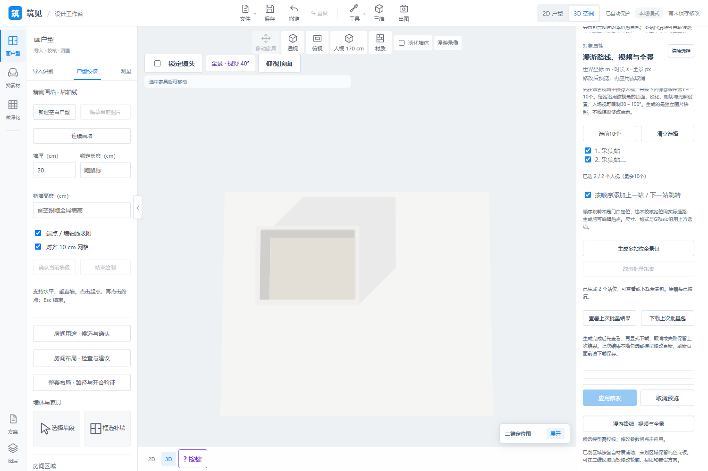

## 2026-10-30 · Entry-to-room tours, dimensions and quotes

Source [0f28b3e](https://github.com/ETET114514/GewuZhizaoNew/commit/0f28b3e043333f733bcf8c89ca6fc11f0b6eb1cf); [scope and evidence](updates-2026-10-30-design.md).

1. Author/edit wall heights, split by actual length, or use straight/arc parameter walls and basic hosted openings.
2. In 3D choose the visible tour-recording shortcut. Specify entry door/interior room/living room when classification is missing or ambiguous. Generate entry interior → living → selected rooms, or edit manual waypoints. Preview, record, inspect and download silent 720p WebM. Optional temporary door opening is restored at end/cancel. Current standing-point panorama export produces 2:1 2K/4K JPG/PNG.
3. In Plan → Measure → Dimensions, select units/automatic room or opening lines and apply display settings. Pick or drag two custom anchors; inspect associations/offsets, save, edit/hide/delete. Missing hosts are reported instead of showing stale numbers.
4. Open basic quantities/quotes, inspect each formula/source, choose one cabinet pricing basis, enter rates/loss/inclusion and export quote/board CSV. Missing/unsupported quantities stay explicit.

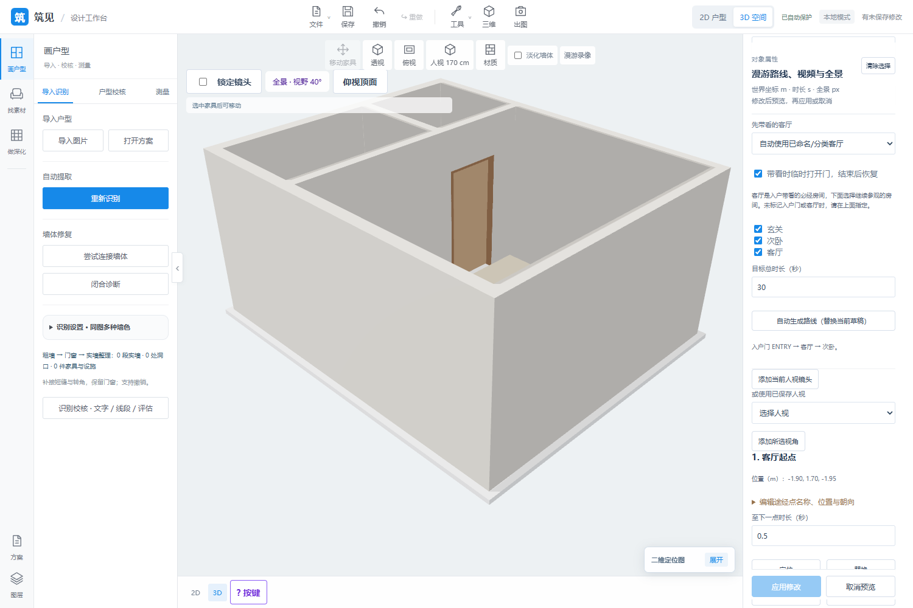

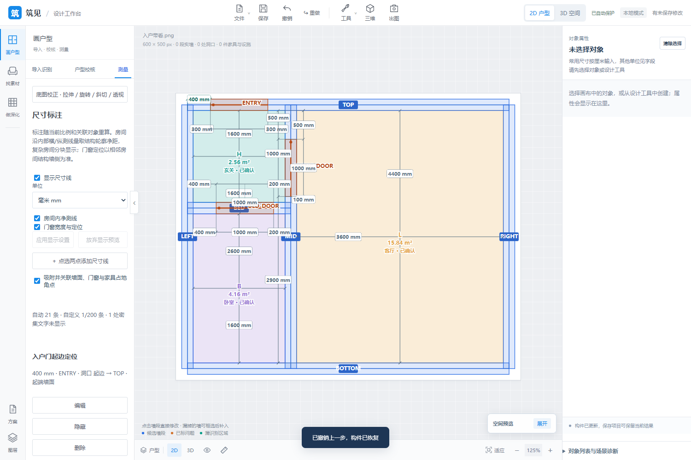

## 2026-10-30 · CAD, templates, correction and routes

Source checkpoint: [d9338b5](https://github.com/ETET114514/GewuZhizaoNew/commit/d9338b5dd8194e8acb36768fa068e6626959531e).

- Open the local plan-template library, choose one of seven skeletons, set dimensions/orientation and preview before creating. Inspect names, net areas and bounds; templates do not include complete furnishing/equipment designs.
- In DXF import, check units/layers and optionally display attached attributes, saved dimensions, fills and line styles. Use explicit centerlines or selected boundary candidates; re-preview after selecting boundary candidates. Assign separate symbol layers to doors/windows, review hosts/widths, select openings and room-name text, then confirm independent creation. Cancel keeps the source project.
- Preview stretch/rotation/shear/four-corner perspective copies, then recognize/trace/calibrate again. OCR supplies text and room-name proposals; confirm names separately, author complete annotations and evaluate. Diagnostic lines do not become editable angled walls.
- Furniture/lamp imports accept static glTF ZIP or embedded .gltf; review materials/units/orientation before applying. Automatic walking/fixed-pose carrying routes in the layout assistant only fill inputs after continuous checks; they do not turn or move objects automatically.

[Full scope, limits and evidence](updates-2026-10-30.md). Captures retain the actual Chinese interface; English labels here are translated descriptions.

## 2026-10-28 · Complete-plan and delivery workflow

Select a room → complete layout/path/motion validation → choose room/all rooms and generate → compare separate metrics → preview → apply once or cancel. Author path points on the map and verify walking/carrying with current door poses; check an opening from closed to its authored endpoint. Use project backup/import and version comparison for delivery, saved-view ZIP for images, local model organization for reuse and independent dimensions for scale checks.

See [scope, screenshots and verification](updates-2026-10-28.md).

Explore the project in the following order. All images come from the running interface or scene rendering; some 3D detail scenes demonstrate one specific feature.

2026-10-23: the top 2D/3D switch uses one workbench with five shared tool groups/property positions. 2D zoom/scroll and 3D camera state are retained separately. Preview changes, then use the bottom **Apply changes** (`应用修改`) or **Cancel preview** (`取消预览`). Esc cancels ordinary form drafts. Resolve unapplied changes before switching objects/tools. Expand auxiliary views for a small 3D preview or 2D camera map. UI labels below are translated for reference; screenshots retain the captured application interface.

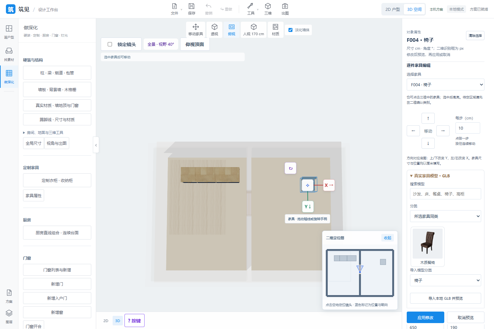

## 1. Turn a floor plan into editable objects

Import an image and inspect numbered wall, opening and furniture candidates. Select objects on the plan and edit category, dimensions or orientation on the right. Add missing objects manually.

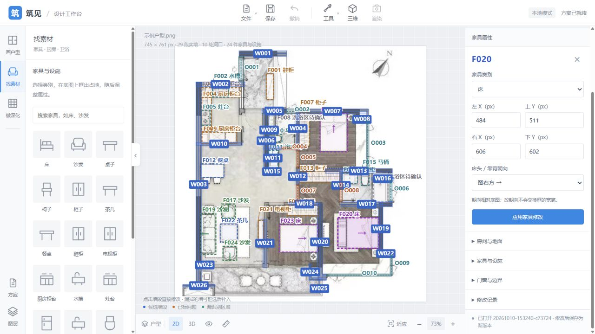

Alternatively, start with a blank canvas or calibrate an image and trace continuous orthogonal walls. Edit physical length/thickness; connected walls update together when endpoints move. Diagonal/curved walls are not implemented.

## 2. Confirm scale, room boundaries and area

Calibrate with a known length, inspect/repair boundaries and generate or draw room regions. Areas derive from valid contours and scale; users still need to review automatic regions.

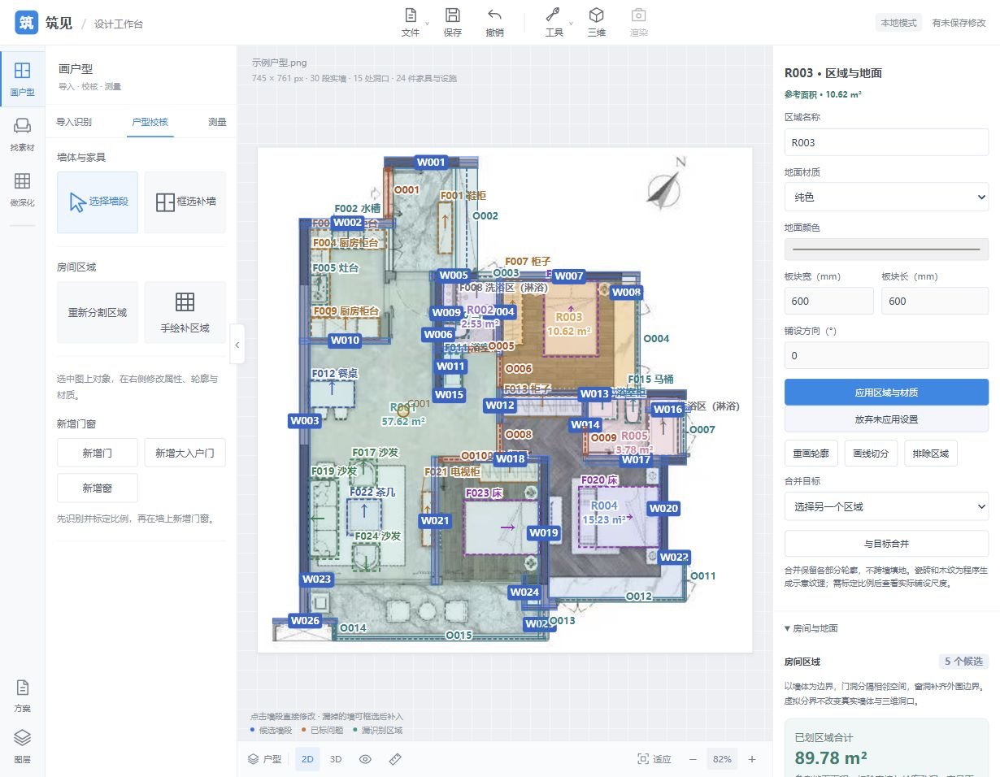

Under **Measure → Show wall lengths** (`测量 → 显示墙长`), switch between original centerlines, room-side net lengths and solid-wall net lengths, optionally filtering by room. Solid-wall measurements exclude horizontal projections of openings; unconfirmed openings withhold values. Enabling floor deductions on elements shows gross/deducted/paveable room area and restores paving after deletion or movement.

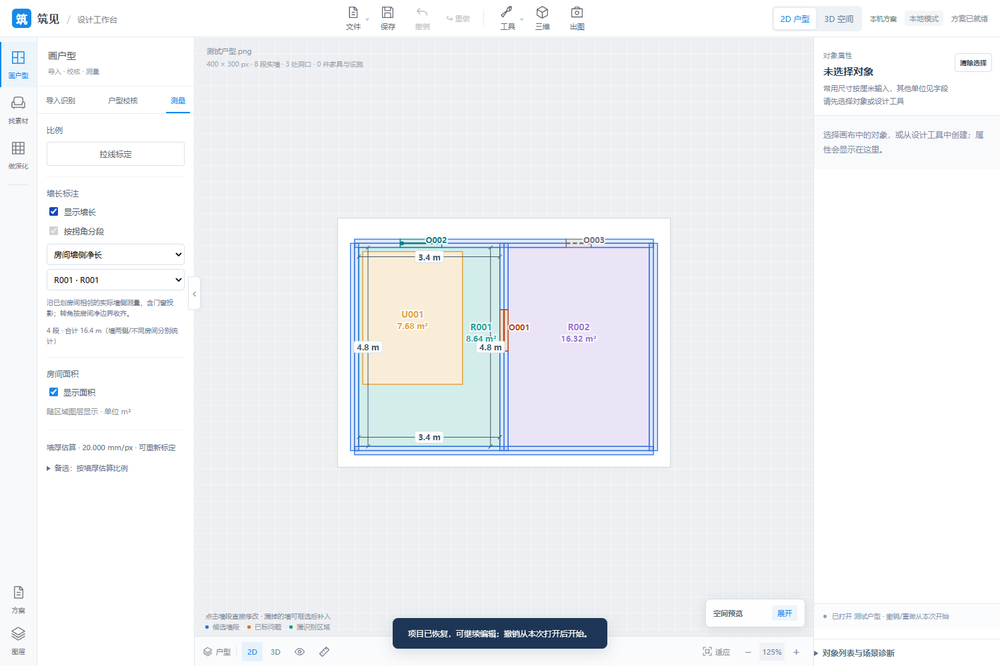

## 3. Adjust space and materials in 3D

Walls, openings, furniture and floors derive from editable data. Change views, move furniture and select a wall-side material, then preview/cancel/apply.

**Detailing → Finishes and structure → Batch materials · Room wall sides · GLB parts** (`做深化 → 硬装与结构 → 批量材质 · 房间墙侧 · GLB 部位`) lets you select locations and assign, replace by source material or restore. GLB parts support original UVs/physical projection and original-material restoration. Interior room sides clip to actual adjacency intervals; laid floors retain orientation/per-piece records. Multi-map PBR requires color; normal/roughness/metalness/AO are optional. Apply the project after import.

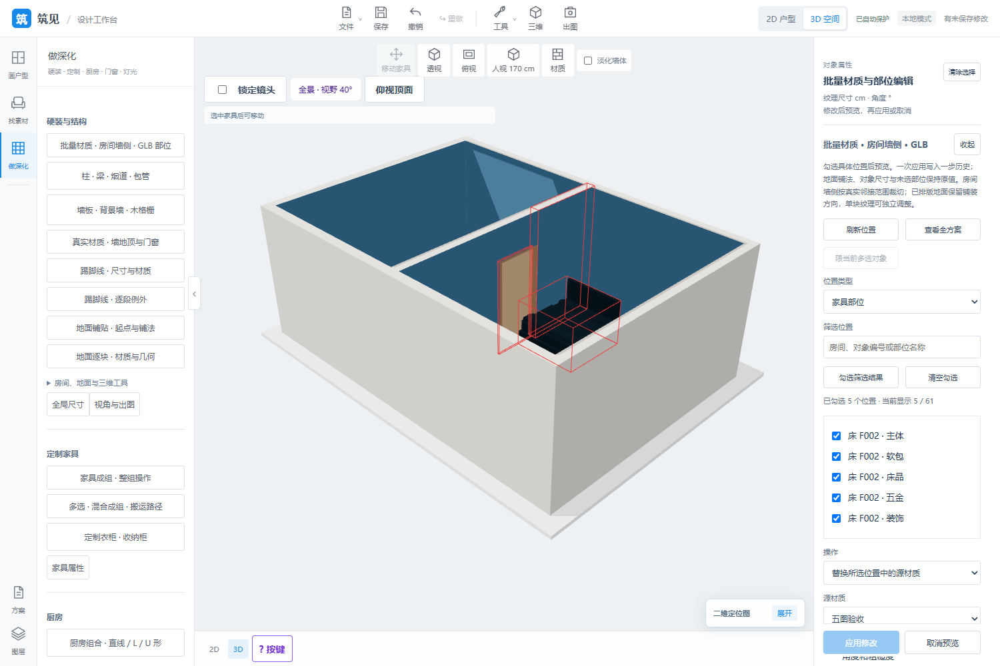

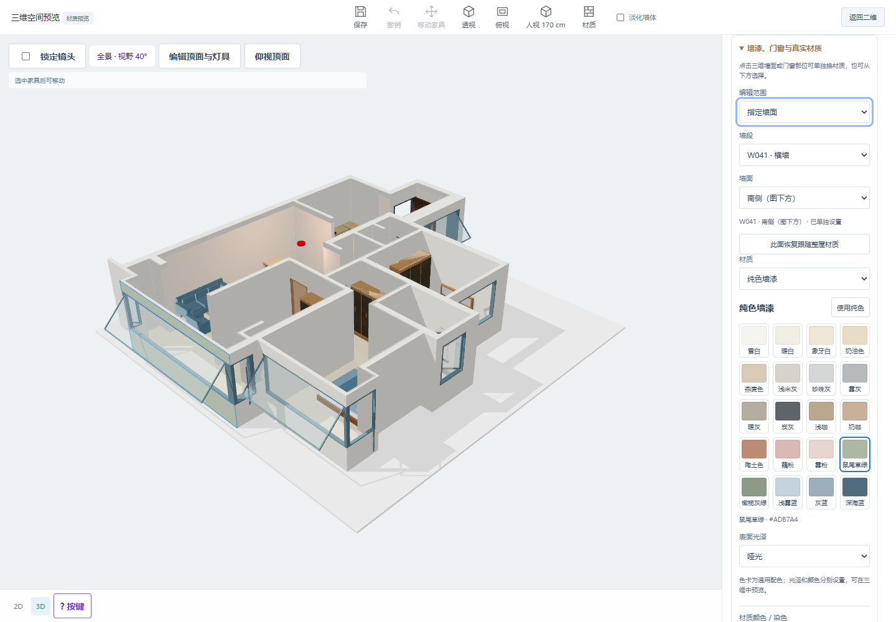

Open **Detailing → Floor laying · Origin and pattern** (`做深化 → 地面铺贴 · 起点与铺法`), select a room floor and enable piece-based layout. Set straight/half-offset/third-offset or physical herringbone, piece width/length, origin, joint width/color and direction. Use the room bounds' upper-left or center as origin. Mini/2D/3D views clip to room boundaries and holes. Coverage dimensions continue to control texture scale; layout piece counts are not procurement quantities.

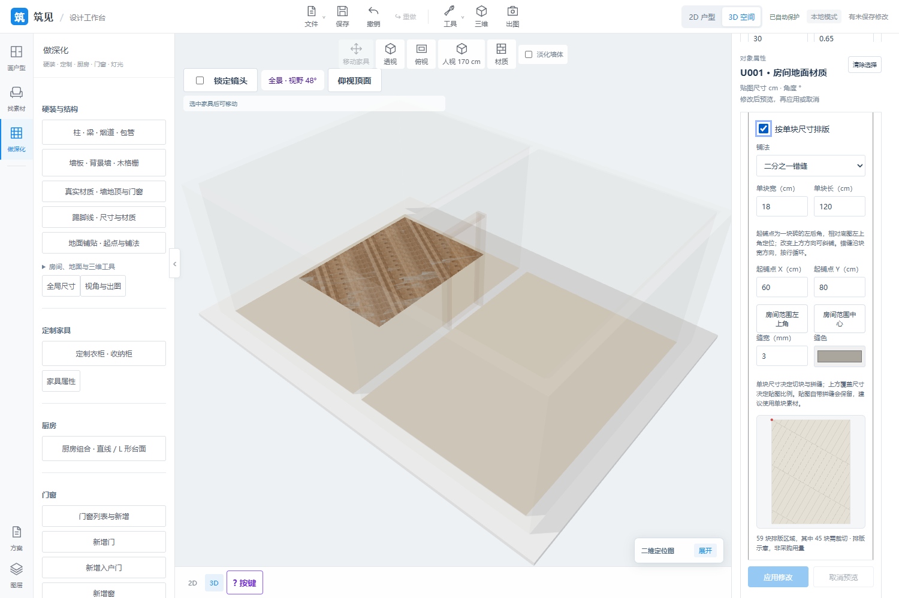

Ordinary material panels and **Individual floor pieces · Materials and hiding** (`地面逐块 · 换材质与隐藏`) accept PNG/JPG/WebP uploads, carried with the project after application. Select pieces in the main 2D canvas, mini view or 3D to change materials, hide or restore them. Herringbone offers a 15 × 60 cm / 45° example with textures following boards. Changing the grid clears old overrides; cancel/undo can restore them.

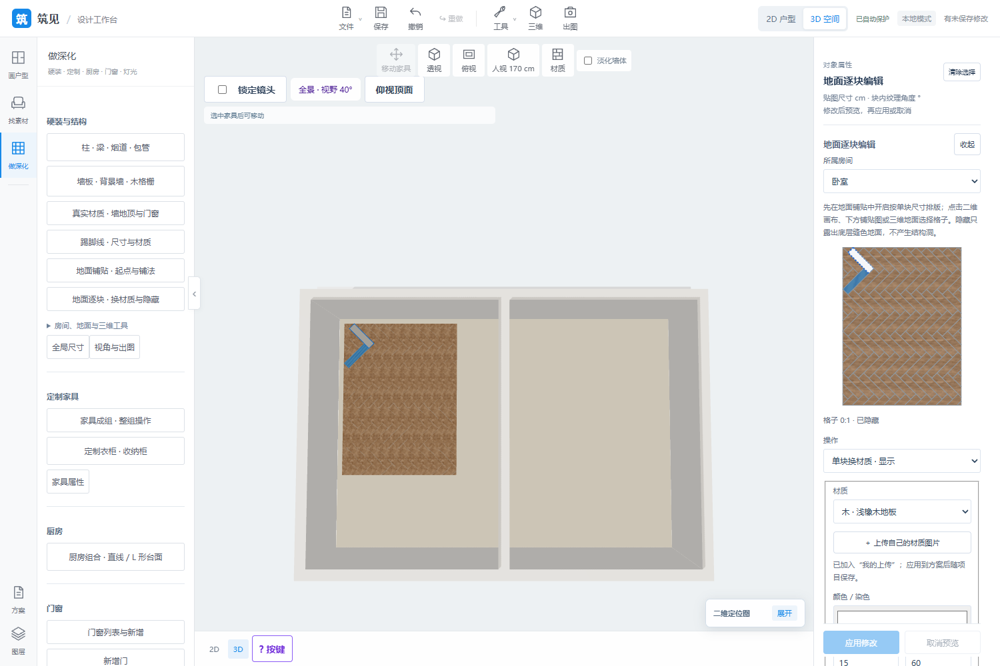

**Furniture groups · Group operations** (`家具成组 · 整组操作`) groups 2–40 objects for movement/rotation/copying. Drag the selected dashed bounds in 2D or use 3D handles. Ungrouping preserves furniture. **Multi-select · Mixed groups · Transport paths** (`多选 · 混合成组 · 搬运路径`) supports direct batch actions, mixed/nested groups, scaling and multi-segment path checks. Custom clearances are not a code-compliance review.

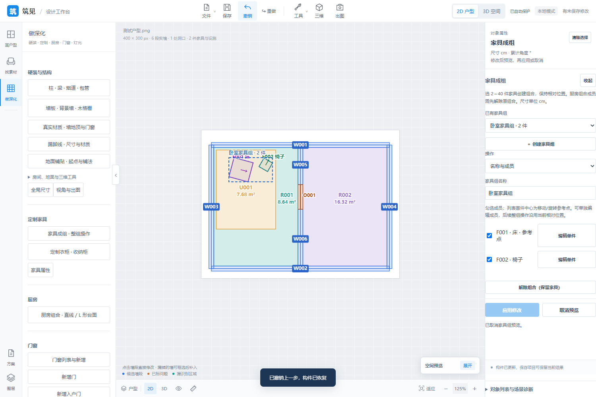

## 4. Edit door and window operation

Hinged openings, double/unequal doors and dual-track sliding share editing/persistence. Here, a moving sliding leaf passes behind the fixed leaf to free roughly half the opening.

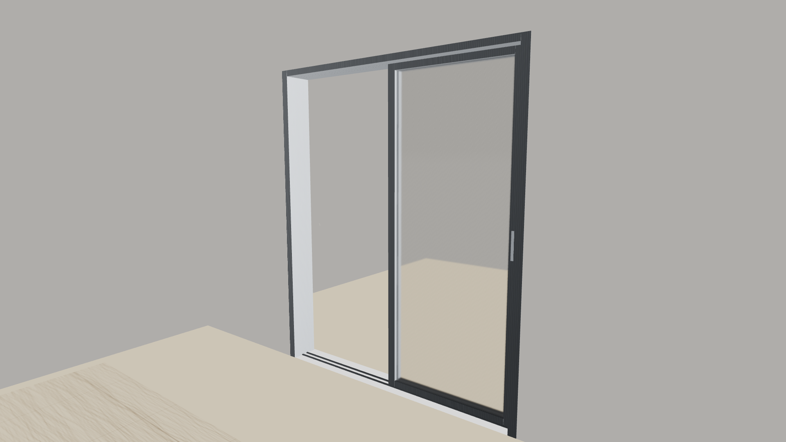

Original horizontal 2–6-leaf windows and per-leaf operation remain available. A dedicated detailing entry now adds vertical subdivisions, mullions/transoms and screens.

Opening properties include **Subdivisions · Frame profiles · Screens · Bay windows** (`分格 · 框型 · 纱窗 · 飘窗`): per-cell operation, door transoms/sidelights, actual profiles and independent screens. Rectangular three-sided bays and explicit different-height shared frames have their own constraints.

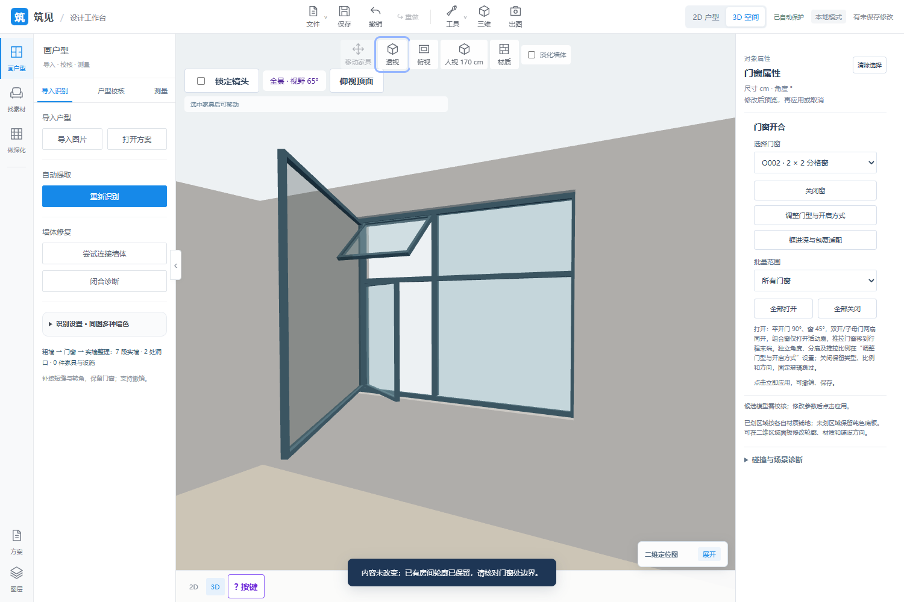

## 5. Detail walls and ceilings

Edit flat feature panels, vertical slats and room skirting: position, dimensions, thickness and materials. Finishes preserve actual door/window openings. Ceilings, dropped ceilings and coves also accept actual materials.

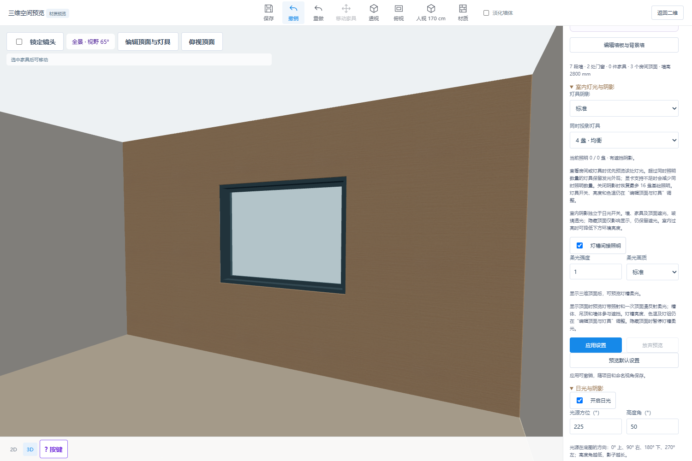

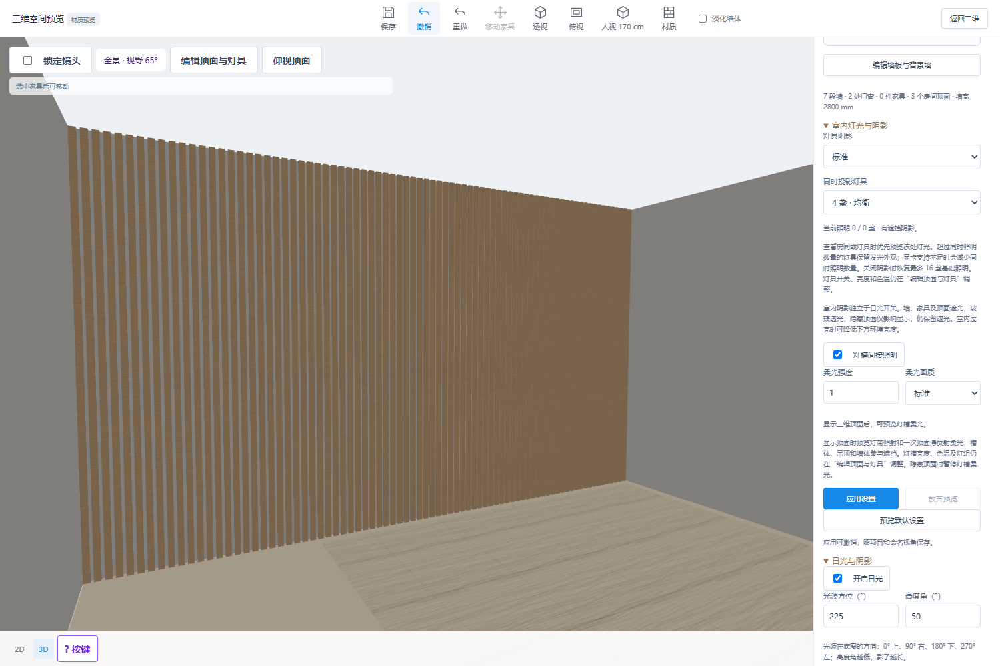

Flat panels support regular seams. Both flat/slatted finishes accept perimeter rectangular trim and independent materials while preserving openings.

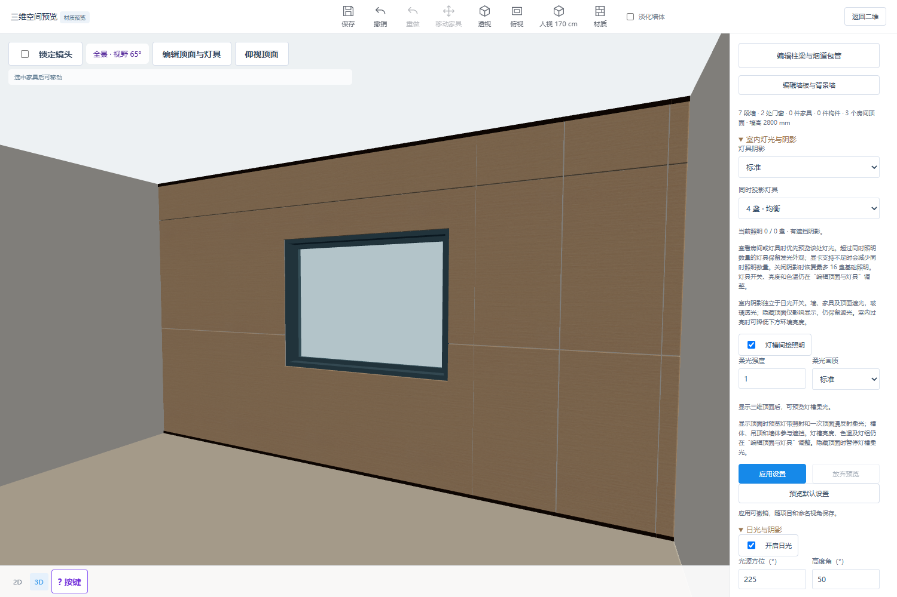

Place single-floor columns, beams, flues and pipe enclosures in 2D and edit dimensions, height, elevation and materials. Optional floor-contact deductions affect paving/paveable area while preserving contours/regions and leaving the structural floor uncut. Flues/enclosures still represent external occupancy envelopes.

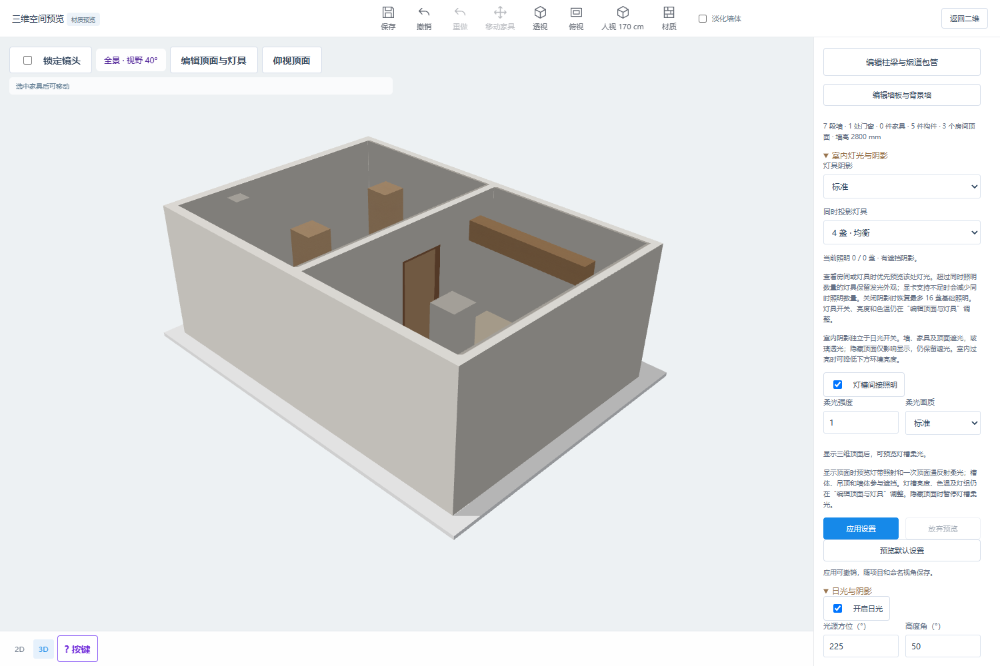

Panel seams use wall-segment/floor positioning or nonuniform horizontal/vertical lines. Perimeter/opening edges have separate rectangular dimensions/materials; a specific opening inherits direction defaults. Enable reveals and set depth/board thickness; doors/full-height windows have no bottom strip. Select a 2D opening and expand **Frame · Depth and reveal fitting** (`门窗框 · 进深与包覆适配`), or use the 3D **Frame depth and reveal fitting** (`框进深与包覆适配`) shortcut to the same form, then preview/apply. The initial version covered ordinary single-leaf openings within one wall segment; special/irregular types and element-geometry integration were pending at that stage. Consult the current feature list for expanded fitting support.

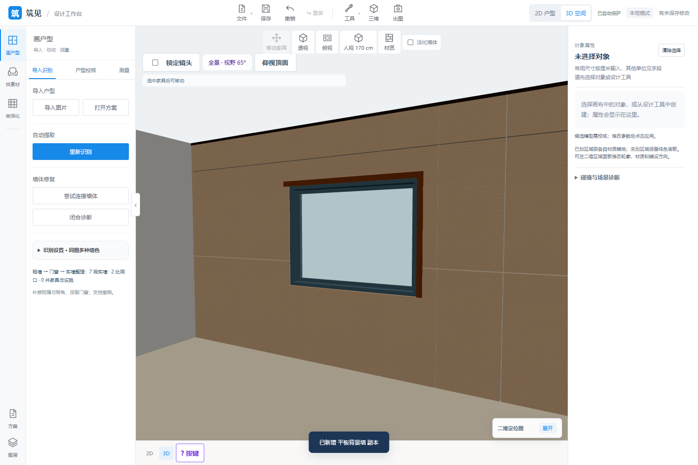

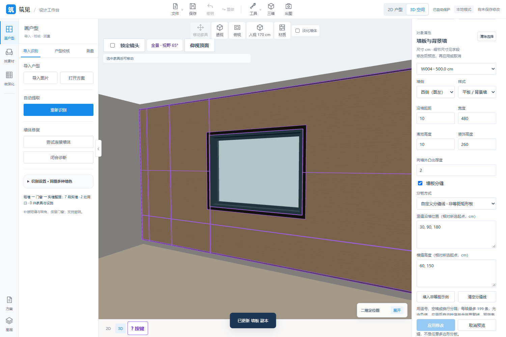

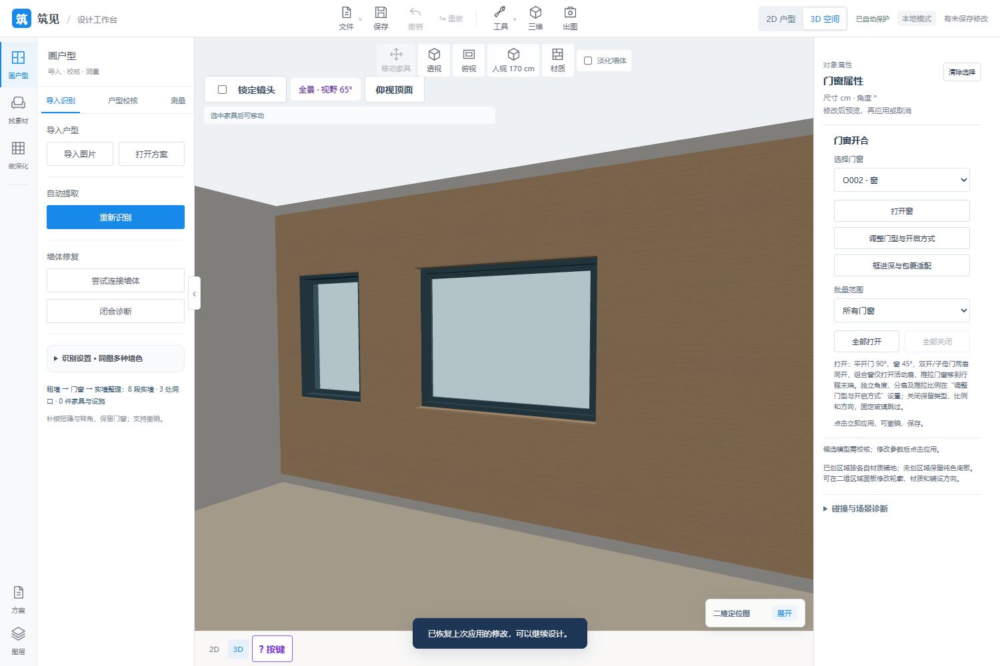

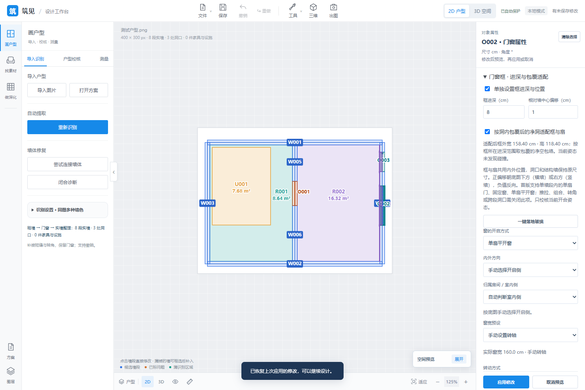

The upload library supports search, renaming and deletion of unused entries, protecting saved/recovery/history references. Wall panels, elements, kitchen worktops and procedural furniture/custom cabinet parts have direct uploads. Five-map PBR, OpenGL/DirectX normals, batch naming/removal and unreferenced-cache checks/cleanup are now supported.

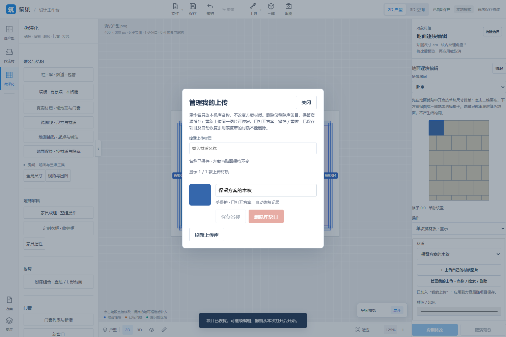

### P35 curves, rails and section inspection

Open **Detailing → Ceilings and lights → Ceilings, dropped ceilings and fixtures** (`做深化 → 顶面与灯光 → 顶面、吊顶与灯具`). Edit per-face materials, lamp parts or actual local GLBs. Expand **Free curves and double-curvature surfaces** for cubic handles and a 4 × 4 height grid; use **Variable profiles** for matching cross-sections along the contour. Preview first, then apply to create one undo step.

Choose a polyline, arc or cubic rail, place attached fixtures and apply motion settings before opening motion preview. Play/pause/seek use the current lighting and collision; stop restores the applied position. Enable section caps, rotate the main plane or add planes to inspect closed solids while preserving holes. Named views and export keep the visible inspection settings/frame.

Import an actual lamp GLB before entering brand/series/SKU/tags/product links in the local library. Search/filter, apply to the current fixture or import/export its hash-bound catalog. **An external online vendor service is not connected.** See [scope, limits and verification](updates-2026-10-27-p35.md).

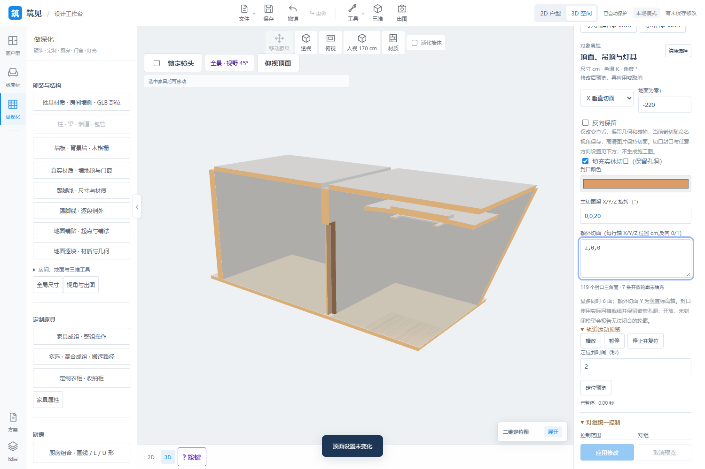

## 6. Design custom cabinetry and straight/L/U kitchens

Wardrobes/storage offer editable boards, compartments, shelves, rails, internal drawers and doors. Each compartment's doors/drawers operate independently and carry materials with them. Internal drawers require doors open to 90°; current poses participate in collision/walking.

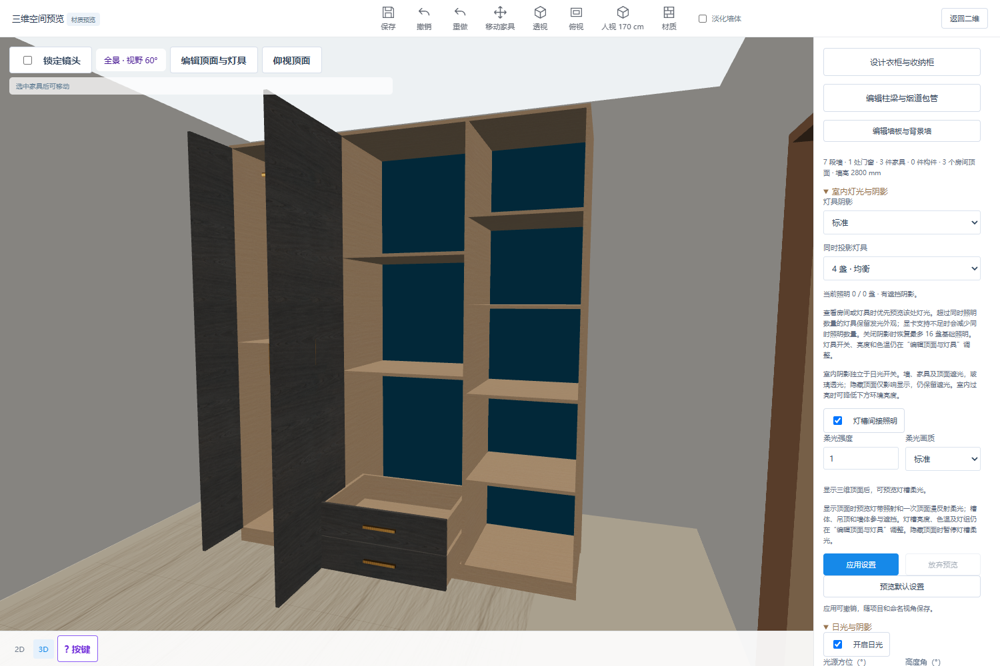

Kitchen base/wall presets align same-type cabinets with matching depth/height/elevation in list order. The first cabinet anchors the run and orientation is orthogonal. Base cabinets can share one independent-material worktop with adjustable thickness/overhang. Moving one cabinet out of alignment pauses the worktop and requests realignment. Ungrouping preserves cabinets.

For an existing valid group, choose whole-group move/right-angle rotation or copy under **Operation** (`操作`). Enter the first cabinet center in X/Y centimeters and 0/90/180/270°, preview, then apply. Cabinets/worktops follow together; independent copies retain structure, materials and operation with new IDs. Bounds/budget failures leave no partial moves/copies; realign invalid groups first.

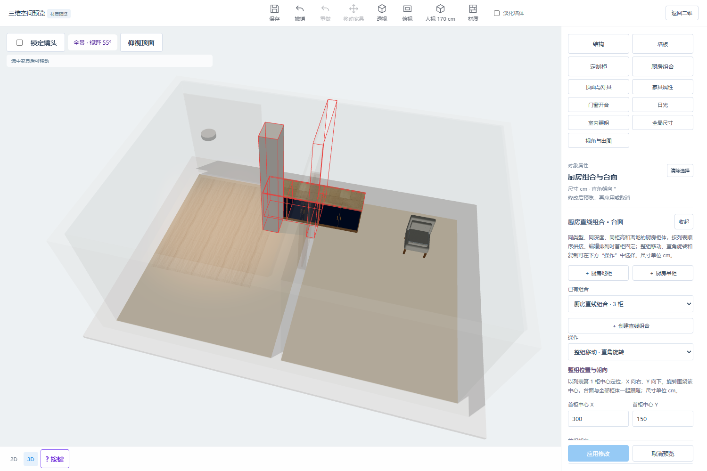

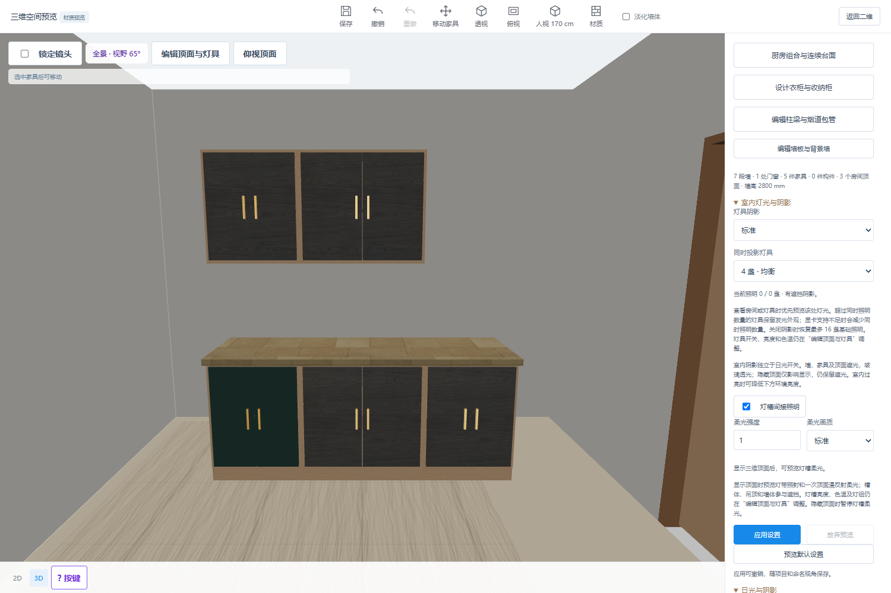

For an L-shaped kitchen, prepare main-run base cabinets, one left/right blind-corner cabinet and return cabinets. Add them in that order under **Kitchen groups · Straight/L worktops** (`厨房组合 · 直线 / L 形台面`). The corner cannot be first/last; depth/height/elevation must match. Applying creates a continuous L worktop. The blind panel is fixed while the operable zone retains compartments, doors and drawers. Numeric/canvas controls move, right-angle rotate and independently copy the group. One gesture is one undo step; Esc restores the prior state.

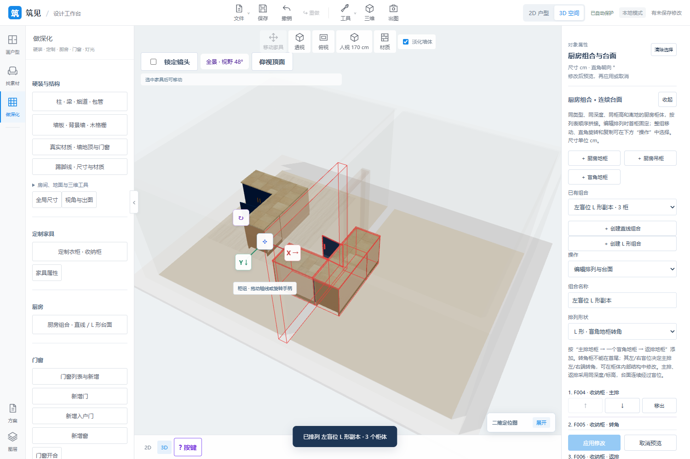

Under **Sink/hob and holes** (`水槽 / 灶具与开孔`), add equipment to an ordinary base cabinet and set hole dimensions, lateral/front-back offsets and inset depth. Worktop/top-panel geometry avoids the hole; equipment follows group movement/rotation/copying. Conflicts with structure/drawer envelopes reject application; adjust compartments/shelves before previewing again.

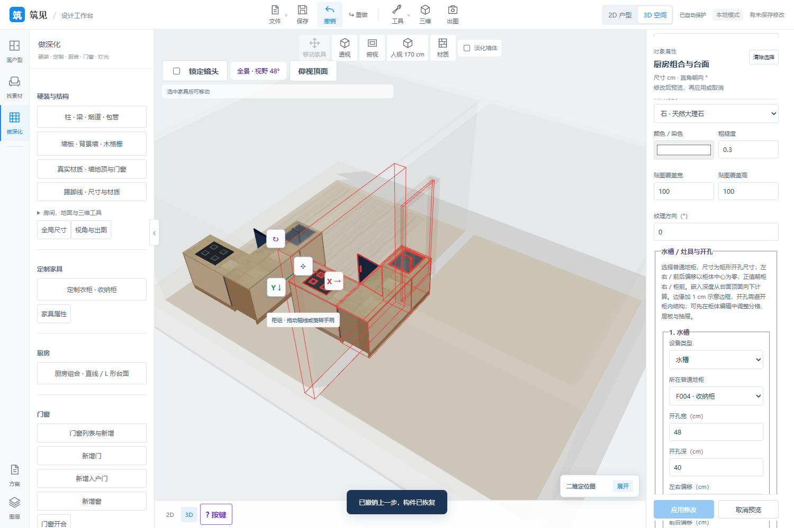

Red boxes in the historical L-shaped screenshots are current-pose collision aids in an isolated scene. Equipment holes/group scope follow the latest update. Product equipment, further corner mechanisms, board schedules and custom drawings remain pending.

The current round supports L-shaped wall cabinets/U-shaped matching base/wall groups and continuous base worktops, circular/rounded holes, blind corners and equipment holes across two or three adjacent cabinets in a run. Holes around turns, further mechanisms and product equipment remain pending.

## 7. Inspect daylight and interior lighting

Adjust daylight direction, brightness and shadows, or edit fixtures, light groups and coves. Daylight direction is relative to the plan; coves use one diffuse-bounce approximation.

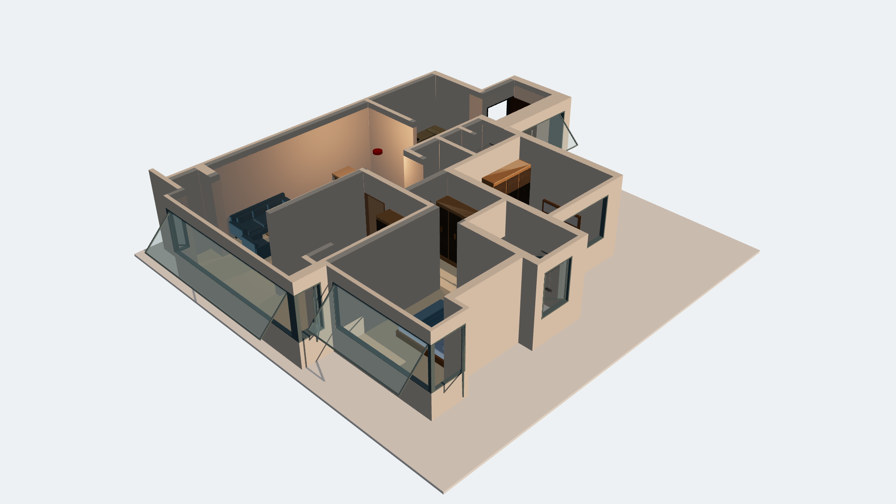

## 8. Save, recover and export images

Name projects and find them through thumbnails/search; undo/redo is supported. Every applied change autosaves locally and can recover after refresh/service restart. Unapplied forms are excluded; undo history restarts between sessions. Manual saves create independent versions.

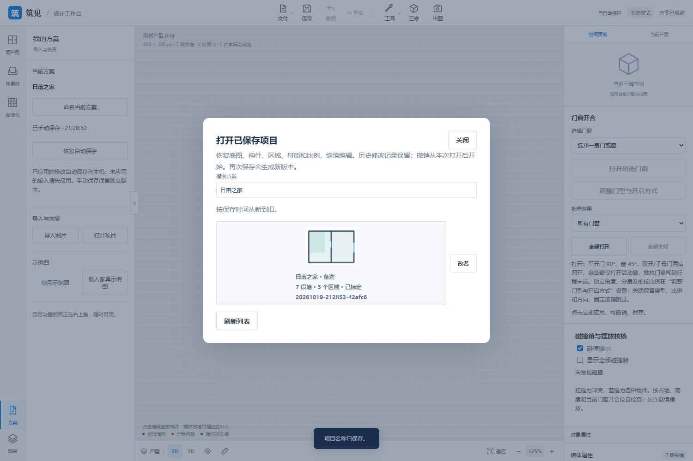

Save common camera positions as named views. JPG/PNG image output supports longest edges of 1920, 2560 or 3840 pixels.

The Showcase currently offers static screenshots; no demo video or public online trial has been published. Browsing this repository does not run the private application.

[Back to project home](../README.md)
