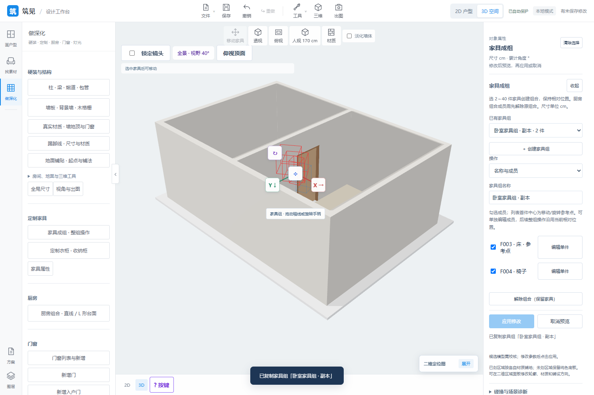

# 2026-10-24 更新概要

[English](updates-2026-10-24.md) | **中文**

- **P23 真实人字拼**：矩形板正交交错，凹形/孔洞/分离区域裁切，板宽长/整体方向/起点/缝宽及逐板纹理可调。
- **P23 地面逐块编辑**：二维主画布/小图和三维选块，独立材质（含上传）/纹理、隐藏及此块/全部恢复默认。
- **P18 上传颜色贴图**：PNG/JPG/WebP，应用后资源随项目及自动恢复保存、校验并恢复丢失缓存。
- **P16 家具成组**：2～40 件建组/改名/成员/解除、整组移动/任意旋转/独立复制、三维手柄和二维直接拖动、吸附/间距。
- **P23 洞边包口与逐边收边**：外周四边开关、门窗外缘包口/逐洞四边覆盖、独立尺寸材质，跟随洞口编辑裁切。

对应 New 完整代码提交：[544714f](https://github.com/ETET114514/GewuZhizaoNew/commit/544714f145bec6094d7a9b3ed4ac20582f59d265)。最新人字拼轮次 **252 项 Node、68 项相关 Python、新浏览器及原铺贴回归通过**；推送前另有 34 项家具/厨房 Python 回归通过。测试数不跨轮次相加，范围见[功能与当前边界](features.zh-CN.md)。

| 真实人字拼与逐板选择 | 家具成组与操纵器 |
| --- | --- |
|  |  |

*隔离验收场景。蓝板使用自制上传条纹图，空缺展示隐藏操作，不表示结构开洞或完成的装修方案。颜色上传不自动生成法线/粗糙度图；鱼骨/复杂拼花、嵌套/混合成组及洞内进深包覆仍待做。*

## 已设想、未实现

- P18：多图 PBR、上传库重命名/删除、其他专用面板入口、任意 GLB 网格编辑及更多批量替换。当前仅不透明颜色图，输入最多 12 MB/1600 万像素，最长边 2048，透明铺白。
- P23：鱼骨/复杂拼花、逐块自由移动/缩放/真正几何删除、洞内进深包覆/逐边不同截面材质、异形背景墙、采购损耗与施工图。人字拼板长大于板宽，不要求整数倍；候选上限每房间 6000/全项目 24000，逐块例外每房间 1000。
- P16：嵌套/混合对象成组、框选多选、完整搬运路径；最多 50 组，每件仅属一个通用组或厨房组，厨房组任意角度仍待做。
- 包口是洞外缘墙面装饰条，不占洞口净尺寸，门洞和落地窗无底边；当前并非洞内进深包覆。
- 图纸/模型交换继续后排。其余见[功能边界](features.zh-CN.md)，本轮不代表 P18/P23 整项规划完成。

## 验证范围

| 轮次 | 已通过记录 |
| --- | --- |
| 最新人字拼 | 252 项 Node、68 项相关 Python；任意比例/负编号/多方向、无重叠铺满与孔洞裁切、逐板 UV、前后端预算/编号/独立多边形并集面积一致；新浏览器及原铺贴回归 |
| 上传/逐块编辑 | 当轮 248 项 Node、64 项相关 Python；图片规范化/去重/透明铺白、缺失缓存恢复/损坏拒绝；新功能、原材质、原铺贴和工作台四组浏览器 |
| 家具组/二维拖动 | 成组当轮 243 项 Node、51 项相关 Python；拖动轮次 245 项 Node、51 项相关 Python；新增及工作台浏览器，含取消/失焦/捕获丢失/无移动/越界/失败恢复 |
| 洞边包口 | 当轮 241 项 Node、61 项相关 Python；四墙侧、洞口联动/覆盖/实际实墙裁切；新功能及原收边浏览器 |
| 推送前补查 | 34 项家具组、复制/模型、厨房柜组和单柜相关 Python |

测试数量按轮次记录，不累加成独立总数。浏览器采用本机 Edge 无头与 SwiftShader，覆盖实际操作、保存重开/刷新恢复、390 px、3840 × 2160 JPG 及相机恢复；不是所有识别样本重测或真实显卡性能结论。修复了应用/撤销后的选择丢失、迟到预览取消、提交失败恢复、地面闪烁及选框三角内边。

历史记录见 [2026-10-23](updates-2026-10-23.zh-CN.md)。源码基线完整提交号：544714f145bec6094d7a9b3ed4ac20582f59d265。

[返回项目首页](../README.zh-CN.md)
