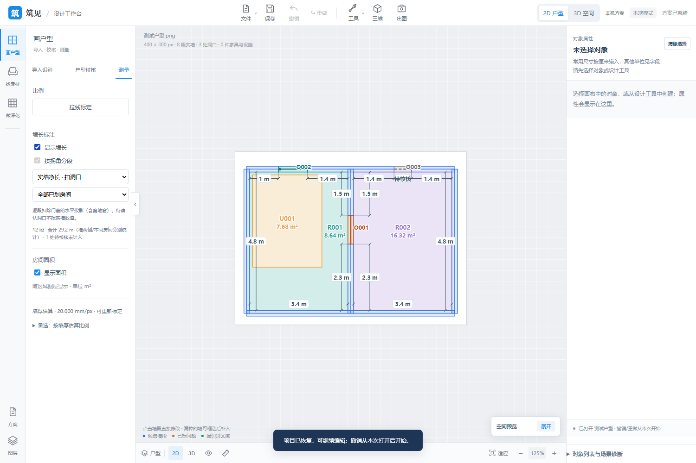
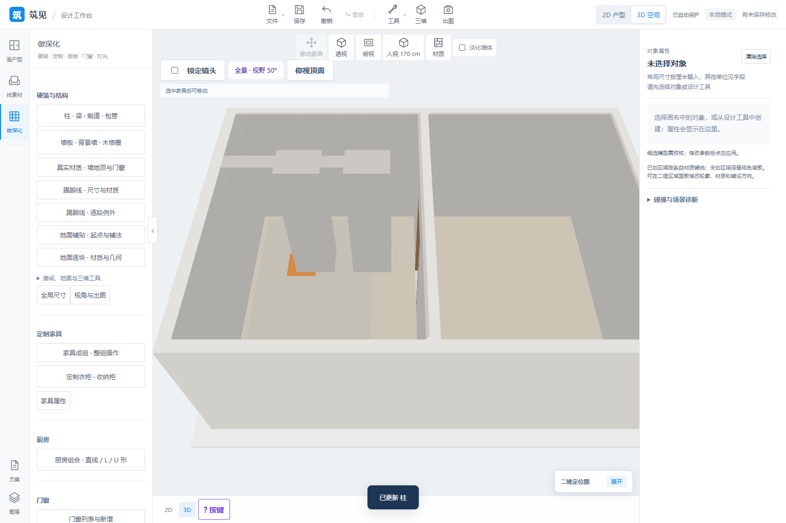
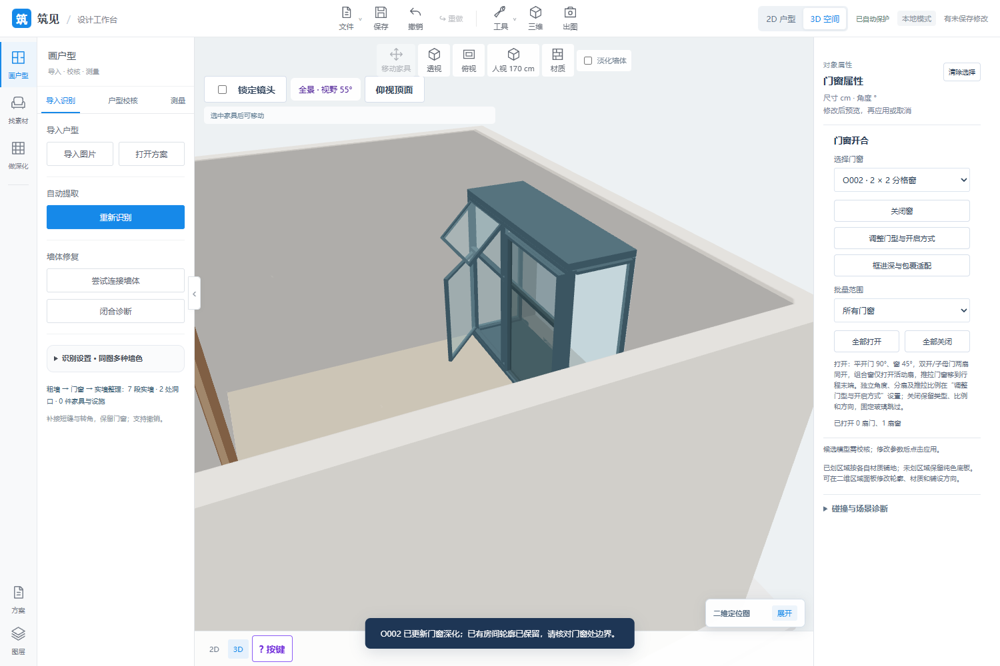
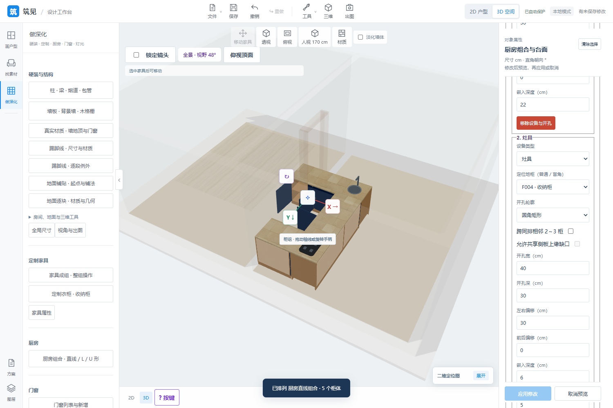
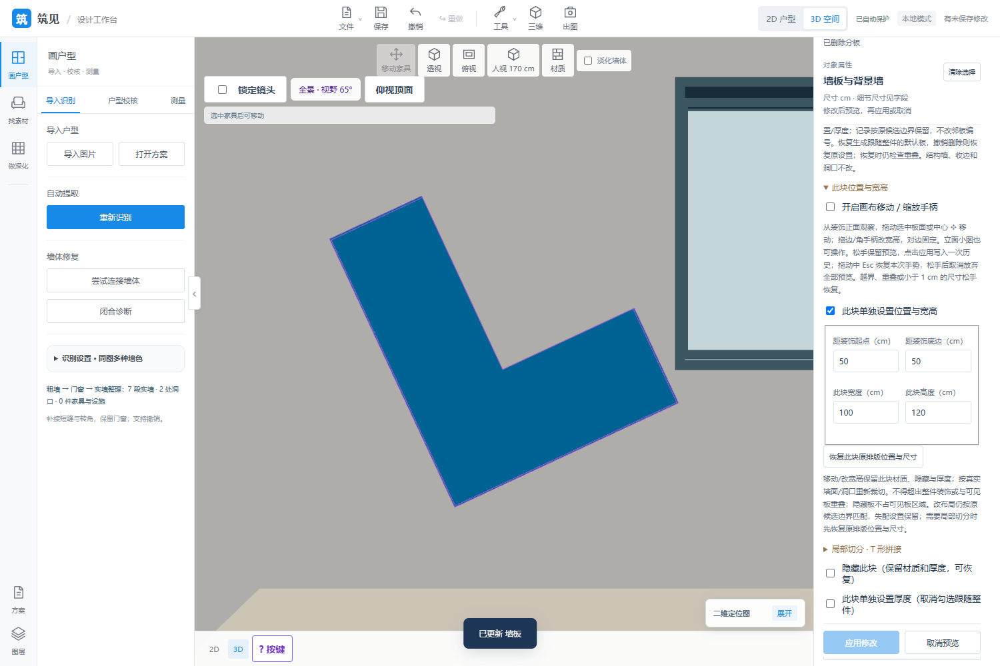

# 2026-10-26 更新概要

[English](updates-2026-10-26.md) | **中文**

完整代码基线：[35d29cd](https://github.com/ETET114514/GewuZhizaoNew/commit/35d29cd8116dca7402186e52930fd6feaa976912)，完整提交号 `35d29cd8116dca7402186e52930fd6feaa976912`。汇总上次推送 `3d812a2` 之后的开发。New 已先推送并核对远端；Showcase 仅发布概要、边界和运行截图。

## 已有功能

- **P13 N01～N03**：保留已存在的轴线/拐角分段，补充房间墙侧净长、扣门窗水平投影的逐段实墙净长、房间筛选及待确认缺口不报确定数值；切换查看口径不写文档或历史。
- **P22 E01～E03**：可选触地构件扣铺装/可铺面积，重叠并集与跨房间分摊；显示原/扣除/可铺面积，原轮廓和逐块记录保留，移动/复制/停用/删除后恢复；构件连续编辑保留属性。
- **P25 D01～D03**：真实行列分格/横竖梃与逐格开合、门上亮/侧亮；平/阶梯/斜面框截面及独立纱窗；矩形三面飘窗、明确共线/正交异高连接与保留实墙的阶差边框。
- **P24 本轮三组**：L 形吊柜/左右盲角吊柜、U 形地柜/吊柜及连续凹形地柜台面；矩形/圆形/圆角设备孔与仅开孔，普通/盲角及同排相邻 2～3 柜、显式共享侧板缺口和参与柜内部净空校核。
- **P23 C01～C08**：自由直缝/简单多边形分板与墙地面单块几何/地面手柄；组合背景墙/层次/嵌灯、实际收边截面/逐边包覆与当前库框适配；更多真实铺法/重复拼花、自定义踢脚线截面与柜体当前占用裁断。清单约定范围收尾。

P13 原轴线标注已经存在，本轮只补净长口径。P23 仅按 C01～C08 已选类型收尾；其他编号完成本轮不等于所有额外设想均实现。

## 已设想、未实现

施工尺寸体系/饰面完成面净距、成套施工图、模型/CAD 导出和报价；旋转/异形结构构件及自动改墙/洞口/分区、多层/楼梯；商品门窗框型/五金、非矩形飘窗、折叠/入墙/多轨联动与完整运动路径；跨转弯/超过三柜/自由多边形设备孔、更多厨房机构/商品设备和清单图纸；曲线墙板/型材、额外商品安装节点等仍按功能清单保留。P20 导出继续后排。

其余材质多图、模型兼容、云协作、专业仿真和生成式设计见[当前边界](features.zh-CN.md)。

## 验证结果

| 范围 | 结果 |
| --- | --- |
| 发布前全量 Node | 407 项通过；P13 包含原 7 项轴线与新增 8 项净长测试。 |
| 发布前全量 Python | 480 项通过，完整发现运行 510.763 秒，覆盖当前完整代码及前几轮修改。 |
| 本轮 P13 浏览器 | 轴线/净长/房间筛选、未知缺口、查看不写历史、门窗改宽、撤销重做、重标定、保存重开与 390 px 通过。 |
| P22 同日分轮 | 399 Node/68 相关 Python，新浏览器及原构件/P23 铺法两组回归通过，含覆盖恢复、原轮廓/逐块身份、窄屏/4K。 |
| P25 同日分轮 | 391 Node/73 相关 Python，新浏览器及原框适配/P23 共框两组回归通过，含真实截面/纱网/飘窗和恢复/出图。 |
| P24、P23 同日分轮 | 厨房与 C01～C08 各组已在开发轮次验收；不是本次重新跑全部浏览器，测试数不跨轮次相加。 |

完整范围与证据见 [New 发布说明](https://github.com/ETET114514/GewuZhizaoNew/blob/35d29cd8116dca7402186e52930fd6feaa976912/RELEASE_2026-10-26.md)。

## 运行截图

上述均为隔离验收场景的实际界面，不代表施工图、商品认证节点或离线写实渲染。

[返回项目首页](../README.zh-CN.md)
