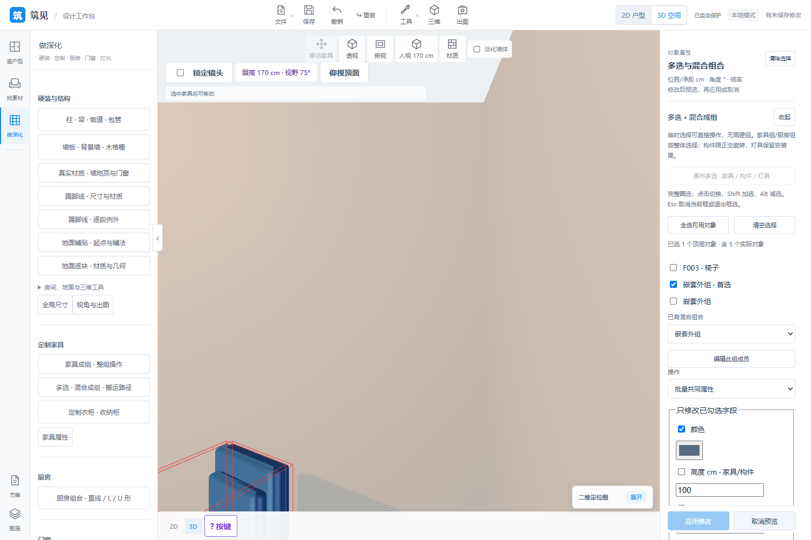
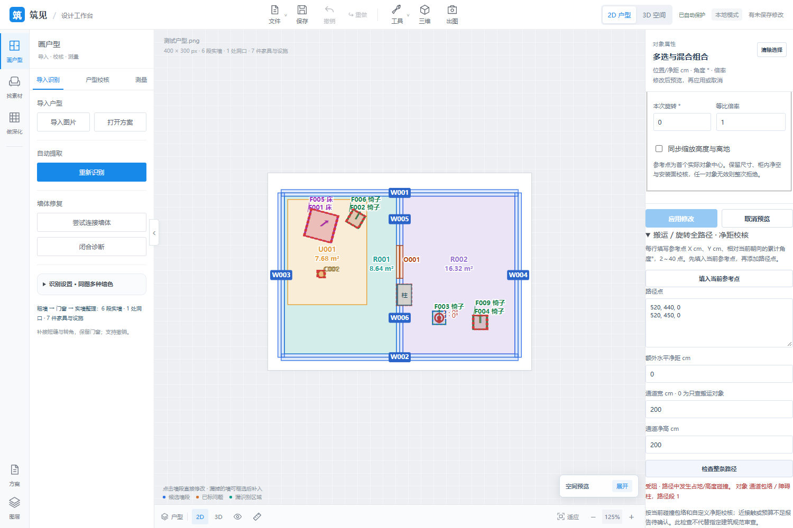

# Update summary · 2026-10-27

**English** | [中文](updates-2026-10-27.zh-CN.md)

Full code baseline: [2164415](https://github.com/ETET114514/GewuZhizaoNew/commit/2164415b7f8e8bac992c975a2a999f243312171f), full SHA `2164415b7f8e8bac992c975a2a999f243312171f`. Covers P16/P18 development after `35d29cd`. New was published and its remote verified first. This repository continues to publish only summaries, limitations and actual application screenshots.

## Implemented capabilities

| Scope | Implemented |
| --- | --- |
| P16 temporary selection | Box/click selection of furniture, independent elements and lights; Shift adds, Alt removes; move/rotate/copy/delete without first creating a group |
| P16 mixed/nested objects | Mixed/nested groups, names/member editing, ungroup/delete; independent copied objects with tree references rebound and host constraints preserved |
| P16 editing/paths | Proportional footprint scaling/optional height synchronization, shared/type-specific batch properties, individual 2D rotation, rectangular fitting at any angle, multi-segment translation/rotation and custom passage-clearance checks |
| P18 five-map PBR | Color, normal, roughness, metalness, AO; OpenGL/DirectX normals; lossless data maps, set validation and content deduplication |
| P18 GLB parts | Stable source node/mesh/primitive selection, original UV/physical-size projection, original-material restoration and model-content fingerprints isolating replacements |
| P18 room wall sides | Automatic actual adjacency, local clipping across rooms on the same side, preserving openings/corners; explicit single-side/whole-wall/restoration rules |
| P18 batch materials | Location lists, type/name filters and P16 selected-object scope; assignment, source-material replacement, retained location parameters and restoration; stale project versions reject application |
| P18 library/cache | Multi-select, prefix/suffix renaming, batch removal, cache usage/protection reasons and fresh checks of current project/history/saves/recovery/previews before cleanup |
| Editing/portability | Preview/cancel/Esc, one history entry per application, atomic failures and unchanged-edit redo retention; five maps/GLB parts carried with save/recovery/copy; legacy color-only compatibility |

Additional checks fixed the risk of batch materials changing floor-layout direction or clearing per-piece records. Cell identity/layout remain intact; individual texture angles remain independently editable. System-locked cache files stay hidden with a retry entry. Cleanup rejects links and out-of-root paths.

## Planned scope and current constraints

P16 is complete for the user-confirmed furniture, independent elements and lights. Structural elements/kitchens remain orthogonal; lights retain host mounting surfaces. Paths use existing collision envelopes and custom horizontal clearances/passage headroom. They do not infer product internal cavities, cover lifting/tilting/mechanism deformation or certify a particular building code. Arbitrary-angle kitchens/additional product mechanisms are separate scope.

P18 M01–M08 is complete. Each map is limited to 12 MB/16 million pixels, each set to 48 MB, normalized longest edge 2048. Color becomes opaque JPEG with transparency flattened white; data maps use PNG. Color is required, the other four channels optional. No map generation, transparency/displacement/height maps, mesh modeling or skeletal animation. Product light models/appearance belong to P35; cloud asset sync is separate scope.

One batch supports 500 material locations and one GLB up to 512 editable parts; split larger operations into batches. Overlapping room contours require review; ambiguous ownership falls back with a notice. Whole-wall, specified side and room-side operations remain distinct to clarify overrides. Cache cleanup removes only assets removed from the library without retained references. Unverifiable records block deletion. Library actions do not alter projects/history.

After scoped P23/P16/P18 completion, 20 directions retain future work: 12 have main workflows; eight lack stated target workflows. These figures are not completion percentages. Model/CAD export, construction drawings, pricing, cloud collaboration and generative design remain in [current limitations](features.md).

## Verification results

| Scope | Result |
| --- | --- |
| Latest full Node suite | 427 passed, including room-side clipped-area conservation, vertical sides, ambiguous fallback and existing wall/furniture/collision regressions |
| Latest full Python snapshot | 495 passed, full discovery in 683.140 seconds |
| P18 final targeted verification | 48 passed, including 13 P18 tests; four boundary tests were added after the full snapshot and verified here, not included in the 495 |
| Final cache verification | 23 passed for final link rejection, asset protection and locked-file retries |
| New P18 browser | Five-map decoding on separate GLB meshes, frontend/backend part IDs, restore/undo/redo, room sides, cross-object replacements, library batch rename/remove/cleanup, failure/Esc, save/recovery, 390 px and 3840 × 2160 output/camera restoration; zero page exceptions |
| Existing browser workflows | Ordinary materials, uploads, GLB library and single-side wall paint passed; zero page exceptions |
| P16 round record | 422 Node/486 Python, new browser and existing groups/kitchens/cabinetry/GLB regressions; 2D/3D, temporary selection/mixed/nested groups, scaling/copying, paths, persistence/recovery, 390 px and 4K. This retains P16's own record and is not claimed as a fresh rerun |

Test sets overlap and are not added. Full scope/evidence: [P16 completion](https://github.com/ETET114514/GewuZhizaoNew/blob/2164415b7f8e8bac992c975a2a999f243312171f/P16_COMPLETION.md), [P18 completion](https://github.com/ETET114514/GewuZhizaoNew/blob/2164415b7f8e8bac992c975a2a999f243312171f/P18_COMPLETION.md), [P18 acceptance record](https://github.com/ETET114514/GewuZhizaoNew/blob/2164415b7f8e8bac992c975a2a999f243312171f/wall-recognition/output/p18-closeout/README.md).

## Actual screenshots

Actual isolated acceptance scenes; red boxes are collision aids. They do not represent complete designs, construction drawings or offline photorealistic rendering.

[Back to project home](../README.md)
