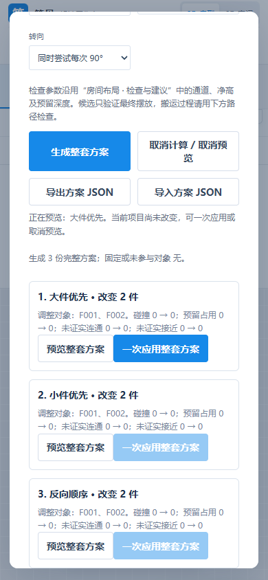
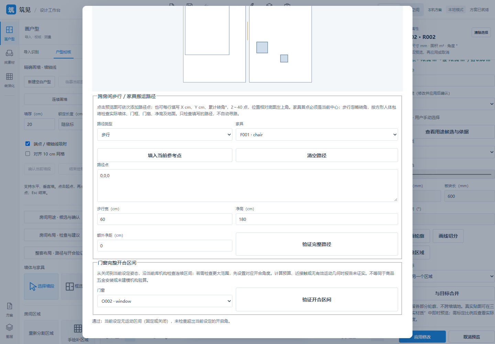
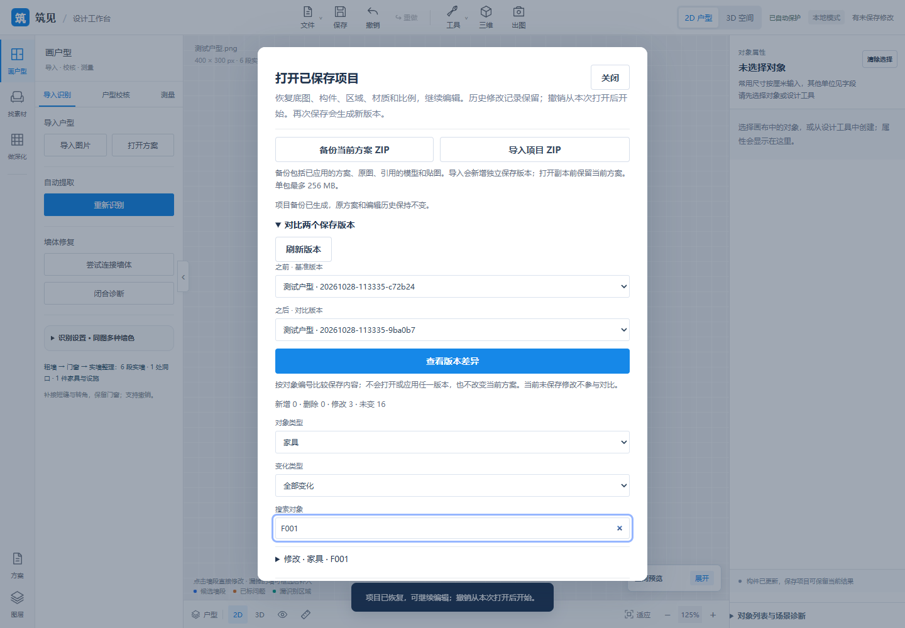
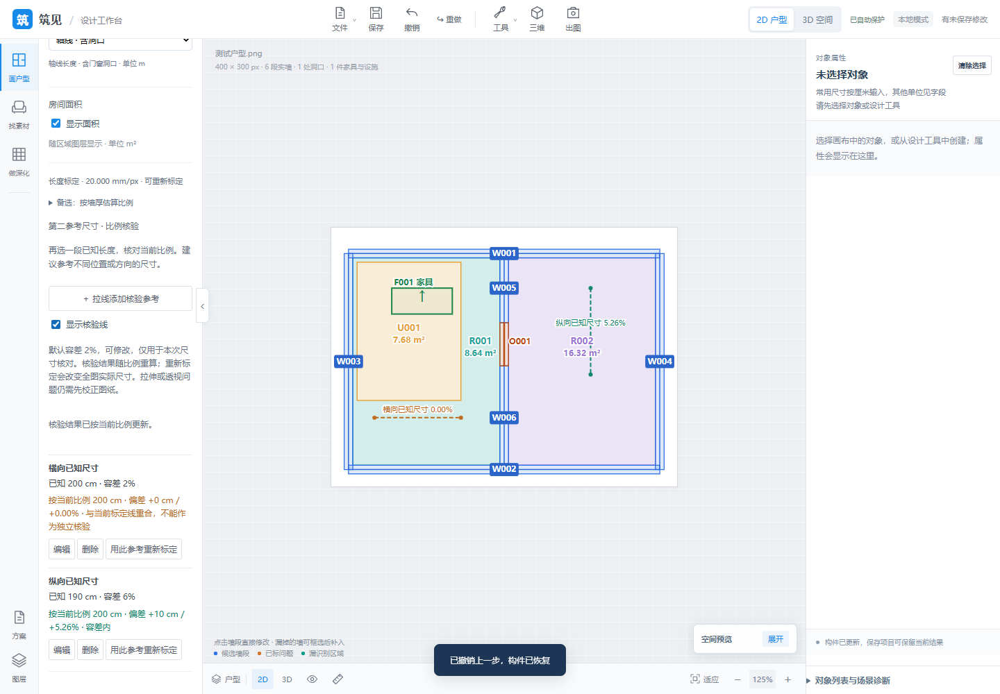

# 2026-10-28 · 本机流程与 P30 收尾

[English](updates-2026-10-28.md) | **中文**

源码检查点：[01e2db7](https://github.com/ETET114514/GewuZhizaoNew/commit/01e2db70b7088779dd65c642b5c09e74e3e72365)。本轮覆盖 P35 之后积累的更新，不镜像私有源码或原始项目/资产。

| 模块 | 已交付范围 | 保留边界 |
| --- | --- | --- |
| P17 | 本机 GLB 收藏/显示名/分组/标签，哈希绑定整理资料迁移与共用筛选 | 静态内嵌资源 GLB 格式范围不变，未增加模型集合 |
| P19 | 保存视角多选、串行 JPG/PNG ZIP、取消/进度及镜头/场景恢复 | 无离线渲染、全景或视频 |
| P25 D04/D05 | 正面逐窗格与六个飘窗部位材质、点选、PBR、继承/历史/保存 | 更多商品五金/新机构继续暂缓 |
| P29 | 当前/保存项目 ZIP 携带资源、隔离导入及只读版本对比 | 无账号、云同步或跨次完整撤销栈 |
| P31 | 独立已知尺寸参考、偏差/容差、显式重新标定及保存 | 无 OCR、透视/拉伸校正或通用精度承诺 |
| P30 | 用途确认；报告/命名快照；单件及整房/整屋现有家具候选；比较/预览/原子应用与方案文件；指定步行/搬运路线、当前库开合扫掠及操作区 | 有限搜索、当前包络及指定路线/运动；不自动添模型、寻路、优化尺寸或承诺商品人体工学 |

## 验证

503 项全量前端、43 项相关 Python、18 组新 P30 浏览器验收及原床尾/快照/候选浏览器回归通过。浏览器覆盖实际下载/导入、旧文件拒绝、取消、预览、原子应用、一次撤销重做、保存重开和 390 px；Python 另验证自动恢复及可迁移 ZIP 恢复。测试集合有重叠，不相加；更早的各功能证据保留在 New，不将其写成本次新跑的全量 Python。

## 操作导览

选中房间，进入整套布局/路径/开合面板，选择单房间或整屋、采样间距及直角转向后生成。分别比较指标，预览并一次应用选定方案。固定厨卫/定制柜/组成员及归属不清对象保持固定。在图上点选或输入步行/搬运路径，按当前尺寸验证实际穿门和连续运动；门窗检查从关闭到设定姿态。结果区分通过、受阻和未证实。

限制：最多 40 件可移动对象、30 个房间和 3 份方案；单件最多采样 1600 姿态并完整重算 12 个。整套生成不等于全局最优或自动寻路；通用四周检查不猜测 GLB 正面；开合不推定未知五金或超出设定端点的运动。OCR 归 P31；P25 更多机构和账号/云端继续后置。

[功能](features.zh-CN.md) · [演示](demo.zh-CN.md) · [首页](../README.zh-CN.md)
