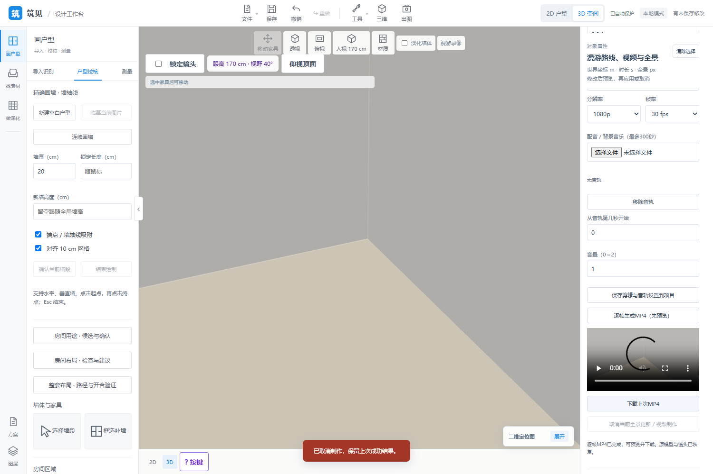
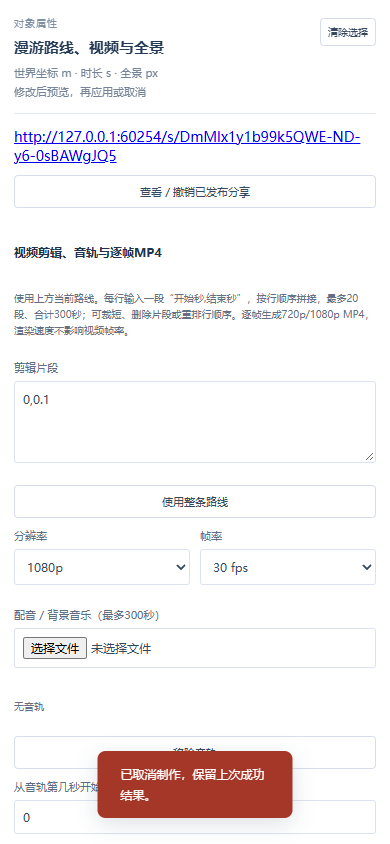
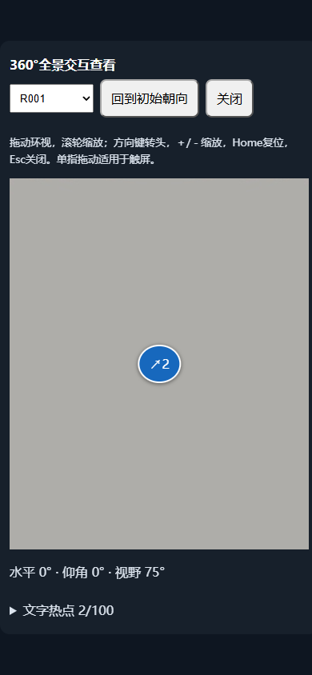
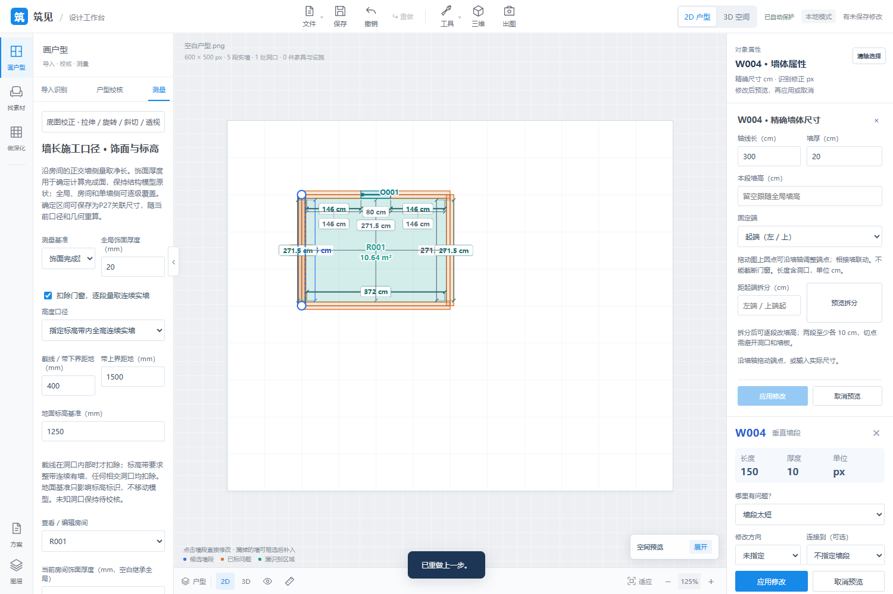
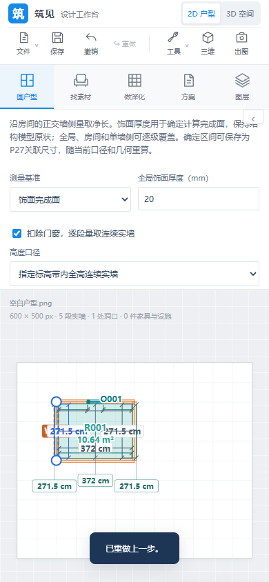

# 2026-10-31 · P26 and P13 closeout

**English** | [中文](updates-2026-10-31-closeout.zh-CN.md)

Source [77736ba](https://github.com/ETET114514/GewuZhizaoNew/commit/77736bac6b0e83db23a9c269ad21c66d09f9c1d9).

## Delivered

P26 local/self-hosted delivery adds automatic room viewpoints, project-carried panoramas/hotspots/recipes and explicit model recapture preserving scene identity. A separate read-only service provides optional passwords, server expiry and revocation. Ordered/trimmed clips, one local audio track with offset/volume and deterministic 720p/1080p, 24/30fps H.264/AAC MP4 use preview followed by explicit download.

P13 closes its established orthogonal room-side scope: global → room → wall-side finish thickness, finish-face net lengths, horizontal height sections/full-band continuous solid lengths and datum. P27 stores linked dimension intent rather than cached numbers, with batch deduplication, split migration, invalid references and shared units. Relevant project resources/settings support history, recovery and ZIP transfer; measurement snapshots export as CSV/JSON.

The current inventory retains 17 future directions: 13 with corresponding main workflows and 4 without the listed target workflow. No completion percentage is calculated. P26 local/self-hosted and P13 established orthogonal measurement scopes are removed from the pending list.

## Verification and counting

Final P13-stage evidence: **598 full frontend tests and 60 related Python tests**, with **13 new browser groups and the existing P13 12/P27 18 groups**. The earlier P26 stage has 585 frontend/56 related Python tests, 13 new groups and existing panorama 76/video 15 groups. Stages and subsets overlap and are not added.

At the P26 stage, 781 unique Python test IDs passed segmented verification: prior/isolated recognition passes covered 534, followed by the remaining 247. A single-process attempt ended during legacy pale-furniture recognition, so no completed single-process run is claimed. That snapshot predates P13 changes; final P13-related results are reported separately.

Independent decoding checks actual MP4s: 720p/24fps/12 frames with audio and 1080p/30fps/3 frames without audio. Actual CSV/JSON and project ZIP downloads are read back. Coverage includes incorrect passwords/mutual jumps/read-only access/revocation, retained hotspots on recapture, camera/project restoration, cancellation/failure protection, units/datum/800mm window subtraction and 390px. Synthetic empty rooms and test tones do not establish independent recognition accuracy.

## Remaining boundaries

Sharing defaults to loopback and supports a separate network interface/fixed port/public origin configuration; no hosted public deployment or team-account service is supplied. Recapture is explicit and published shares remain snapshots; ordered hotspots do not certify passage. MP4 samples existing real-time lighting, rather than offline ray tracing or a professional multitrack editor. P13 finish thickness defines a manual calculation boundary within orthogonal wall sides; nonorthogonal finishes, full building levels and construction PDF/DXF sets remain future scope.

## Use

1. In 3D → tours, choose saved human views or automatic room viewpoints; generate and save a project panorama. Edit hotspots and save to the project; explicitly recapture after model changes.
2. Select a project panorama, set optional password/1–720 hour expiry and publish. Verify in a separate browser; default links are local and external service needs deployment. Revoke from the list.
3. In video production enter start/end seconds per line, choose audio/offset/volume, 720p/1080p and 24/30fps; generate, preview and download MP4. Save the route before saving production settings.
4. In Measure → wall measurement conventions, choose structure/finish, thickness inheritance and height section/band/datum, then preview/apply. Save certain spans as P27 dimensions or download CSV/JSON; use project/ZIP saving for continued editing.

## Application screenshots

