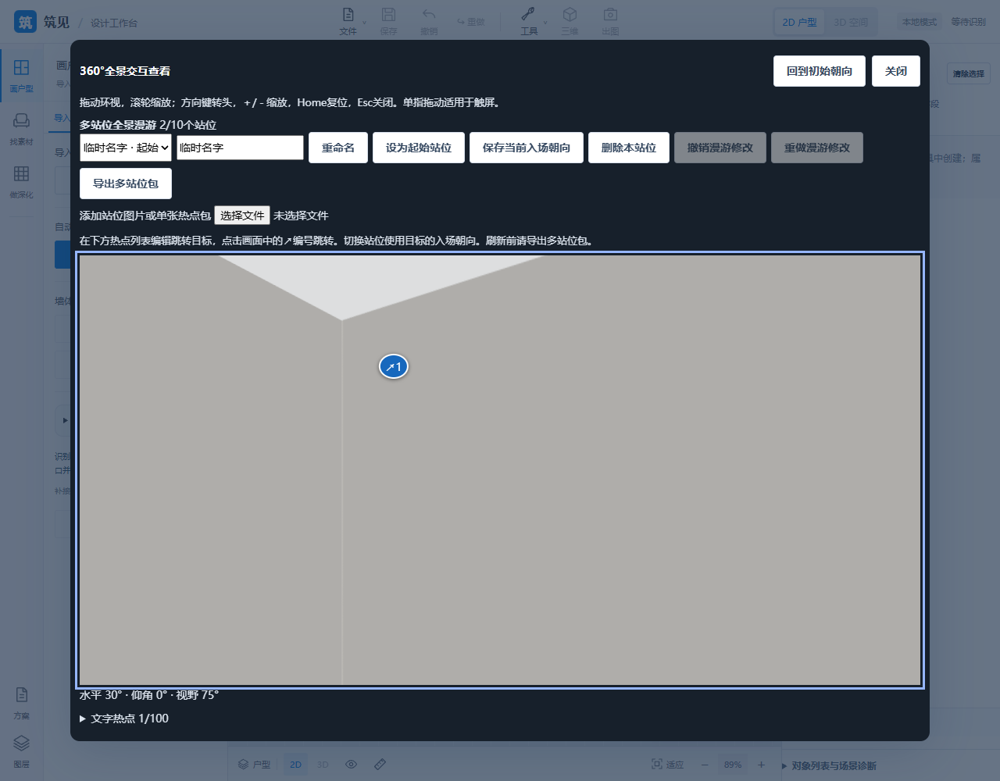
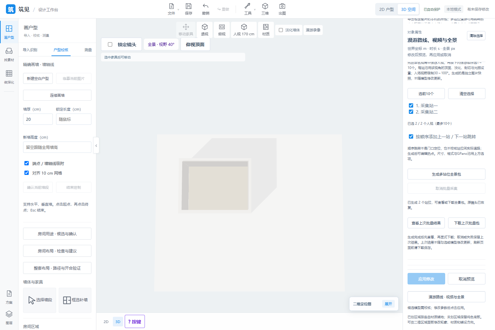
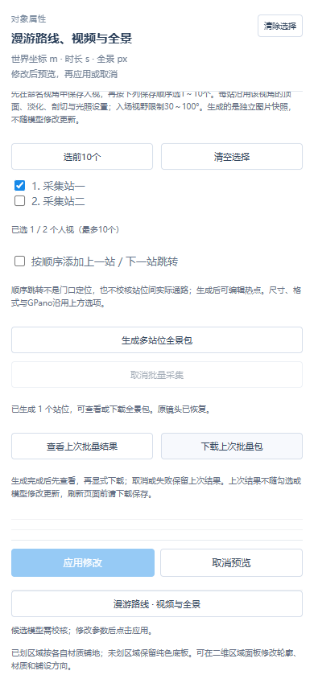

# 2026-10-31 panorama and capture update

**English** | [中文](updates-2026-10-31-panorama.zh-CN.md)

Source [b9ee167](https://github.com/ETET114514/GewuZhizaoNew/commit/b9ee167b494268e74a54c2e242c904004dbced65). Scope checked against source, FEATURES and P26/P27 acceptance records.

## Delivered

Local 2:1 interactive panorama viewing, optional JPG/PNG GPano, text hotspots and up to 10 scenes with jump hotspots and image-carrying packages. Serial 2K/4K JPG/PNG capture accepts 1-10 saved human views with per-view display and lighting settings; optional ordered previous/next navigation, preview and explicit download. P27 applying unchanged default dimension display settings no longer adds history, clears redo or rewrites autosave.

## Verification and counting

Final local evidence: **575 full frontend tests, 18 related Python tests and 76 browser checks**. The browser total includes 58 prior checks and 18 batch-capture checks; overlapping rounds are not added. The 812-Python/555-frontend baseline predates these changes and remains historical; there was no final full Python rerun. The second-source rejection uses fault injection to test failure isolation.

Actual 2K JPG/4K PNG packages are independently checked with Pillow/XML. Coverage includes drag/keyboard/narrow screens, mutual jumps, fresh-page restore, capture/package cancellation, camera/canvas/document/history restoration, invalid image/package rejection and byte-preserved prior results.

## Remaining boundaries

Local static images/packages only: no hosting, accounts/permissions, web sharing, automatic room viewpoint choice, live model updates or project-bound panorama storage. Ordered navigation is not doorway placement or verified passage. Limits: 32MB per image, 10 scenes/64MB images, 92MB input package; download before refresh. The standalone viewer does not infer north/GPS or interpret external crop/orientation metadata. Audio/MP4, offline rendering and the remaining P26 roadmap are still open.

## Application screenshots

Images show generated acceptance rooms for feature demonstration. No source or user project/panorama packages are copied.

[Back to home](../README.md)
