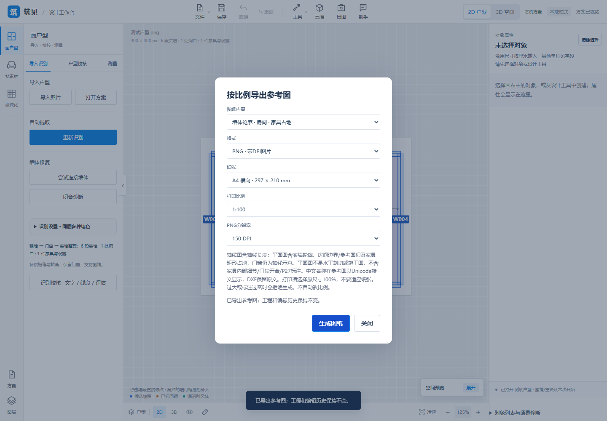
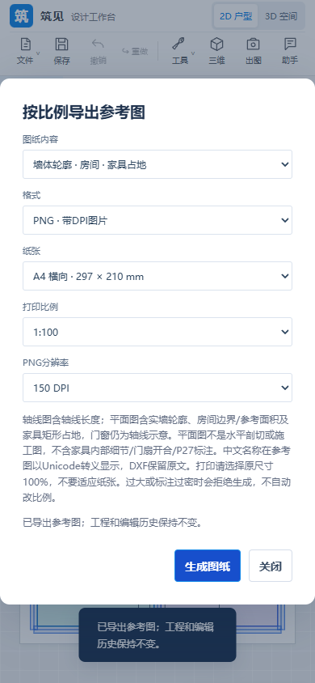
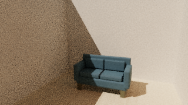

# 2026-11-07 · Local rendering and model/plan delivery

**English** | [中文](updates-2026-11-07-render-exchange.zh-CN.md)

Source [f913696](https://github.com/ETET114514/GewuZhizaoNew/commit/f913696701fd4c8e94aaea153ea14f6d65bb86b1).

## Delivered

Local P19 path tracing now uses an isolated Worker/OffscreenCanvas scene, multiple light bounces, finite area/spot lights, local HDRI, region rendering, saved-view batches, reusable recipes, pause/resume and early finish with actual/target sample metadata. P20 exports static meter-based GLB/embedded glTF, millimeter DXF axes and wall/room/furniture footprint layers, plus fixed-scale A4/A3 vector PDF or DPI-tagged PNG. Room holes, opening gaps and rotated furniture envelopes are retained; labels avoid outlines. Earlier source changes since the previous showcase also expanded furniture and added wall cleanup, batch arrangement and a globally accessible design assistant.

## Boundaries

These are delivered subscopes, not completion of all P19/P20 work. No cloud renderer, IES, EXR import, geographic sun study, persistent render history, DWG, construction drawing sets or P27-linked sheet dimensions. Furniture exports are envelopes; door/window symbols remain axes, not detailed frames/swings. Non-ASCII paper labels currently use Unicode escapes; DXF preserves original text. Rendering requires local WebGL2/float buffers; the gallery is session-only. Small synthetic samples do not establish high-resolution speed, photorealistic quality or recognition generalization.

## Verification and counting

Source-stage evidence: **666 full Node tests and 28 related Python tests**; actual GLB/glTF round trips, DXF/PDF/PNG downloads, independent ezdxf/Pillow/pypdf reads, vector scale bars, cancellation/failure restoration and 390px layouts passed. One glTF download run timed out; the isolated retry passed and the failed log is retained. Earlier render-control acceptance reported 660 Node/12 related Python tests and real pause/resume/early-finish checks. Counts overlap and are not summed. The render sample is 320×180/64 samples; separate 16×16/1024-sample HDR and 32×18/64-sample region checks are small-scene evidence, not 1920–3840px benchmarks. This showcase synchronization checks documentation, links and asset provenance; it does not rerun the source test suites.

Source evidence: `RENDER_STUDIO.md`, `P20_EXCHANGE.md`, `FEATURES.md` and acceptance logs in the linked commit. Only summaries and three synthetic acceptance PNGs are copied; no source, models, textures, HDR files, project packages or exchange files are mirrored.

