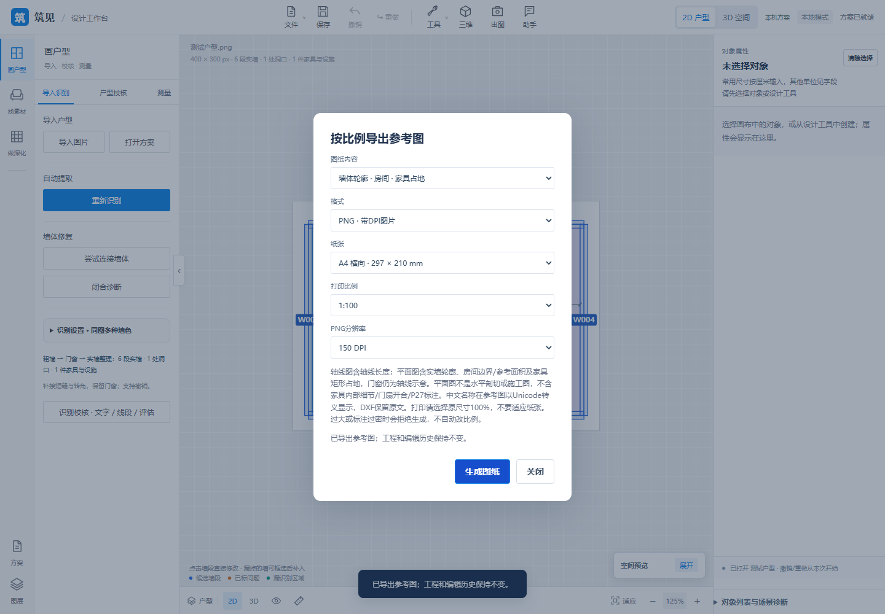
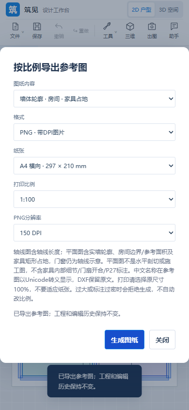
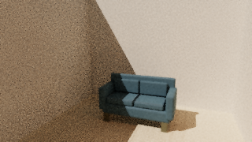

# 2026-11-07 · 本机渲染与模型/平面交付

[English](updates-2026-11-07-render-exchange.md) | **中文**

源码 [f913696](https://github.com/ETET114514/GewuZhizaoNew/commit/f913696701fd4c8e94aaea153ea14f6d65bb86b1).

## 已交付

P19本机路径追踪已使用独立Worker/OffscreenCanvas场景，支持多次反射、有限面光/聚光、本地HDRI、局部出图、保存视角批量、参数复用、暂停/继续和提前结束，记录实际/目标采样数。P20接入米制静态GLB/内嵌glTF、毫米制DXF轴线与实墙/房间/家具占地分层，以及A4/A3固定比例矢量PDF或带DPI的PNG；保留房间孔洞、门窗缺口和旋转家具矩形占地，标签避让轮廓。上次展示之后的源码更新还扩展家具，并加入墙体清理、批量布置和全局设计助手入口。

## 边界

这只是P19/P20已交付的子范围，并不表示整项完成。云渲染、IES、EXR、地理日照、跨会话成图历史、DWG、成套施工图与P27关联尺寸上图均未实现。家具导出为矩形占地，门窗仍是轴线，不含精细框型或开合符号；纸图非ASCII名称暂为Unicode转义，DXF保留原文。渲染要求本机WebGL2/浮点缓冲，图库仅本次会话保留。小型合成样例不能证明高清速度、摄影级画质或识别泛化。

## 验证与计数

源码阶段验证：**666项全量Node、28项相关Python**通过；实际GLB/glTF往返、DXF/PDF/PNG下载、ezdxf/Pillow/pypdf独立读回、矢量比例尺、取消/失败恢复和390px布局通过。一次glTF下载等待超时，独立重跑通过，失败日志保留。此前渲染控制验收为660项Node/12项相关Python，含真实暂停/继续/提前结束；计数重叠，不累加。渲染样例为320×180/64次采样，另有16×16/1024次采样HDR与32×18/64次采样局部图验证，均非1920～3840px性能基准。本次展示同步检查文档、链接和素材来源，不声称重新运行源码测试套件。

源码依据：`RENDER_STUDIO.md`、`P20_EXCHANGE.md`、`FEATURES.md`及对应提交中的验收日志。仅复制概要和三张合成验收场景PNG，不镜像源码、模型、贴图、HDR、工程包或导出文件。

