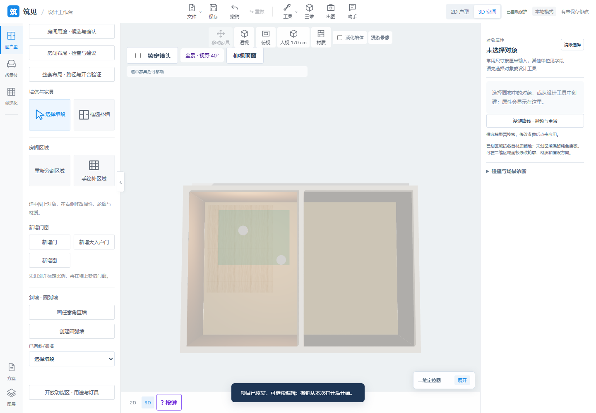
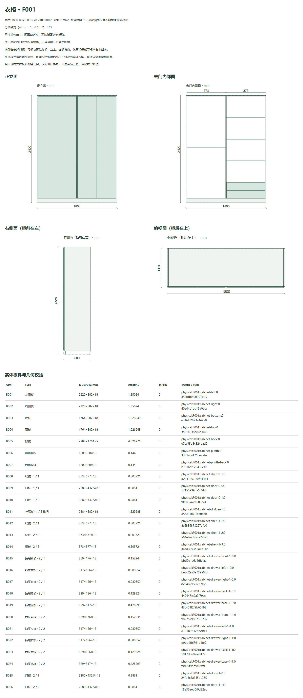

# Spatial tools, cabinet views and purchasing · 2026-11-14

**English** | [中文](updates-2026-11-14.zh-CN.md)

Source: [2c0bbbb](https://github.com/ETET114514/GewuZhizaoNew/commit/2c0bbbb7c9481c78dec968c07d40b92ef56eb7da). [Features](features.md) · [Architecture](architecture.md) · [Demo](demo.md) · [Screenshots](../screenshots/README.md).

## Delivered capabilities

| Area | Current behavior |
| --- | --- |
| Wall evidence review | Read-only cross-section sampling compares existing orthogonal walls with the source image; flags offsets, thickness differences, unstable samples and insufficient evidence. Local overlays and JSON reports support manual review. |
| Open functional zones | Independently authored polygons preserve physical walls, rooms and flooring quantities. Effective areas exclude walls, holes and floor-cutting elements; overlapping totals use a union. Optional translucent 3D color overlays have explicit priority. Existing ceiling tools create actual lamps in one undoable operation. |
| Dimension chains | Confirmed ticks and segment/optional overall dimensions use an explicit axis/structure/finish/unknown basis. Reports show measured lengths, segment/total conflicts and diagnostic constraint residuals; suggested lengths never automatically move geometry or recalibrate the project. |
| Vector PDF import | Independently drawn straight/polygon edges are transformed into color/line-width DXF layers. The existing unit/layer, wall-axis or paired-boundary preview and confirmation tools then create an independent editable project. |
| HouseSpec structure import | Millimeter orthogonal walls, basic doors/windows, room labels and source functional zones enter the native project. Orthogonal opening `from/to` values are world X/Y coordinates, including reversed host walls. Unsupported content is listed explicitly. |
| P24 cabinet drawings | Front, open internal, right-side and top views use closed-pose geometry. Physical-board selection links to dimensions and profiles, with SVG/CSV/offline HTML/verified ZIP delivery and stale-source protection. |
| P28 purchasing follow-ups | Same-source multi-order balances, unallocated-demand drafts, draft recalculation, batch receipts/returns, supplier cost checks, supplier-only purchase documents and complete receipt/reference histories retain frozen source provenance. |

Authored zones/chains use the existing history, recovery, save/reopen, ZIP transfer and saved-version comparison. Source import previews leave the current project intact; replacement still requires the existing unsaved-work decision.

## Scope and remaining work

- Zones express use and optional illustration colors; they do not silently replace flooring materials or add duplicate flooring BOM quantities. Removing a zone retains actual lamps. Room/geometry edits recompute effective zone shapes and membership.
- Dimension suggestions are diagnostics, not a CAD constraint solver or nonlinear transformation of an already edited project. Unknown measurement bases do not participate in solving.
- PDF limits: 8MB/100 pages, one selected page, bounded edge/instruction counts and a 25-second worker. Curves, clipping, images and Form resources are skipped/reported; scans and arbitrary architectural symbols are not universally recognized. Physical mm/pt scale must be confirmed.
- HouseSpec limits: one selected floor, up to 300 orthogonal walls/200 opening entries, 900KB JSON and a 30-second worker. Advanced openings, angled walls, furniture, structures, source materials, other floors and unmapped fields are reported rather than replaced with invented objects. Hinge/opening direction and structural properties still need review.
- P24 whole-kitchen elevations, assembly/exploded/installation and product-process drawings remain open. Full P28 still includes actual inventory, arbitrary geometry/manufacturing, manufacturer hardware/CNC, authenticated roles, external approvals/signatures, supplier ERP and payment integration.
- These four agreed adaptations are delivered; they do not establish universal recognition accuracy or reproduce the entire upstream designer. Ideas were studied from [chencheng666/house-plan-designer](https://github.com/chencheng666/house-plan-designer/tree/enhanced-v2), based on [ZWD11](https://github.com/ZWD11/house-plan-designer), under its MIT license. No upstream screenshot or complete source is mirrored here.

## Actual validation

Development-stage evidence: **744 full Node tests**, **58 related Python tests**, **22 new browser groups**, plus existing P31, DXF-axis 17-group and wall-review 15-group regressions. Real downloads, 390px layouts and a genuine 3D zone mesh were checked. These counts overlap with earlier stages and are not added as unique coverage; no full Python-suite claim is made.

Immediately before this publication, **27 P24/P28-related Python checks were rerun and passed**. Earlier cabinet/P28 browser and export checks retain their dated source records; they were not all rerun for Showcase publication.

The public D128 example imported as 31 walls, 12 basic openings, 9 spaces and 4 zones; unsupported entries were reported. This is structured interoperability evidence, not complete example reproduction or a held-out recognition benchmark.

Evidence in New: [release record](https://github.com/ETET114514/GewuZhizaoNew/blob/2c0bbbb7c9481c78dec968c07d40b92ef56eb7da/RELEASE_2026-11-14.md), [spatial tools](https://github.com/ETET114514/GewuZhizaoNew/blob/2c0bbbb7c9481c78dec968c07d40b92ef56eb7da/wall-recognition/output/learned-design-complete/README.md), [cabinet drawings](https://github.com/ETET114514/GewuZhizaoNew/blob/2c0bbbb7c9481c78dec968c07d40b92ef56eb7da/P24_CABINET_DRAWINGS.md), [purchase documents](https://github.com/ETET114514/GewuZhizaoNew/blob/2c0bbbb7c9481c78dec968c07d40b92ef56eb7da/P28_PURCHASE_DOCUMENTS.md).

