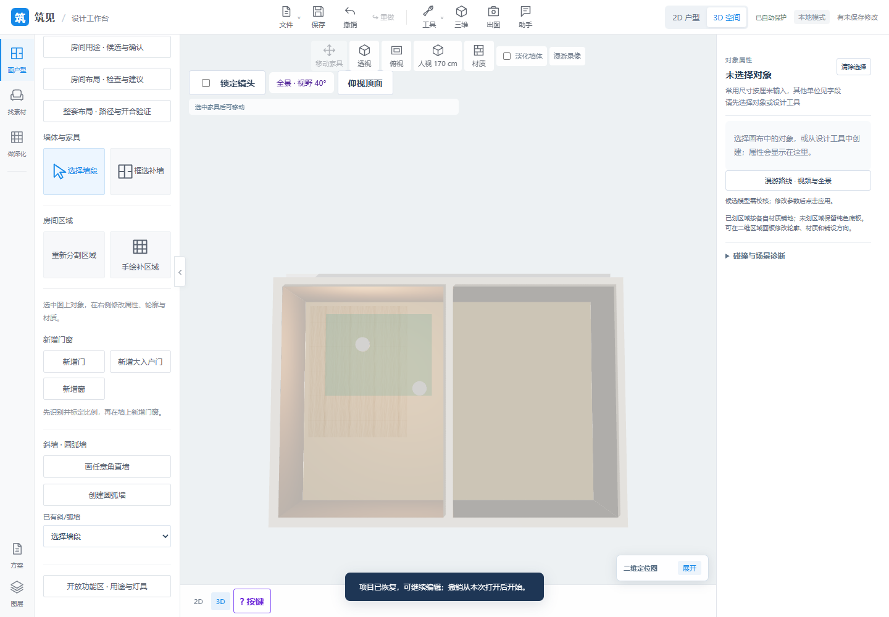
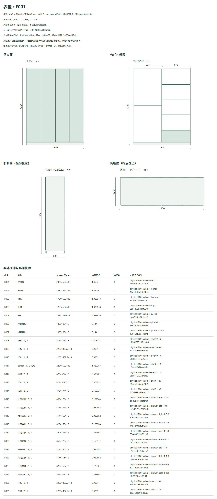

# 空间工具、整柜视图与采购续作 · 2026-11-14

[English](updates-2026-11-14.md) | **中文**

源码：[2c0bbbb](https://github.com/ETET114514/GewuZhizaoNew/commit/2c0bbbb7c9481c78dec968c07d40b92ef56eb7da)。[功能](features.zh-CN.md) · [架构](architecture.zh-CN.md) · [演示](demo.zh-CN.md) · [截图](../screenshots/README.zh-CN.md)。

## 已交付能力

| 方向 | 当前行为 |
| --- | --- |
| 墙体原图复核 | 只读横截面采样，把已有正交墙与原图对照，标出位置/厚度偏差、波动及证据不足，支持局部叠加和JSON报告，供人工核对。 |
| 开放功能区 | 独立多边形保持物理墙、房间和铺装工程量；有效面积避开墙、孔洞及扣地构件，重叠合计取并集。三维可选半透明示意色层并明确覆盖优先级；复用顶面工具一次创建实际灯具，可撤销。 |
| 尺寸链 | 已确认刻度、分段及可选总长明确区分轴线/结构/完成面/待核实口径，列图测长度、分段与总长冲突和约束残差；建议长度不会自动移动几何或重新标定。 |
| 矢量PDF导入 | 独立直线/多边形边界按矩阵转换为颜色/线宽分层DXF，继续使用现有单位、图层、墙轴线或双线候选预览与确认工具，创建独立可编辑工程。 |
| HouseSpec结构导入 | 毫米正交墙、基础门窗、房间标签及源功能区进入原生项目；正交门窗`from/to`按世界X/Y坐标解释，支持反向宿主墙。不支持内容逐项列明。 |
| P24柜体图纸 | 整柜正面、去门内部、右侧及俯视均取关门归位几何，实体板联选可查尺寸和轮廓，支持SVG/CSV/离线HTML/校验ZIP及来源过期保护。 |
| P28采购续作 | 同源多单余额、未分配需求草稿、草稿重算、整批收退货、供应商成本、独立供应商采购单与完整凭据追溯，均保留冻结来源。 |

功能区/尺寸链共用原有历史、自动恢复、保存重开、ZIP迁移与版本对比；来源导入预览不修改当前工程，替换仍沿用未保存工作的确认流程。

## 范围与余项

- 功能区表达用途和可选示意色，不暗改地面材质或新增重复铺装BOM。删区保留实际灯具；房间/几何变化后重算有效轮廓与归属。
- 尺寸建议只作诊断，不是完整CAD约束求解或已编辑工程非线性变形；口径待核实时不联立求解。
- PDF限制：8MB/100页、每次1页、有界图元/指令数量及25秒独立进程。曲线、裁剪、图像与Form资源跳过并报告，不通用识别扫描件和任意建筑符号，需确认mm/pt实物比例。
- HouseSpec限制：选定单层、最多300段正交墙/200个洞口条目、900KB JSON与30秒构建。高级门窗、斜墙、家具、构件、源材质、其他楼层和未映射字段逐项报告，不虚构替代对象；开向、铰链与结构性质仍需核实。
- P24整组厨房立面、装配/爆炸/安装与商品工艺图仍待；完整P28仍包括真实库存、任意几何/制造、厂家五金/CNC、认证身份、外部审批/签章、供应商ERP和支付等。
- 完成的是约定的四项改造，不代表通用识别准确率已提升或完整复刻上游设计器。思路来自MIT项目[chencheng666/house-plan-designer](https://github.com/chencheng666/house-plan-designer/tree/enhanced-v2)，其上游为[ZWD11](https://github.com/ZWD11/house-plan-designer)；此展示仓库不镜像上游截图或完整源码。

## 实际验证

开发阶段证据：**744项全量Node、58项相关Python、22组新增浏览器**，以及原P31、DXF轴线17组、墙体复核15组回归。已检查真实下载、390px与实际三维功能区网格。各阶段数字重叠，不累加为独立覆盖，不声称跑过全量Python。

本次发布前**另复跑27项P24/P28相关Python检查，通过**。此前柜体/P28浏览器和导出验收保留各自日期与范围，未声称本次Showcase发布全部重跑。

公开D128示例结构导入得到31墙、12个基础洞口、9个空间和4个功能区，不支持条目已列明；这是结构互通验证，不是完整复刻或独立真实识别基准。

New中的证据：[发布记录](https://github.com/ETET114514/GewuZhizaoNew/blob/2c0bbbb7c9481c78dec968c07d40b92ef56eb7da/RELEASE_2026-11-14.md)、[空间工具](https://github.com/ETET114514/GewuZhizaoNew/blob/2c0bbbb7c9481c78dec968c07d40b92ef56eb7da/wall-recognition/output/learned-design-complete/README.md)、[柜体图纸](https://github.com/ETET114514/GewuZhizaoNew/blob/2c0bbbb7c9481c78dec968c07d40b92ef56eb7da/P24_CABINET_DRAWINGS.md)、[采购单据](https://github.com/ETET114514/GewuZhizaoNew/blob/2c0bbbb7c9481c78dec968c07d40b92ef56eb7da/P28_PURCHASE_DOCUMENTS.md)。

