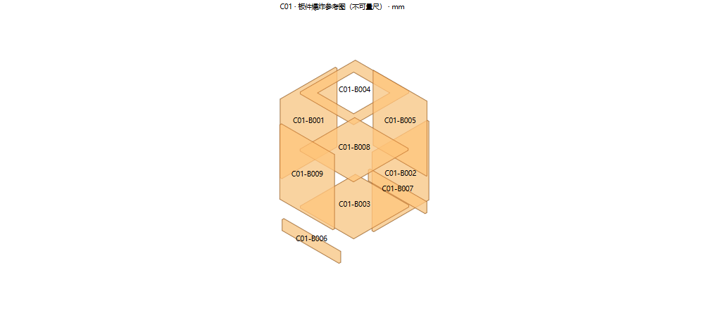

# 2026-11-18 · Wall reference ranges and kitchen drawing/contact workflows

**English** | [中文](updates-2026-11-18-p12-p24.zh-CN.md)

[Home](../README.md) · [Features](features.md) · [Architecture](architecture.md) · [Demo](demo.md) · [Screenshots](../screenshots/README.md) · [Assets](../NOTICE.md)

[GewuZhizaoNew 9b48db1](https://github.com/ETET114514/GewuZhizaoNew/commit/9b48db190e64f437662d0ac37662332151c6fe97)

This release adds declared multi-segment wall references and single-wall reference drawings, then extends P24 with straight/L/U kitchen sheets, explicitly selected upper/lower groups, single-cabinet isometric/exploded views, and physical material-contact checks. Blind-corner shelf positioning now avoids the former half-board-thickness side-panel penetration.

Implemented: declared fraction/mm multi-segment reference migration through supported split/merge/reversal/source selection/node/fillet operations; single-wall axis-length elevation, local normal section and actual level slice; straight/L/U front/internal/plan kitchen sheets; explicit 2–10 group combinations with actual offsets, upper/lower interval clearances and equipment checks; one selected cabinet’s actual-board isometric/exploded views; separate single-cabinet, cross-cabinet and countertop/equipment material checks. Shared board IDs, source revisions, selection, persistence and drawing packages remain connected.

Wall interval bindings retain explicit host/side/range semantics and reject loss of declared coverage; the Python wall-drawing resolver binds output to the current document digest. Kitchen sheets reuse physical manufacturing layers, actual placement and closed component poses. The browser builds a read-only report; source guards and the CAD service check the complete selected group/member set. Cross-cabinet checks aggregate measured board-pair contact/overlap into cabinet pairs; any material overlap excludes that cabinet pair as a contact-graph edge. Component checks compare board/slab/equipment layers while excluding board-board repetition and same-fixture internal parts. Native dimensions, revision XDATA and ZIP file hashes preserve traceability.

In the workbench, open Detail design → Whole-kitchen elevations/countertop-equipment sheets. Select a main group and optional additional groups, then read the sheets. Choose one cabinet to append isometric/exploded reference views. Enable cross-cabinet checks and/or countertop-equipment checks explicitly; each option change invalidates the old report. Click a board, cabinet or equipment-part number to inspect the source geometry; selecting another entity from a single-cabinet isometric view returns to the overall plan. Download SVG/DXF/CSV/offline HTML/JSON/ZIP, or cancel and retry. For P12, declare supported external interval semantics and use the wall-drawing panel to choose the host, station and section level. Check stale-source refusal and save/reopen regeneration.

Four shared PNGs are self-produced captures from synthetic acceptance projects, copied byte-for-byte from the source revision. No customer drawings, local project archives, full source, models or textures are copied into this Showcase. The wall screenshot shows a horizontal arc-wall slice despite its original filename; the kitchen combined/exploded captures represent their dated acceptance stages. See the bilingual screenshot index for exact source paths and provenance. Existing third-party notices remain unchanged.

Full P12 and P24 remain unfinished. These are bounded reference drawings and geometric checks. Unknown reference semantics, arbitrary wall topology, complete construction details, professional hidden-line removal, hardware/connection strength, installation constraints, assembly order/motion and manufacturer CNC remain open. Equipment is the existing schematic geometry; an overlap may be intended embedding and requires review.

Development evidence: 809 full Node tests, 57 related Python tests, 15 new Edge workflow groups, and the existing 14 cross-cabinet/11 single-cabinet browser groups passed. Independent GEOS checks cover 24 normal/low-upper-cabinet cases; actual ZIP/CSV/HTML/JSON and native-dimension CAD downloads were read back. Publication preparation additionally passed 22 P12 reference-range/wall-drawing Python tests on 2026-11-18. Counts overlap and are not added; no full Python rerun or fresh rerun of every earlier browser suite is claimed. Showcase publication checks bilingual pages, links and screenshot provenance.

Source scope and evidence: [P12_REFERENCE_RANGES.md](https://github.com/ETET114514/GewuZhizaoNew/blob/9b48db190e64f437662d0ac37662332151c6fe97/P12_REFERENCE_RANGES.md) · [P12_WALL_DRAWINGS.md](https://github.com/ETET114514/GewuZhizaoNew/blob/9b48db190e64f437662d0ac37662332151c6fe97/P12_WALL_DRAWINGS.md) · [P24_KITCHEN_DRAWINGS.md](https://github.com/ETET114514/GewuZhizaoNew/blob/9b48db190e64f437662d0ac37662332151c6fe97/P24_KITCHEN_DRAWINGS.md) · [P24_COMBINED_DRAWINGS.md](https://github.com/ETET114514/GewuZhizaoNew/blob/9b48db190e64f437662d0ac37662332151c6fe97/P24_COMBINED_DRAWINGS.md) · [P24_ASSEMBLY_DRAWINGS.md](https://github.com/ETET114514/GewuZhizaoNew/blob/9b48db190e64f437662d0ac37662332151c6fe97/P24_ASSEMBLY_DRAWINGS.md) · [P24_BOARD_CONTACTS.md](https://github.com/ETET114514/GewuZhizaoNew/blob/9b48db190e64f437662d0ac37662332151c6fe97/P24_BOARD_CONTACTS.md) · [P24_KITCHEN_CONTACTS.md](https://github.com/ETET114514/GewuZhizaoNew/blob/9b48db190e64f437662d0ac37662332151c6fe97/P24_KITCHEN_CONTACTS.md) · [P24_COMPONENT_CONTACTS.md](https://github.com/ETET114514/GewuZhizaoNew/blob/9b48db190e64f437662d0ac37662332151c6fe97/P24_COMPONENT_CONTACTS.md) · [RELEASE_2026-11-18.md](https://github.com/ETET114514/GewuZhizaoNew/blob/9b48db190e64f437662d0ac37662332151c6fe97/RELEASE_2026-11-18.md)

