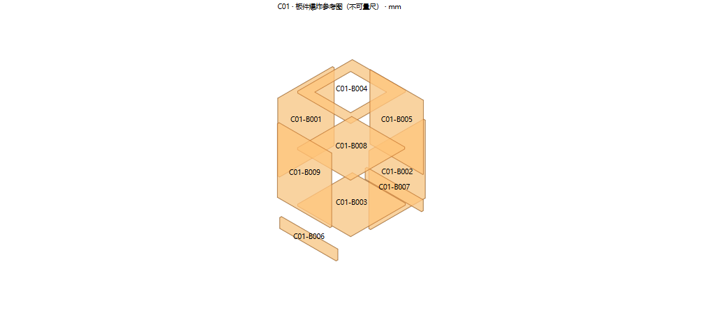

# 2026-11-18 · 墙体区间引用与厨房图纸/接触检查

[English](updates-2026-11-18-p12-p24.md) | **中文**

[首页](../README.zh-CN.md) · [功能](features.zh-CN.md) · [架构](architecture.zh-CN.md) · [演示](demo.zh-CN.md) · [截图](../screenshots/README.zh-CN.md) · [素材](../NOTICE.zh-CN.md)

[GewuZhizaoNew 9b48db1](https://github.com/ETET114514/GewuZhizaoNew/commit/9b48db190e64f437662d0ac37662332151c6fe97)

本次发布新增声明式多段墙体引用和单墙参考图，并扩展P24直线/L/U厨房图纸、明确选择的上下柜联合图、单柜轴测/爆炸参考图和实体材料接触检查；同时修正盲位层板伸入侧板半个板厚的问题。

已实现：声明式比例/毫米多段引用随支持的拆分/合并/反向/选源/节点/圆角操作迁移；单墙轴长展开立面、局部法向竖剖和真实标高水平截面；直线/L/U正立面/内部图/俯视；明确选择2～10组、保留真实偏移的联合图、上下柜区间净距和设备检查；一个所选柜体的实体板轴测/爆炸图；独立的单柜、跨柜及台面设备材料接触检查。板件ID、来源修订、联选、保存及图包共用。

墙体区间绑定保留明确宿主/墙侧/范围语义，丢失声明覆盖时拒绝操作；Python单墙图解析器将输出绑定当前工程摘要。厨房图纸复用制造实体分层、实际摆放和归位部件。浏览器生成只读报告，来源保护与CAD服务核对完整所选组合/成员集。跨柜检查将逐板面贴合/体积汇总为柜体对，任一材料重叠会使该柜体对不能作为贴合图谱边；台面设备检查比较板件/台面/设备分层，排除重复的板件对和同设备内部部件。原生尺寸、修订XDATA及ZIP逐文件哈希用于追溯。

在工作台“做深化 → 整组厨房立面·台面设备联图”选择主组合及可选附加组合，再读取图纸；选择一个柜体可附加轴测/爆炸参考图。跨柜检查、台面设备检查分别显式勾选，改变选项会使旧图失效。点击板件、柜体或设备部件编号联查来源几何；从单柜轴测选择其他实体时回到整体俯视。可下载SVG/DXF/CSV/离线HTML/JSON/ZIP或停止重试。P12可声明受支持的外部区间语义，并在单墙图面板选择宿主、沿程剖切位置和标高；核对过期拒绝及保存重开后重生成。

本轮四张共用PNG均为合成验收工程的自行截图，按源码修订逐字节复制；Showcase不复制客户图纸、本机项目包、完整源码、模型或贴图。墙体截图实际显示弧墙水平截面，以可见内容而非原文件名命名；联合/爆炸图截图反映各自验收阶段。具体源路径和来源见双语截图索引，既有第三方说明保留。

P12和P24整项仍未完成。当前为有限参考图与几何检查；未知引用语义、任意墙体拓扑、完整施工节点、专业隐藏线、五金/连接强度、安装约束、拆装顺序/运动及厂家CNC继续保留。设备采用现有示意几何，材料重叠可能属于预期嵌入，需要人工核对。

开发验收：809项全量Node、57项相关Python、新15组Edge及原跨柜14组/单柜11组浏览器通过；24套正常/低吊柜工程经GEOS独立核验，实际ZIP/CSV/HTML/JSON和原生尺寸CAD下载经独立读回。2026-11-18发布准备另补验22项P12区间引用/单墙图Python并通过。计数交叠不累加，不声称本轮跑全量Python或重新跑全部历史浏览器。Showcase发布核对双语、链接与截图来源。

源码范围与证据：[P12_REFERENCE_RANGES.md](https://github.com/ETET114514/GewuZhizaoNew/blob/9b48db190e64f437662d0ac37662332151c6fe97/P12_REFERENCE_RANGES.md) · [P12_WALL_DRAWINGS.md](https://github.com/ETET114514/GewuZhizaoNew/blob/9b48db190e64f437662d0ac37662332151c6fe97/P12_WALL_DRAWINGS.md) · [P24_KITCHEN_DRAWINGS.md](https://github.com/ETET114514/GewuZhizaoNew/blob/9b48db190e64f437662d0ac37662332151c6fe97/P24_KITCHEN_DRAWINGS.md) · [P24_COMBINED_DRAWINGS.md](https://github.com/ETET114514/GewuZhizaoNew/blob/9b48db190e64f437662d0ac37662332151c6fe97/P24_COMBINED_DRAWINGS.md) · [P24_ASSEMBLY_DRAWINGS.md](https://github.com/ETET114514/GewuZhizaoNew/blob/9b48db190e64f437662d0ac37662332151c6fe97/P24_ASSEMBLY_DRAWINGS.md) · [P24_BOARD_CONTACTS.md](https://github.com/ETET114514/GewuZhizaoNew/blob/9b48db190e64f437662d0ac37662332151c6fe97/P24_BOARD_CONTACTS.md) · [P24_KITCHEN_CONTACTS.md](https://github.com/ETET114514/GewuZhizaoNew/blob/9b48db190e64f437662d0ac37662332151c6fe97/P24_KITCHEN_CONTACTS.md) · [P24_COMPONENT_CONTACTS.md](https://github.com/ETET114514/GewuZhizaoNew/blob/9b48db190e64f437662d0ac37662332151c6fe97/P24_COMPONENT_CONTACTS.md) · [RELEASE_2026-11-18.md](https://github.com/ETET114514/GewuZhizaoNew/blob/9b48db190e64f437662d0ac37662332151c6fe97/RELEASE_2026-11-18.md)

