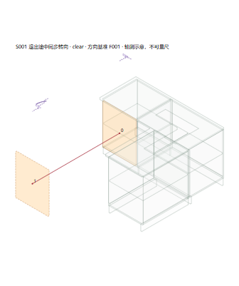

# 2026-11-20 · P24 kitchen disassembly and synchronized tool withdrawal turns

[中文](updates-2026-11-20-p24.zh-CN.md) · [Source commit 245b3d2](https://github.com/ETET114514/GewuZhizaoNew/commit/245b3d21f13ccd6a72919dac7357325099052d83) · [Source PR #3, awaiting merge](https://github.com/ETET114514/GewuZhizaoNew/pull/3)

P24 checks explicit cabinet disassembly plans with staged board and tool motions. Once the board reaches its destination, each tool can turn about its own vertical axis, either in place or during a selected withdrawal segment. A comparison can test other timing while keeping the authored waypoints and tool order.

The update also covers custom cabinet layouts, countertop openings, material contact sections, disassembly sequencing, detours, parking positions and staged board yaw. The checks use modeled cabinet solids and rectangular tool envelopes. Board flips, independent turning during tool entry, manufacturer installation procedures and load checks remain open.

975 Node tests, 70 related Python tests and 19 Edge workflow groups passed. In the two-tool fixture, the original turn hit a waiting tool at 45°. The first withdrawal segment cleared after the same 90° turn was synchronized with translation. Independent GEOS sampled 1,001 poses. The actual ZIP matched all 41 manifest checksums; 18 native 3D CAD reference lines had a maximum error bound of 0.038125 mm. CAD audit reported zero errors.

