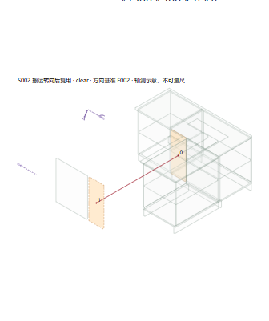

# 2026-11-20 · P24 厨房装拆校核与驻留工具搬运转向

[English](updates-2026-11-20-p24.md) · [源码提交 27a9f22](https://github.com/ETET114514/GewuZhizaoNew/commit/27a9f2228e26bf08a6fdfeb6060f9deaab0dee9d) · [源码 PR #3，待合并](https://github.com/ETET114514/GewuZhizaoNew/pull/3)

驻留工具可以在指定搬运段同步转向、到位后转向或原地转向。校核从真实驻留朝向开始。若搬运中途受阻，保留最近一次已验证的位置和朝向。

同一件工具可在本步或后续步骤从新姿态接入复用。反向装配按相反顺序撤销搬运与转角。几何校核采用柜体实体和长方体工具包络。板件翻转、多工具同时独立运动、厂家安装工艺和受力验算仍待实现。

988 项 Node、70 项相关 Python 和 22 组 Edge 验证通过。同一工具由 15° 驻留朝向搬运至 105°，再从新姿态复用。GEOS 独立复查 1503 个姿态，并复现另一例中途碰撞。实际 ZIP 的 42 个文件校验一致，读回 10 条三维转向轨迹、2 条中心路径和 1 条 40° 原生圆弧，CAD 审计零错误。

