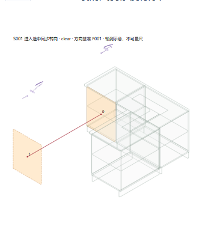

# 2026-11-20 · P24 厨房装拆校核与工具进入朝向

[English](updates-2026-11-20-p24.md) · [源码提交 0558870](https://github.com/ETET114514/GewuZhizaoNew/commit/0558870f17e7183c7769c00e6432fb3b5b6a3ae7) · [源码 PR #3，待合并](https://github.com/ETET114514/GewuZhizaoNew/pull/3)

P24 工具可按指定初始朝向进入，在选定的进入段或到达工作位后转到工作朝向。退出可另设一次转向。替代时机搜索保留原位移点及工具顺序。

校核使用已建模柜体实体及长方体工具包络。复用同件驻留工具时，进入起点的位置和朝向须与实际驻留状态衔接。同一工具阶段内的多次独立转向、板件翻转、厂家安装工艺及受力验算仍待实现。

980 项 Node、70 项相关 Python 与 20 组实际 Edge 验证通过。工具到位后转到 45° 会碰到等候工具，改为进入第二段边走边转后通过。同一工具退出时转到 +60°。GEOS 独立核查 1001 个进入姿态。实际 ZIP 的 41 个文件校验一致，读回 18 条进入和 12 条退出 CAD 参考线，最大误差上界 0.038125 mm，CAD 审计零错误。

