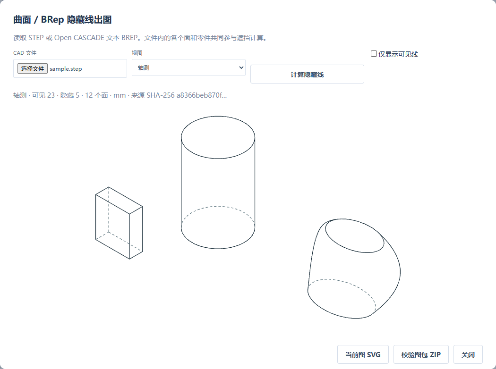
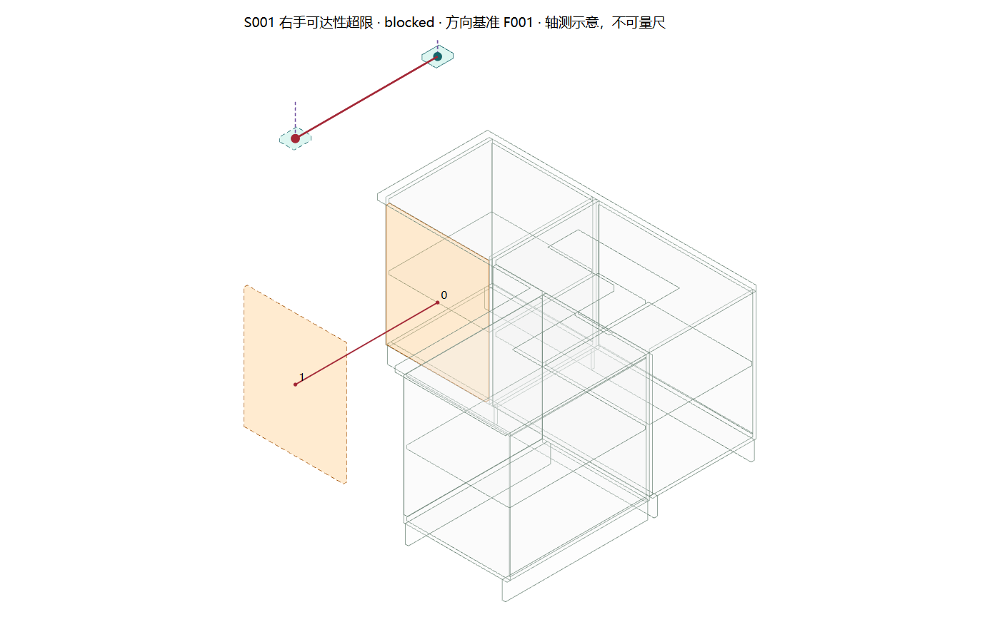

# 2026-11-26 · P24 general software acceptance

**English** | [中文](updates-2026-11-26-p24-closeout.zh-CN.md)

[Source commit f7b7be9](https://github.com/ETET114514/GewuZhizaoNew/commit/f7b7be921428b5d18d8d1dfdfbe19e9fc79dfc6c) · [Source PR #6, awaiting merge](https://github.com/ETET114514/GewuZhizaoNew/pull/6) · [Source acceptance notes](https://github.com/ETET114514/GewuZhizaoNew/blob/f7b7be921428b5d18d8d1dfdfbe19e9fc79dfc6c/P24_ENGINEERING.md)

## Completed workflows

- Cabinet opening supports custom orders, automatic sequential search, and staged or simultaneous checks. Joint disassembly search keeps authored waypoints and unaffected detours while testing revised turn timing.
- Board groups and carried tools can flip around a horizontal axis. Multiple tools can translate, rotate, and wait independently on a shared timeline, including compound turns and tilted retention and reuse. Verified paths carry through to reverse assembly.
- Closed tool meshes preserve sloped walls, through-holes, enclosed cavities, and an island inside a cavity. The importer can decompose a closed tool mesh into up to 64 convex parts. Hand access uses the entered envelope, fixed reference point, and maximum palm distance during entry, movement with the board group, and withdrawal.
- STEP and text BREP support hidden-line front, top, right, and isometric views. Preview, SVG, offline HTML, millimeter DXF, and source JSON share the same projected edges.

## Acceptance evidence

1,157 Node tests, 1,431 Python tests, and 111 Edge workflows passed on the final source revision. Two Python tests were skipped. Readback of three downloaded drawing packages verified 123 manifest entries, two reach-limit witnesses, and 168 cavity triangles. The DXF cross-section retained a 60 × 60 mm cavity. A separate surface fixture matched all 86 edges across four views and formats.

In the cabinet turn example, the hand could reach both endpoints. At about 51% of the turn, the palm reached about 1,177 mm and exceeded the entered 1,170 mm limit. In the closed-cavity example, a probe moved within the cavity and reported a collision when its path crossed the wall.

P24 passed coordinated cabinet opening, continuous disassembly with timed tools and hand reach, and STEP/BREP hidden-line drawing. The five packages for product mechanisms, actual appliances, manufacturer hardware, installation processes, and CNC delivery are deferred. [Current scope](https://github.com/ETET114514/GewuZhizaoNew/blob/f7b7be921428b5d18d8d1dfdfbe19e9fc79dfc6c/P24_ENGINEERING.md#p24-当前范围与剩余验收包)

