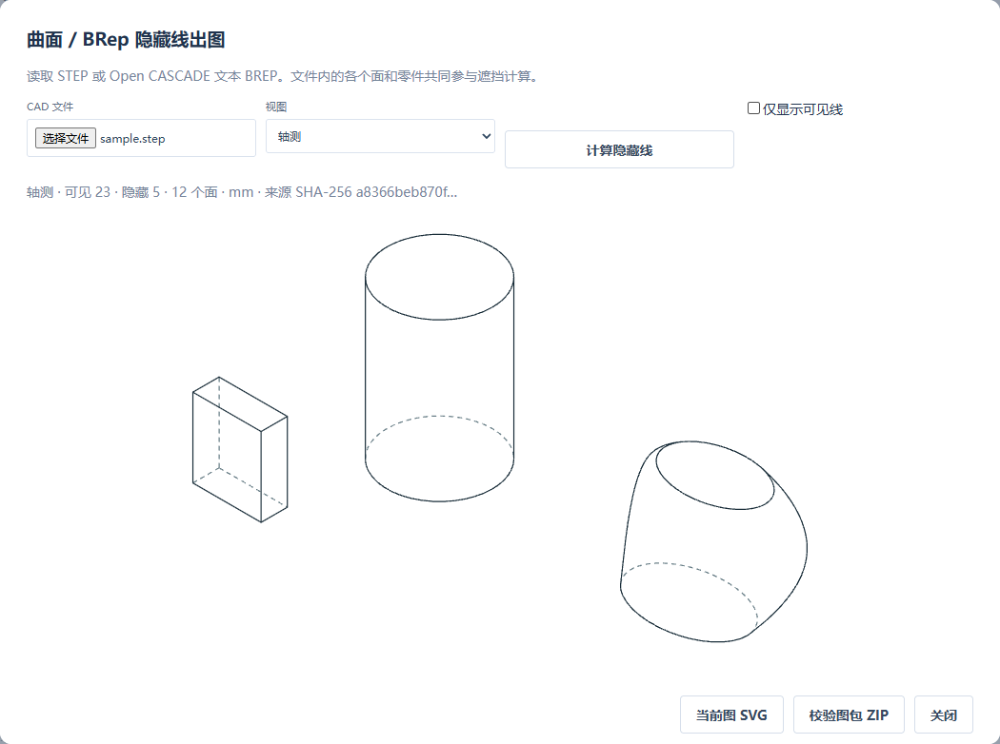
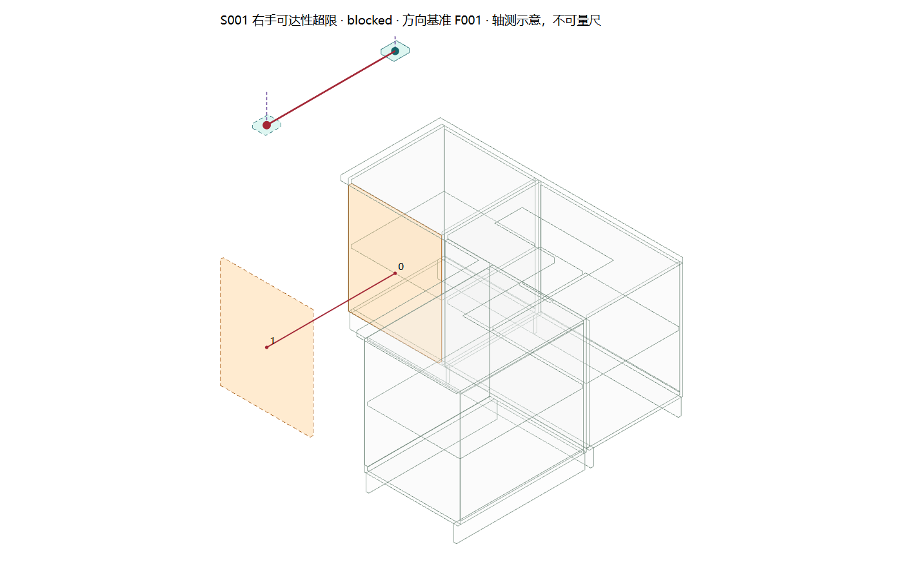

# 2026-11-26 · P24 通用软件验收

**中文** | [English](updates-2026-11-26-p24-closeout.md)

[源码提交 f7b7be9](https://github.com/ETET114514/GewuZhizaoNew/commit/f7b7be921428b5d18d8d1dfdfbe19e9fc79dfc6c) · [源码 PR #6，待合并](https://github.com/ETET114514/GewuZhizaoNew/pull/6) · [源码验收记录](https://github.com/ETET114514/GewuZhizaoNew/blob/f7b7be921428b5d18d8d1dfdfbe19e9fc79dfc6c/P24_ENGINEERING.md)

## 已通过的流程

- 多柜开合支持自定义顺序、自动搜索逐柜开合顺序、分阶段开合和同时起动。联合装拆避碰调整转向时机时保留原路径点和不受影响的绕行。
- 板件组和随行工具可绕水平轴翻转。多工具可按同一时间表分别平移、旋转和等待，支持复合转动、倾斜驻留及复用。通过的路径可用于反向装配。
- 封闭工具网格保留斜壁、通孔、封闭空腔及腔内独立实体，最多分解成 64 个凸块。手部按录入的包络、固定参照点及最大掌心距离核验进入、随组移动和退出。
- STEP 和文本 BREP 支持正视、俯视、右视及轴测隐藏线。预览、SVG、离线 HTML、毫米 DXF 和来源 JSON 共用同一套投影边线。

## 验收证据

最终源码通过 1,157 项 Node、1,431 项 Python 和 111 组 Edge 验收，另有 2 项 Python 跳过。 实际下载的三个图包通过 123 个清单文件、2 条手部超限见证及 168 个空腔三角面的读回核对。DXF 截面保留 60 × 60 mm 空腔。曲面样例在四个视图和各导出格式之间逐条核对了 86 条边线。

柜板转向算例的两个端点都在可达范围内。转到约 51% 时，掌心距离达到约 1,177 mm，超过设定的 1,170 mm 上限。封闭空腔算例中的检验件可在腔内运动，路径穿过腔壁时会报告碰撞。

P24 已通过多柜开合协同、带异速工具和手部可达性的连续装拆，以及 STEP/BREP 曲面隐藏线出图。商品机构、实际设备、厂家五金、现场安装工艺和 CNC 机床交付五包暂缓。 [当前范围](https://github.com/ETET114514/GewuZhizaoNew/blob/f7b7be921428b5d18d8d1dfdfbe19e9fc79dfc6c/P24_ENGINEERING.md#p24-当前范围与剩余验收包)

