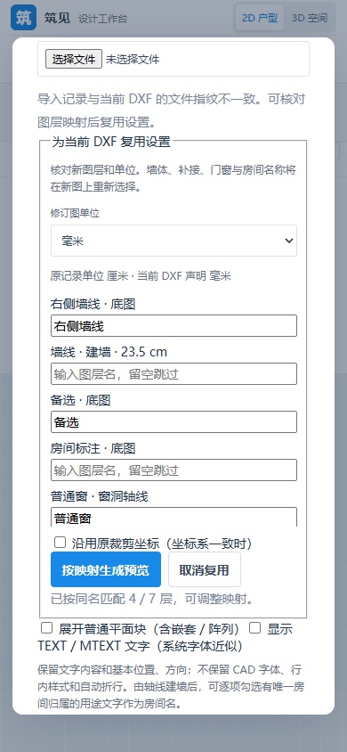
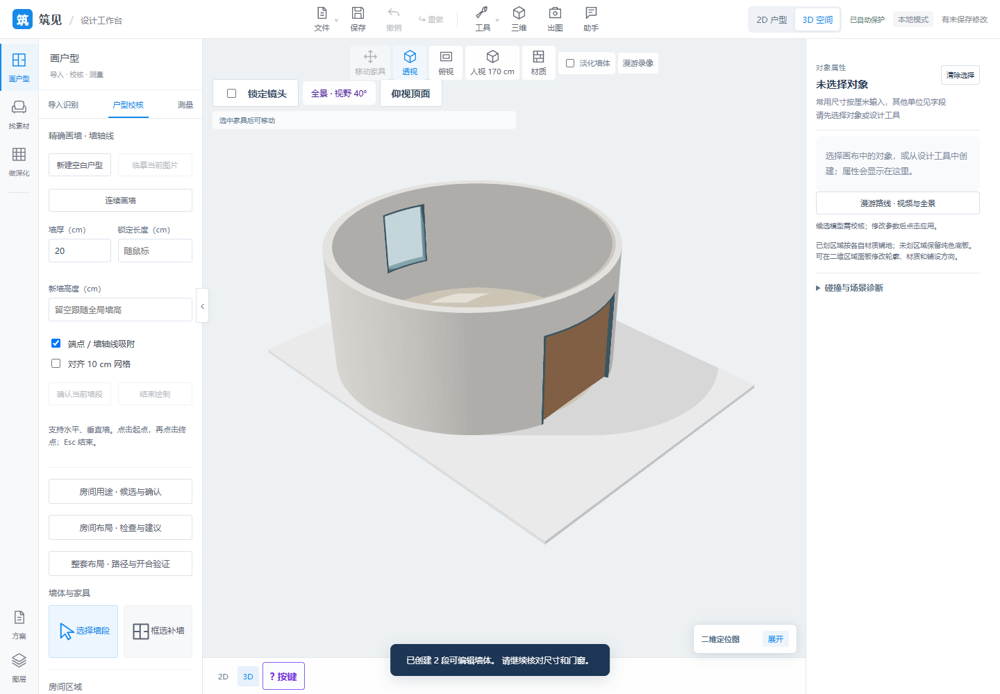
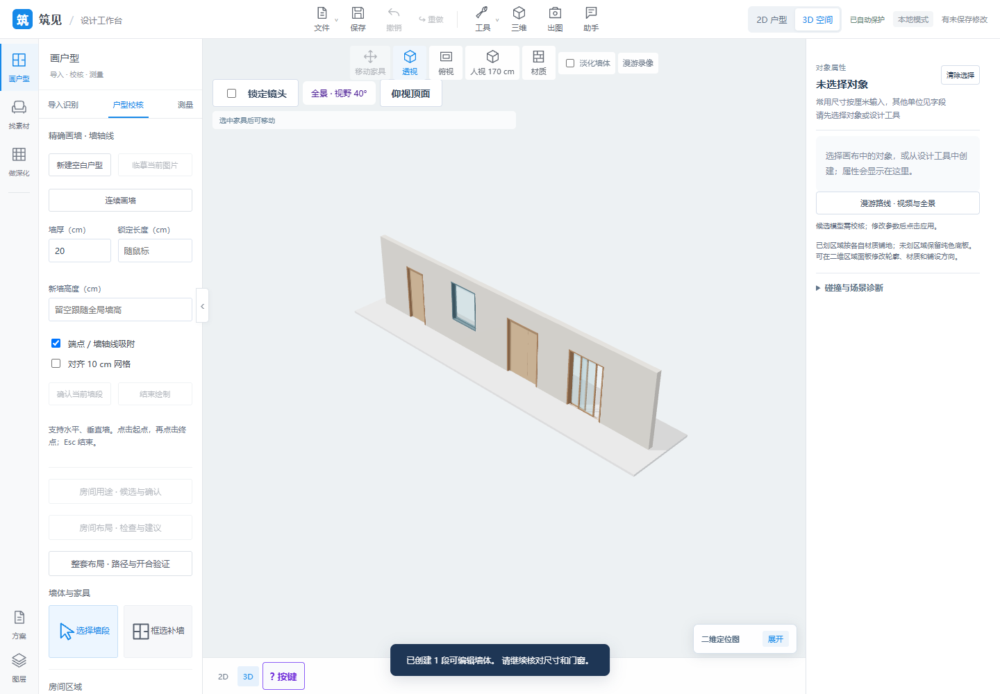

# 2026-11-28 · P21 DXF walls and reusable import records

**English** | [中文](updates-2026-11-28-p21-dxf.zh-CN.md)

[Showcase home](../README.md) · [Demo guide](demo.md) · [Screenshot index](../screenshots/README.md)

[Source PR #7, awaiting review and merge](https://github.com/ETET114514/GewuZhizaoNew/pull/7) · [Source commit `3fc40856ae4d9b9a33057dc60acc6af3b4c1b838`](https://github.com/ETET114514/GewuZhizaoNew/commit/3fc40856ae4d9b9a33057dc60acc6af3b4c1b838)

## Wall and opening conversion

- Wall centerlines and paired outlines can produce editable orthogonal, sloped, and circular walls. Straight outline pairs can supply a varying thickness and preserve intermediate control sections.
- Confirmed door and window axes or recognized symbols can bridge wall gaps. The workflow checks the local section at each end, rejects crossing bridge placements, and keeps circular splits clear of selected apertures.
- Wall-axis DXF export and import preserve continuous wall sections and supported opening elevations, mechanisms, frame fit, grids, screens, and rectangular bay windows.

## Reuse across drawings

Download the import record after preview and selection. The same DXF restores its settings and selections after a fresh preview. A revision can reuse layer purposes, thicknesses, and display settings through exact-name matches or a manual layer map. The revised drawing supplies the new candidates. Its declared units are offered by default, and the previous crop is optional.

## Verification

The final P21 development round passed 252 DXF Python checks and 16 Edge checks for revised drawings and exact replay. The publishing run passed all 1,168 Node checks. The revised-drawing fixture reused a centimeter-based record on a millimeter DXF, rebuilt a 1,000 mm doorway, named the room, and reopened the saved project. Earlier P21 checks cover tapered sections, symbol-driven bridges, and downloaded DXF reimport. [Source acceptance record](https://github.com/ETET114514/GewuZhizaoNew/blob/3fc40856ae4d9b9a33057dc60acc6af3b4c1b838/P21_LOCAL_ACCEPTANCE.md)

## Scope

This release covers the documented DXF geometry and symbols. DWG import, dynamic block and external reference evaluation, and validation against an independent real CAD collection remain outside the accepted scope. Older tracing records can be restored. Older wall-building records lack some of the settings needed for exact recovery.

