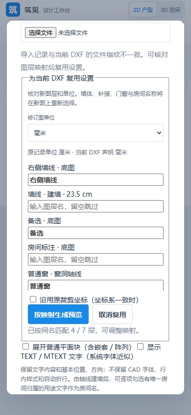
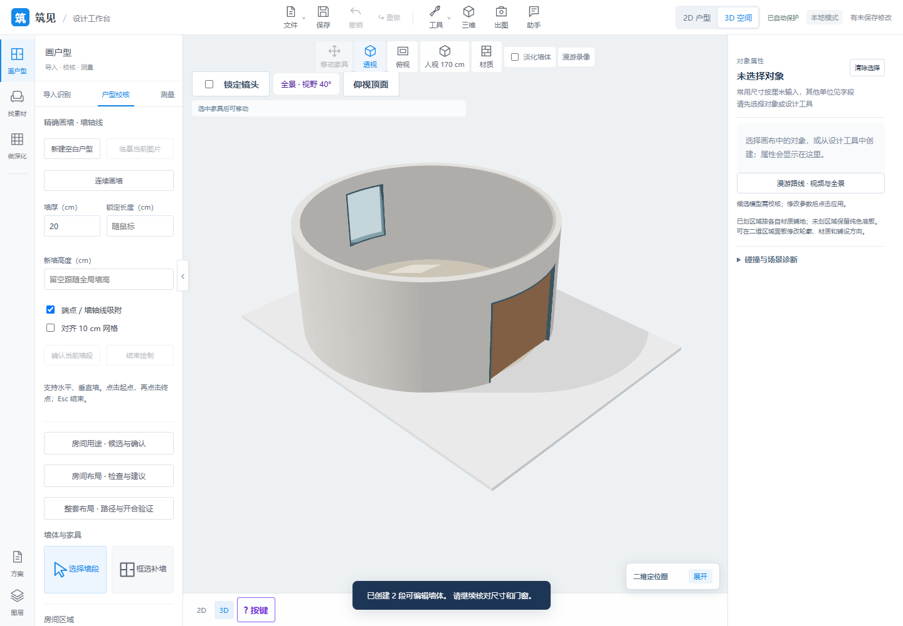
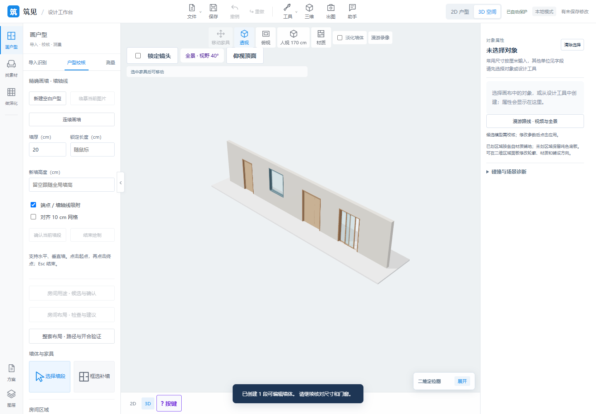

# 2026-11-28 · P21 DXF 建墙与导入记录复用

[English](updates-2026-11-28-p21-dxf.md) | **中文**

[展示首页](../README.zh-CN.md) · [演示导览](demo.zh-CN.md) · [截图索引](../screenshots/README.zh-CN.md)

[源码 PR #7，待审查与合并](https://github.com/ETET114514/GewuZhizaoNew/pull/7) · [源码提交 `3fc40856ae4d9b9a33057dc60acc6af3b4c1b838`](https://github.com/ETET114514/GewuZhizaoNew/commit/3fc40856ae4d9b9a33057dc60acc6af3b4c1b838)

## 建墙与门窗转换

- 墙中心轴线与配对轮廓可生成可编辑的正交、斜直和圆弧墙。双线直边可推定渐变墙厚并保留中间控制截面。
- 确认后的门窗轴线或约定符号可补接断墙。系统核对两端的局部截面，处理相交补接候选，并让整圆分段避开已选洞口。
- 墙轴线 DXF 往返可保留连续墙截面及适用的门窗标高、机构、框适配、分格、纱窗和矩形飘窗。

## 复用导入记录

预览并完成勾选后下载导入记录。同一份 DXF 重新预览时可恢复设置和选择。修订图可按同名或手动映射复用图层用途、墙厚和显示设置，再按新图重新确认候选。单位优先采用修订图声明，原裁剪范围可选沿用。

## 验证

P21 最终开发轮通过 252 项 DXF Python 测试和 16 项修订图映射及同源恢复 Edge 检查。发布前重新执行的 1,168 项 Node 测试全部通过。实测用厘米记录处理毫米制修订图，实现 1000 mm 门洞、房间命名及保存重开。前序验收覆盖渐变截面、符号补接和实际下载 DXF 回导。[源码验收记录](https://github.com/ETET114514/GewuZhizaoNew/blob/3fc40856ae4d9b9a33057dc60acc6af3b4c1b838/P21_LOCAL_ACCEPTANCE.md)

## 范围

本轮覆盖约定的 DXF 几何和符号。DWG、动态块和外部参照求值，以及独立真实 CAD 图集验证仍在保留范围。旧版临摹记录可恢复，旧版建墙记录缺少完整恢复参数。

