# Screenshot index

**English** | [中文](README.zh-CN.md)

## 2026-10-31 · Panoramas and batch capture

Source [b9ee167](https://github.com/ETET114514/GewuZhizaoNew/commit/b9ee167b494268e74a54c2e242c904004dbced65); [scope and evidence](../docs/updates-2026-10-31-panorama.md).

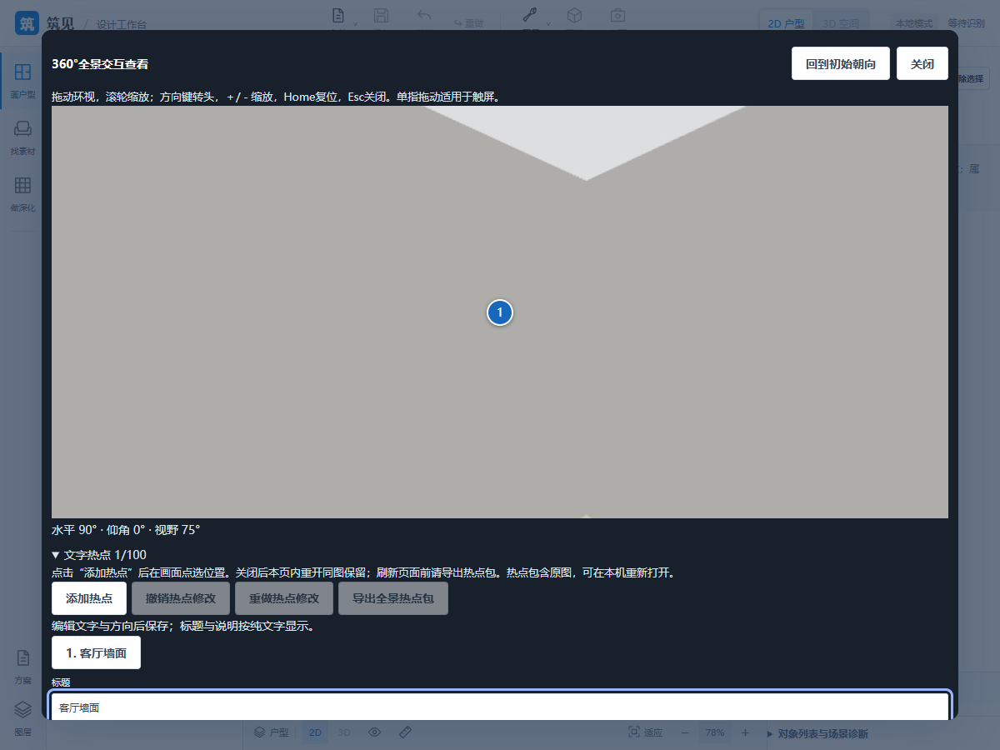

Both languages share PNGs from generated acceptance scenes with translated descriptions. No source, user projects, panorama packages or model assets are mirrored.

## 2026-10-30 · Design checkpoint materials

Source [0f28b3e](https://github.com/ETET114514/GewuZhizaoNew/commit/0f28b3e043333f733bcf8c89ca6fc11f0b6eb1cf); [scope and evidence](../docs/updates-2026-10-30-design.md). New P15/P26/P27/P28 images are actual isolated acceptance screenshots. Both languages share PNG assets with translated captions. No source, user projects, CAD files, model/texture assets or video packages are mirrored. Source-side videos remain separately documented; these synthetic scenes do not establish independent recognition accuracy.

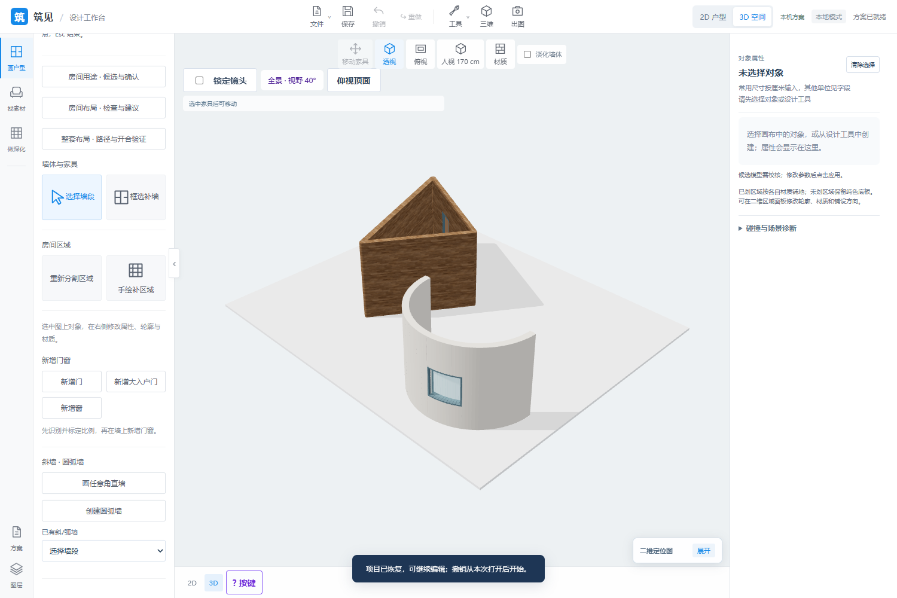

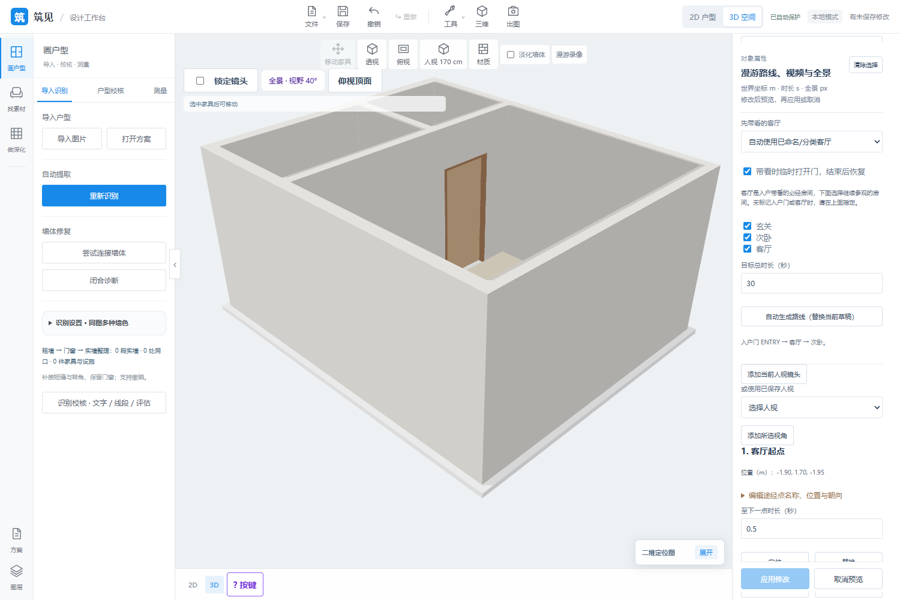

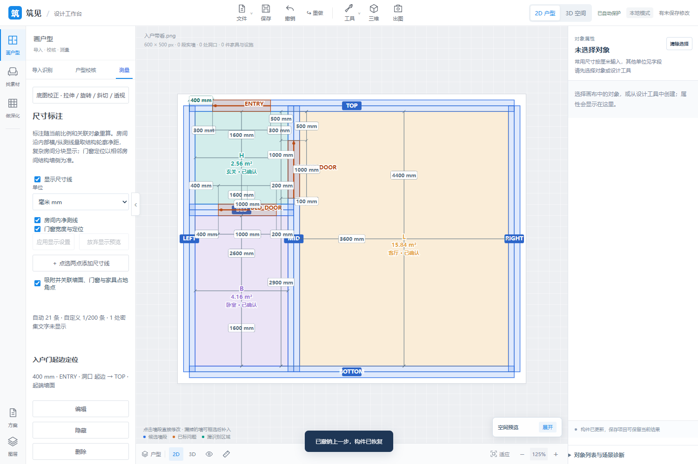

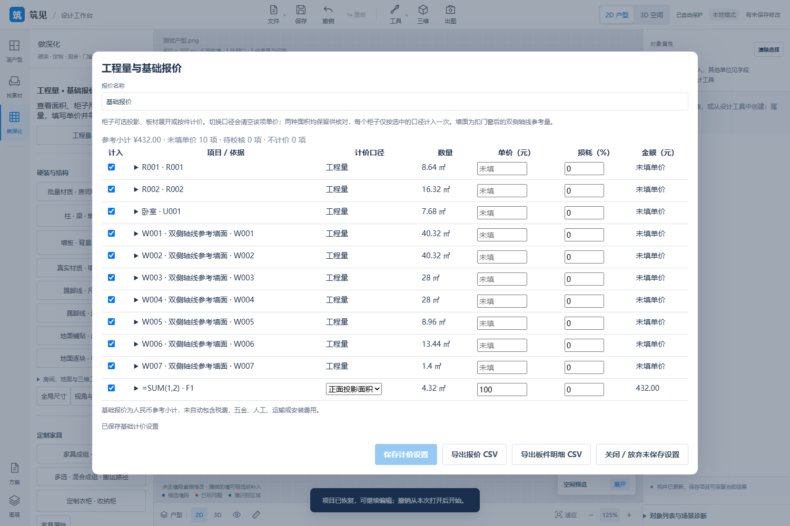

## 2026-10-30 checkpoint materials

Corresponds to New [d9338b5](https://github.com/ETET114514/GewuZhizaoNew/commit/d9338b5dd8194e8acb36768fa068e6626959531e). [Scope and verification](../docs/updates-2026-10-30.md). P21 CAD/boundary/opening/residential scenes, P31 OCR, P17 glTF and P30 route captures come from actual isolated acceptance runs; both languages share images with translated descriptions. Only PNGs and summaries are copied, without source, CAD/project packages, models/textures or annotations. Synthetic scenes do not establish real-world generalization accuracy.

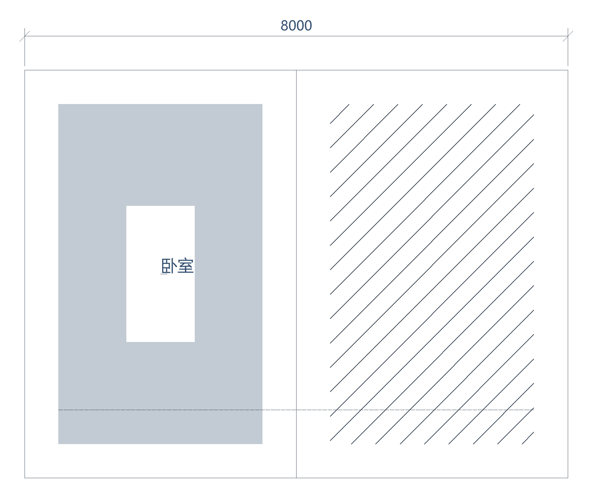

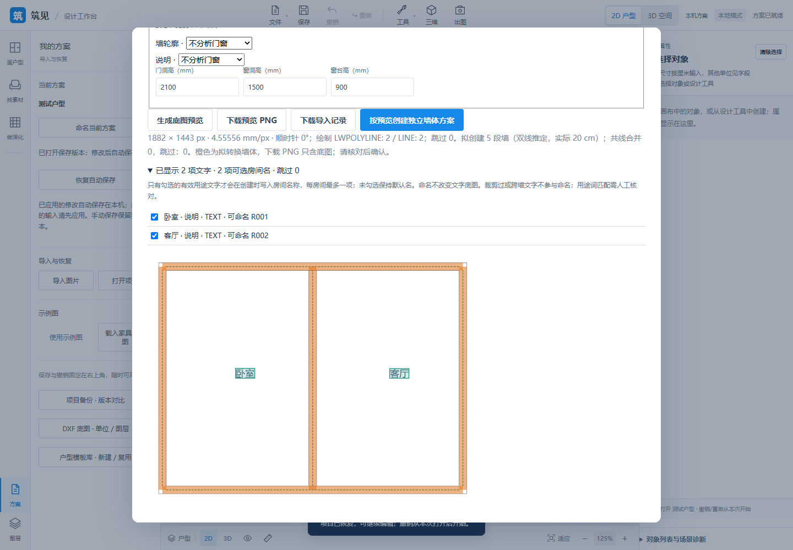

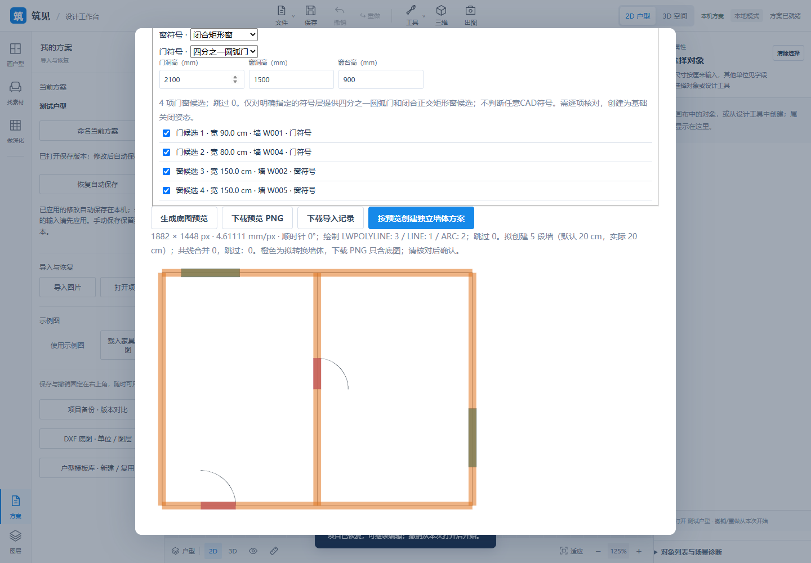

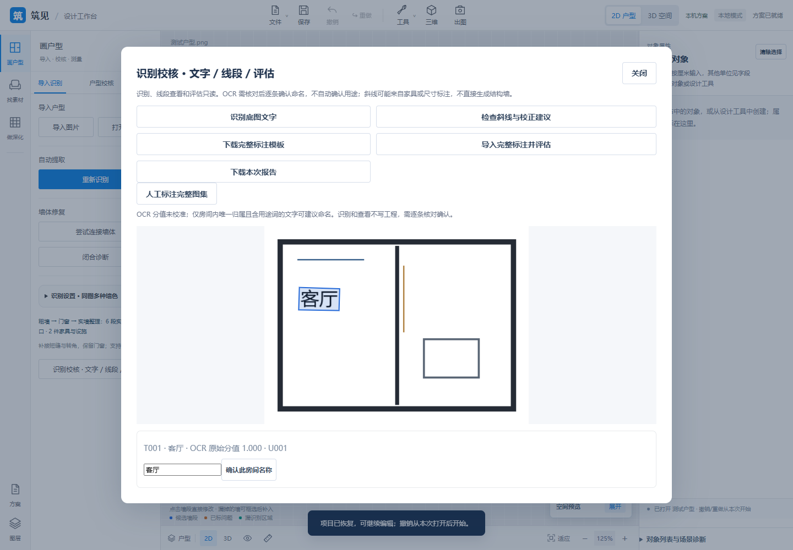

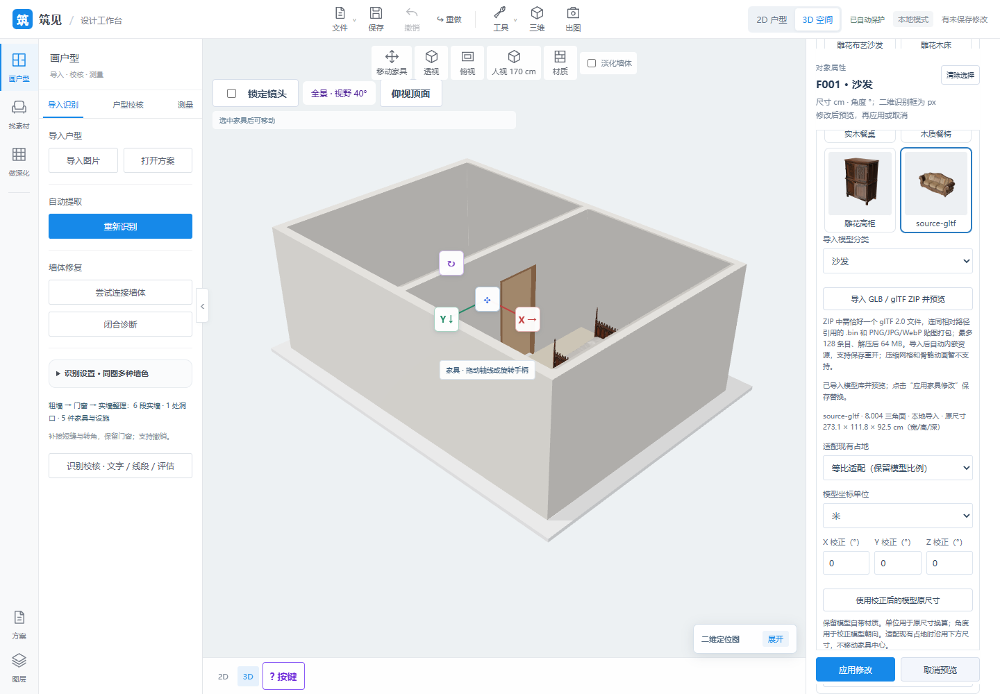

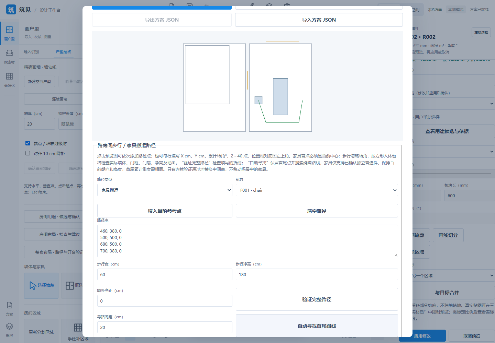

## 2026-10-28 captures

Complete layout comparison/390 px, current path/opening validation, saved-version comparison and independent dimensions are acceptance-scene captures from New 01e2db7. Only PNG screenshots are copied; no project archives or source assets. See [verification](../docs/updates-2026-10-28.md).

All images are original captures from the running interface or rendering. They do not include AI-generated product mockups.

| File | Content | Scene type |
| --- | --- | --- |
| [design-result.png](design-result.png) | 3D plan, furniture, openings, daylight and shadows | Existing floor-plan example |
| [workbench.png](workbench.png) | 2D recognition, asset sidebar and furniture editing | Existing floor-plan example |
| [floorplan-regions.png](floorplan-regions.png) | Room regions, properties and reference area | Existing floor-plan example |
| [material-editor.png](material-editor.png) | Material/color editing on one wall side | Existing floor-plan example |
| [sliding-door.png](sliding-door.png) | Dual-track sliding door and glass | Feature demo |
| [cove-lighting.png](cove-lighting.png) | Cove illumination on ceilings and soft wall light | Feature demo |
| [material-library.jpg](material-library.jpg) | Eight categories/160 base materials | Material samples |
| [furniture-models.jpg](furniture-models.jpg) | Five built-in CC0 furniture GLBs | Model thumbnails |

## Latest update · 2026-10-27 · P35

Corresponds to New [99882a8](https://github.com/ETET114514/GewuZhizaoNew/commit/99882a803e649666153e617bcf2b132661040c9d). Unmodified captures from the actual isolated acceptance scene; see [current scope and verification](../docs/updates-2026-10-27-p35.md). These demonstrate section inspection and ceiling controls, not construction drawings or an online brand catalog.

| File | Content |
| --- | --- |
| [p35-section-caps.png](p35-section-caps.png) | Rotated/multiple section planes with actual mesh-intersection caps |
| [p35-ceiling-narrow.png](p35-ceiling-narrow.png) | Double-curvature ceiling controls at 390 px |

## Earlier update · 2026-10-27 · P16/P18

Corresponds to New `2164415`. All are original isolated acceptance screenshots; see [update details](../docs/updates-2026-10-27.md) for scope/tests. Red boxes show current collision aids; path clearances use project-defined criteria.

| File | Content |
| --- | --- |
| [p16-mixed-objects.png](p16-mixed-objects.png) | Mixed/nested furniture, structural elements and lights |
| [p16-path-check.png](p16-path-check.png) | Multi-segment translation/rotation and passage-clearance checks |
| [p18-material-batch.png](p18-material-batch.png) | Cross-object materials for room wall sides/furniture parts |

## Previous update · 2026-10-26

Actual UI from isolated acceptance scenes, corresponding to New `35d29cd`. See [scope and verification](../docs/updates-2026-10-26.md).

| File | Content |
| --- | --- |
| [p13-room-net-lengths.png](p13-room-net-lengths.png) | Room-side net lengths alongside original centerline labels |
| [p13-solid-wall-lengths.png](p13-solid-wall-lengths.png) | Solid-wall segments excluding opening projections and areas requiring review |
| [p22-floor-occupancy.png](p22-floor-occupancy.png) | Element occupancy linked to paving/paveable area |
| [p25-opening-details.png](p25-opening-details.png) | Subdivisions, actual profiles and independent screens |
| [p25-bay-window.png](p25-bay-window.png) | Rectangular three-sided bay window |
| [p24-kitchen-cutouts.png](p24-kitchen-cutouts.png) | Blind-corner equipment and actual hole shapes |
| [p23-free-wall-panels.png](p23-free-wall-panels.png) | Free straight seams/simple polygon panels |

## Previous update · 2026-10-25

| File | Content | Scene type |
| --- | --- | --- |
| [opening-frame-fit.png](opening-frame-fit.png) | Reveal, fitted frame and 3D shortcut | Isolated acceptance scene |
| [opening-frame-fit-editor.png](opening-frame-fit-editor.png) | Frame depth/offset and fitted outer dimensions | Isolated acceptance scene |
| [wall-panel-opening-details.png](wall-panel-opening-details.png) | Per-opening edge material/upload and rectangular-dimension overrides | Isolated acceptance scene |
| [wall-panel-lines.png](wall-panel-lines.png) | Nonuniform horizontal/vertical rectangular panel divisions | Isolated acceptance scene |
| [upload-library.png](upload-library.png) | Uploaded-material names and entry management | Isolated acceptance scene |

Corresponds to New `3d812a2d9bc78b7e51271c6ae7f04357ea00ff1a`. Actual captures do not represent product installation details, construction drawings or a final interior design.

## Previous update · 2026-10-24

| File | Content | Scene type |
| --- | --- | --- |
| [herringbone.png](herringbone.png) | Herringbone, uploaded material and hidden board | Isolated acceptance scene |
| [herringbone-4k.jpg](herringbone-4k.jpg) | 3840 × 2160 JPG with selection hidden | Isolated acceptance scene |
| [floor-tiles-upload.png](floor-tiles-upload.png) | Per-piece uploads/textures and selection map | Isolated acceptance scene |
| [furniture-groups.png](furniture-groups.png) | Furniture group and 3D handles | Isolated acceptance scene |
| [furniture-groups-plan.png](furniture-groups-plan.png) | 2D group bounds and drag entry | Isolated acceptance scene |
| [wall-opening-surround.png](wall-opening-surround.png) | Top/right opening strips and per-opening switches | Isolated acceptance scene |

Corresponds to New 544714f145bec6094d7a9b3ed4ac20582f59d265. Blue boards use a project-created striped upload; gaps demonstrate hiding, not structural openings or a complete construction deliverable.

## Historical kitchen holes and floor laying · 2026-10-23

| File | Content | Scene type |
| --- | --- | --- |
| [kitchen-cutouts.png](kitchen-cutouts.png) | Equipment editing, rectangular holes, group binding and 2D settings | Isolated acceptance scene |
| [kitchen-cutouts-4k.jpg](kitchen-cutouts-4k.jpg) | Simplified sink/hob, continuous worktop and through-holes; 3840 × 2160 real-time image | Isolated acceptance scene |
| [floor-layout.png](floor-layout.png) | Floor origin, three patterns, piece size and layout mini view | Isolated acceptance scene |
| [floor-layout-4k.jpg](floor-layout-4k.jpg) | PBR floor clipped to room boundaries; 3840 × 2160 real-time image | Isolated acceptance scene |

Corresponds to New `a1407646daa384e1bc5c7f8650724208c2118d80`. Kitchen red boxes show existing collision aids; exported images hide helpers. These are not construction drawings or a finished interior.

## Historical unified workbench and L kitchens · 2026-10-23

| File | Content | Scene type |
| --- | --- | --- |
| [unified-workbench.png](unified-workbench.png) | Unified 3D workbench, shared tools/properties and furniture handles | Isolated acceptance scene |
| [unified-plan.png](unified-plan.png) | Unified 2D workbench and auxiliary views | Isolated acceptance scene |
| [l-kitchen.png](l-kitchen.png) | Independent left/right blind-corner L kitchens, continuous concave worktops and editor | Isolated acceptance scene |
| [l-kitchen-plan.png](l-kitchen-plan.png) | Six-vertex L-worktop contour in 2D | Isolated acceptance scene |
| [l-kitchen-narrow.png](l-kitchen-narrow.png) | Kitchen editor at 390 px | Isolated acceptance scene |

Corresponds to New `37c066b3becd011e96714efd648b8600e50aedc3` (including workbench commit `66c8761`). L-shaped red boxes show current-pose collision aids. These original acceptance screenshots do not represent a finished interior.

## Historical workflow foundations · 2026-10-23

| File | Content | Scene type |
| --- | --- | --- |
| [workflow-plan.png](workflow-plan.png) | Five detailing tool groups, ceiling properties and unified status | Isolated acceptance scene |
| [workflow-model.png](workflow-model.png) | 3D kitchen position/orientation and unified apply/cancel | Isolated acceptance scene |
| [workflow-model-narrow.png](workflow-model-narrow.png) | Kitchen properties and unified controls at 390 px | Isolated acceptance scene |

Corresponds to New `d89af66dd1e72552ac1a8f874389232fd6db75db`. Not a complete interior; that round still used separate 2D/3D containers, since replaced by the U03 unified workbench.

## Historical interior design · 2026-10-20

| File | Content | Scene type |
| --- | --- | --- |
| [seamed-wall-trim.png](seamed-wall-trim.png) | Regular seams/perimeter rectangular trim preserving windows | Feature demo |
| [structures.png](structures.png) | Single-floor columns, beams, flues and pipe enclosures | Feature demo |
| [wardrobe-open.png](wardrobe-open.png) | Wardrobe boards, compartments, doors and internal drawers | Feature demo |
| [straight-kitchen.png](straight-kitchen.png) | Straight base/wall cabinets and continuous independent-material worktop | Feature demo |

## Interior design and project management · 2026-10-19

| File | Content | Scene type |
| --- | --- | --- |
| [background-wall.png](background-wall.png) | Timber feature wall preserving an actual window opening | Feature demo |
| [slats-wall.png](slats-wall.png) | Vertical timber slat thickness and spacing | Feature demo |
| [projects.png](projects.png) | Project naming/search/thumbnails and autosave entry | Feature demo |

## Material library

## Real furniture models

See the [asset notice](../NOTICE.md) for external sources. This is a feature prototype; images do not represent complete construction plans or offline photorealistic rendering.

[Back to project home](../README.md)
