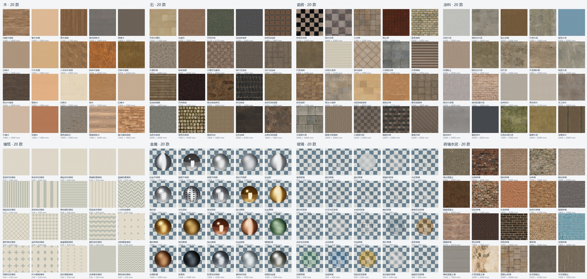
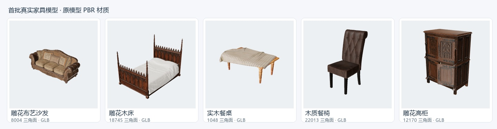

# 截图索引

所有图片来自实际运行界面或渲染，保留原图，不含 AI 生成的产品效果示意。

| 文件 | 展示内容 | 场景类型 |
| --- | --- | --- |
| [design-result.png](design-result.png) | 三维户型、家具、门窗、日光与阴影 | 已有户型示例 |
| [workbench.png](workbench.png) | 二维识别结果、素材栏与家具编辑 | 已有户型示例 |
| [floorplan-regions.png](floorplan-regions.png) | 房间分区、区域属性与参考面积 | 已有户型示例 |
| [material-editor.png](material-editor.png) | 单面墙的材质与色卡编辑 | 已有户型示例 |
| [sliding-door.png](sliding-door.png) | 双轨推拉门及玻璃材质 | 功能演示场景 |
| [cove-lighting.png](cove-lighting.png) | 灯槽照射顶面与墙面柔光 | 功能演示场景 |
| [material-library.jpg](material-library.jpg) | 八类、160 款基础材质总览 | 材质样片 |
| [furniture-models.jpg](furniture-models.jpg) | 五个内置 CC0 家具 GLB 预览 | 模型缩略图 |

## 本轮厨房开孔与地面铺贴 · 2026-10-23

| 文件 | 展示内容 | 场景类型 |
| --- | --- | --- |
| [kitchen-cutouts.png](kitchen-cutouts.png) | 厨房设备编辑、矩形开孔、柜组绑定与二维参数 | 隔离验收场景 |
| [kitchen-cutouts-4k.jpg](kitchen-cutouts-4k.jpg) | 简化水槽/灶具、连续台面与通孔，3840 × 2160 实时图片 | 隔离验收场景 |
| [floor-layout.png](floor-layout.png) | 地面起点、三种铺法、单块尺寸与排版小图 | 隔离验收场景 |
| [floor-layout-4k.jpg](floor-layout-4k.jpg) | 按房间边界裁切的 PBR 地面排版，3840 × 2160 实时图片 | 隔离验收场景 |

对应 New 提交 `a1407646daa384e1bc5c7f8650724208c2118d80`。厨房界面红框为现有碰撞提示，图片输出隐藏辅助线；不代表施工图或完成的装修方案。

## 历史统一工作台与 L 形厨房 · 2026-10-23

| 文件 | 展示内容 | 场景类型 |
| --- | --- | --- |
| [unified-workbench.png](unified-workbench.png) | 同一三维工作台、共用工具/属性与家具画布手柄 | 隔离验收场景 |
| [unified-plan.png](unified-plan.png) | 统一二维工作台与辅助视图入口 | 隔离验收场景 |
| [l-kitchen.png](l-kitchen.png) | 两个独立左右盲位 L 形厨房、单块连续凹台面与编辑器 | 隔离验收场景 |
| [l-kitchen-plan.png](l-kitchen-plan.png) | 二维六顶点 L 形台面轮廓 | 隔离验收场景 |
| [l-kitchen-narrow.png](l-kitchen-narrow.png) | 390 px 厨房编辑器 | 隔离验收场景 |

该轮对应 New 提交 `37c066b3becd011e96714efd648b8600e50aedc3`（含工作台提交 `66c8761`）。L 形截图红框为当前姿态碰撞提示；保留原始验收截图，不代表完成的装修方案。

## 历史操作基础 · 2026-10-23

| 文件 | 展示内容 | 场景类型 |
| --- | --- | --- |
| [workflow-plan.png](workflow-plan.png) | 五组深化工具、当前顶面属性和统一状态提示 | 隔离验收场景 |
| [workflow-model.png](workflow-model.png) | 三维厨房组定位、朝向与统一应用/取消 | 隔离验收场景 |
| [workflow-model-narrow.png](workflow-model-narrow.png) | 390 px 下的当前厨房属性与统一操作 | 隔离验收场景 |

截图对应 New 提交 `d89af66dd1e72552ac1a8f874389232fd6db75db`，不代表完整装修方案；当轮二维/三维仍使用原有容器，目前已由 U03 统一工作台替代。

## 历史室内设计 · 2026-10-20

| 文件 | 展示内容 | 场景类型 |
| --- | --- | --- |
| [seamed-wall-trim.png](seamed-wall-trim.png) | 规则网格分缝、四周矩形收边并保留窗洞 | 功能演示场景 |
| [structures.png](structures.png) | 单层柱、梁、烟道与包管 | 功能演示场景 |
| [wardrobe-open.png](wardrobe-open.png) | 衣柜板件、分格、门板与内部抽屉开合 | 功能演示场景 |
| [straight-kitchen.png](straight-kitchen.png) | 地柜/吊柜直线排列、独立材质连续台面 | 功能演示场景 |

## 室内设计与项目管理 · 2026-10-19

| 文件 | 展示内容 | 场景类型 |
| --- | --- | --- |
| [background-wall.png](background-wall.png) | 木饰面背景墙保留实际窗洞 | 功能演示场景 |
| [slats-wall.png](slats-wall.png) | 竖向木格栅的厚度与间隔 | 功能演示场景 |
| [projects.png](projects.png) | 项目命名、搜索、缩略图与自动保存入口 | 功能演示场景 |

## 材质库

## 真实家具模型

外部素材来源见[素材说明](../NOTICE.md)。当前展示为功能原型，图片不代表完整施工方案或离线写实渲染成果。

[返回项目首页](../README.md)
